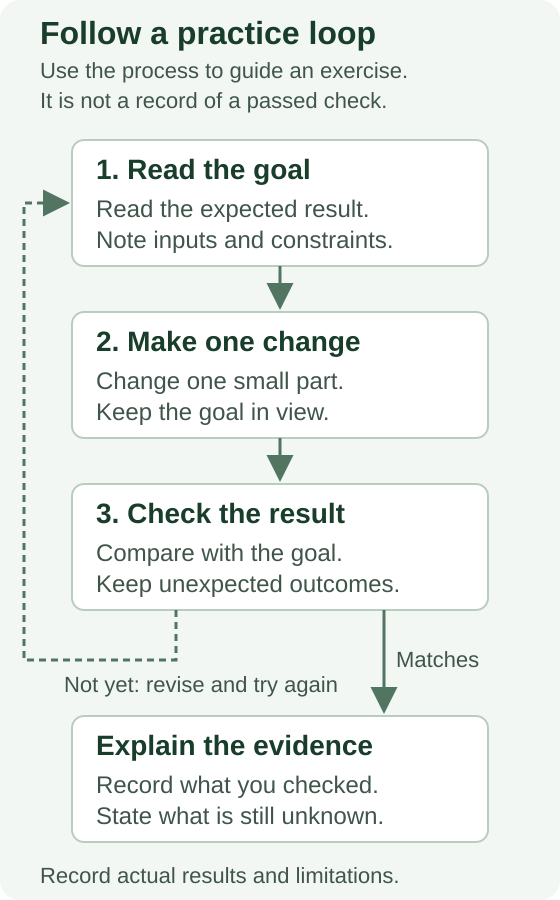

# A first MOAW workshop

Event: **$$event:Self-paced learning$$**

## Goal and prerequisites

Create a preparation checklist with one heading and three unchecked items.
You need a text editor and a browser. This exercise requires no cloud account.
Before publishing an adaptation, update the attribution with real, publishable
information and retain the original source and license notice below.



The return arrow means to revise and check again. This figure explains the
practice workflow; it is not a completed checklist or evidence of a passed check.

## Practice

<div class="task" data-title="Create a checklist">

> Save a file named `checklist.md`. Add one heading and three unchecked items
> describing your preparation steps.

</div>

<details>
<summary>Show an example answer</summary>

```markdown
# Preparation

- [ ] Open the editor
- [ ] Open the workshop
- [ ] Check the working folder
```

</details>

## Check and reflect

You are done when the saved file has one heading and exactly three unchecked
items. Explain where the file is stored and how a local preview differs from
publishing it.

Adapted from the MOAW Copilot Kit template, informed by Yohan Lasorsa and
Microsoft MOAW contributors' [authoring materials](https://github.com/microsoft/moaw).
Content: [CC BY-SA 4.0](https://creativecommons.org/licenses/by-sa/4.0/).
