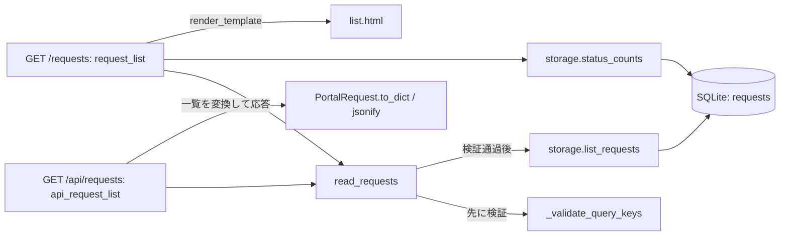

# SEC-02: 既存アプリの理解、要件の具体化、変更計画

> **状態: DRAFT / 検討中**
>
> 設計者向けの進行案です。6段階の構成と本編の範囲は確認済みですが、このプロンプト列による参加者の通し試走と配布判定は未実施です。[ローカル補助試走](../workshop-preparation.md#7-ローカル補助試走の記録)とは区別します。

MOAW本文の章順のCLI試走は[今回の記録](../workshop-preparation.md#8-copilot-cliによる章順の試走)を参照してください。参加者本人の習得やVS Code操作の確認とは別です。

[文書一覧](../../../README.md) / [共通シナリオ](../common-scenario.md) / 前: [基礎](01-foundations.md) / 次: [共通指示](03-custom-instructions.md)

共通教材の[SEC-02章別原稿](../../../workshops/agentic-copilot/chapters/02-discovery-and-planning.md)に、受講者への説明・問い・ヒント・解説をまとめています。講師も同じ教材を使います。

## 1. このセクションの位置づけ

Copilotとの対話を通じて、既存ソフトウェアを理解し、改善の選択肢を考え、「何を、なぜ、どこまで変えるか」を根拠付きで判断する。
到達点は、AIが長い分析文書を出した状態ではない。参加者自身が、現状、変更理由、影響箇所、正しさの確認方法を説明し、後続の担当へ渡せる状態である。

S0の初期アプリから、S1の要件・計画へ進む。実装はSEC-05で扱う。
SEC-03で指示を整理するための根拠、SEC-04で役割と手順を分けるための仕事の範囲、SEC-05以降で実装・レビューするための品質条件を作る。
独自のCustom AgentやSkillを先に用意できていることは、SEC-02の前提にしない。

**今回の通常経路:** 個人でアプリ全体を調べる → 根拠から改善候補を考える → 共通課題のACへ戻る → 変更・確認の計画を自分で説明する。
ヒントの入口は問い、次に参照地図、最後に具体的な依頼例とする案。一般的な開発経験からPython・教材構成の知識まで推定せず、必要な支援を選べるようにする。
実施条件とヒントの分離は[共通シナリオ](../common-scenario.md)第2節に従う。課題・品質条件をヒントへ隠さず、コードの編集やDB更新はまだ行わない。

### 確認済みの進め方

- 全体像、現状の機能・仕様、設計・アーキテクチャ、課題と改善候補、要件具体化、変更計画の6段階で進める。
- 「部署と申請状態による絞り込みを追加する」という変更依頼は、SEC-01で既に提示する。
- 依頼を知っていても、前半は絞り込みの変更箇所だけに限定せず、アプリ全体の役割・機能・構造を調べる。
- 改善候補は幅広く検討する。ただし、本編で実装する対象は全員で絞り込みに揃える。

この範囲は、[決定・未決事項](../decisions-and-open-questions.md)のD-011〜D-013に対応する。
候補比較の結果を絞り込みが必ず最上位になるように誘導しない。共通の変更を実装・検証・レビューまで追うという教材上の選択と、実際の業務で何を優先するかという判断は別である。
他の改善候補は、誤答ではなく保留理由や追加確認事項を残す対象とする。

## 2. 調査で守ること

### 事実、資料、推測、提案を分ける

コードから分かるのは、主に現在の実装と振る舞いの仕組みである。
それが本来の業務要求を満たすか、なぜその設計を選んだかまで、コードだけで確定できるとは限らない。

| 区分 | 記録するもの | 避ける扱い |
| --- | --- | --- |
| 実装で確認できたこと | 参照版、ファイル、関数・処理、確認内容 | 関数名やコメントだけで振る舞いを断定する |
| 資料に書かれた仕様 | 記述元、実装との対応・不一致 | READMEやAGENTS.mdの要求をすべて実装済みとする |
| 推測・仮説 | 推測の理由、不確かな点、必要な追加確認 | 想定利用者や設計意図を事実として補う |
| 改善提案・将来要件 | 解決したい課題、採否、条件、確認事項 | 提案を現在の機能一覧や合意済み要件へ混ぜる |

根拠のある記述でも、コード読解、テストの期待値の読解、実際の動作確認は区別する。
テストを見つけただけでは、実行して成功したことにならない。
資料とコードが一致しない場合は、未実装、仕様不明、コード上の不具合の疑いを切り分け、直ちにどちらかを正しい仕様と決めない。
確認済みの不具合と呼ぶには、問題となる条件と、その判断を支える根拠が必要である。

### 読み取り中心の協働にする

Copilotへ任せるのは、探索、読解、関係の整理、質問・候補・計画の提示まで。
アプリや設定の編集、依存の追加、DB更新、完成例の適用、コミット、外部公開は行わせない。
動作確認が必要な疑問は、S0の観察結果を参照するか、人が判断する追加確認事項として残す。実行結果を想像で埋めない。

プロンプトの「編集しない」だけを権限制御と扱わず、講師は利用可能な読み取り・検索手段とツール制限を確認する。
特定のモード名やUIを必須にせず、環境差はQ-002で扱う。
対象は最新Stable版のVS Code／条件を満たすCodespacesとし、Preview／Experimental機能は使わない。D-031の候補から指定した主モデルを固定し、Auto／HydraFusionを使わない。
モデルの内部思考ではなく、参照した根拠、観察できる調査行動、判断の理由、結果を説明してもらう。

## 3. 準備、入力、全体の流れ

### 講師が準備するもの

| 入力 | 準備・確認すること |
| --- | --- |
| 参加者用の開始版 | 指定版、架空データ、S0の確認結果。完成例を除いた配布版の成立はQ-005で確認する |
| 変更依頼 | SEC-01で提示した絞り込みの依頼と、本編で追加しない機能 |
| 業務条件 | 共通シナリオ。参加者が質問を出した後に、判断とACを照合できる形で用意する |
| 調査メモ | 6段階を通じて追記・訂正する記入欄。記入形式は第5節の案を使う |
| 講師の確認材料 | 参照版に対応したコードの根拠、補助質問、段階別の到達条件 |

本リポジトリには実習アプリや参加者用の記入ファイルをまだ配置していない。
以下のプロンプトでいう「共通シナリオ」「調査メモ」は、講師または参加者が会話に渡す情報の呼び名であり、題材アプリの中に同名ファイルがあるという意味ではない。
参照できない入力は、貼り付けや利用可能な文脈指定で渡す。未提供の内容をCopilotに推測させない。

参照元には完成例パッチと完成例の検証が同居する。
広く調査する演習だからこそ、開始版のコード、将来要件、解説・完成例を区別する必要がある。
ヒント・解説はD-033に従い共通教材へ含める。一方、開始版の検証を完成例パッチの適用へ依存させない構成はQ-005・Q-010で確認する。解説の共用と、開始コード・検証契約の分離は別である。

### 調査の入口

次の表は講師用の参照地図であり、参加者へ最初から全ファイルの全文を読ませる一覧ではない。
ファイルを自分で発見する段階と、必要に応じて地図をヒントとして渡す段階を分ける。

| 関心事 | 参照元の入口 | 確かめる関係 |
| --- | --- | --- |
| 目的・使い方・開発環境 | `README.md`、`AGENTS.md`、`pyproject.toml` | アプリの説明、実装、開発用ツールの区別 |
| HTTP・フォーム・API | `request_portal\__init__.py` | 入力の受付、検証、取得、HTML・JSONへの応答 |
| 業務の値・入力検証 | `request_portal\domain.py` | 部署・状態・種別、入力の制約、データの表現 |
| データの保存・取得・集計 | `request_portal\storage.py` | SQL、並び順、状態変更、一覧と全体集計 |
| 画面 | `request_portal\templates\list.html`、`detail.html`、`new.html` | 表示、入力、HTTP処理から渡される値 |
| 既存の確認 | `tests\test_portal.py`、`tests\test_storage.py` | 何を期待しているか、何をまだ確かめていないか |

アプリ参照版は `1a411cd13c02f28bb6f3ac30844af204f1f61d48` に固定する。
補足ガイドに記された別の参照版を、ここでの開始版へ黙って置き換えない。

### 6段階の接続

以下の段階1〜6はSEC-02内の進め方であり、ワークショップ全体の状態S0〜S6とは別の番号である。

| 段階 | 中心となる問い | 残すもの |
| --- | --- | --- |
| 1. 全体像をつかむ | 何をするアプリで、どこから調べればよいか | 概要とファイルの地図 |
| 2. 現状の機能・仕様を把握する | 現在できることと、その条件・例外は何か | 現状仕様表と不一致・不明点 |
| 3. 設計・アーキテクチャを把握する | どの責務が、どの処理とデータを受け渡すか | 責務表と根拠付きの処理フロー |
| 4. 課題と改善候補を考える | どこに改善余地があり、何を確かめて選ぶか | 候補比較と採用・保留の理由 |
| 5. 変更要求を要件にする | 絞り込みは、具体的に何を満たせばよいか | 確認質問、判断、ACとの対応 |
| 6. 変更計画を作る | どこをどう変え、何で正しさを確認するか | 変更影響とS1の計画メモ |

各段階では「依頼する → 根拠を確かめる → 不足を質問する → 記録を更新する」を繰り返す。
プロンプトを順に送るだけで完了とはしない。追加プロンプトは、前の回答で実際に不足していた点に合わせて使う。
成果は会話と参加者の調査メモへ残し、Copilotにファイルの作成・編集をさせない。
別の会話へ移る場合は、読み取り中心の制約、参照版、合意済みの要点と根拠を渡す。過去の会話が自動共有されるとは仮定しない。

## 4. 6段階の詳細設計

### 段階1: 全体像をつかむ

**目的**は、未見のコードベースの入口を見つけ、業務と技術の輪郭を説明できること。
入力はS0の開始版、既に提示した変更依頼、アプリの説明資料とする。
ここでは機能ごとの例外や全関数の解説まで求めず、次に何を調べるべきかが分かる概要を作る。

| 参加者の行動 | 講師の介入 |
| --- | --- |
| アプリの目的、主要な操作、技術構成を調べさせる | 一般的な申請システムの説明ではなく、このコードベースの根拠を求める |
| 資料の説明と実コードの入口を照合する | 依存定義だけで全アーキテクチャが分かると考えないよう促す |
| 次に調べるファイルと理由を選ぶ | `.venv`、DB、キャッシュなどの一括読取へ進んだら調査対象を戻す |

**開始プロンプト**

```text
このワークスペースのアプリの全体像を、読み取りと検索だけで調べてください。
本編では部署・申請状態の絞り込みを追加しますが、今はアプリ全体を理解したいです。
README、依存定義、ディレクトリ構成、起動・HTTP処理の入口から調査を始めてください。
目的、想定利用者、主要機能、技術構成、次に読む場所と理由を整理してください。
資料の記述、実装で確認できたこと、推測、未確認の点を分け、根拠のパスを示してください。
全ファイルの一括読取や全文の再掲は避け、追加調査には理由を付けてください。
ファイルの作成・編集、アプリやテストの実行、依存の追加はしないでください。
```

**追加プロンプト**

```text
今の概要から、根拠が示されていない主張を取り出してください。
特に、想定利用者の役割と、実装されたログイン・権限の有無を混同していないか確認してください。
必要な箇所だけ追加で読み、確認できなければ未確認として残してください。
概要全体を再生成せず、訂正点と次の調査先だけ示してください。引き続き読み取りのみです。
```

**成果の形**は「概要の主張／確認区分／根拠／次に調べること」の表とする。
例えば、Flaskの利用は`pyproject.toml`と`create_app`から確認できる。一方、誰が社内で承認権限を持つかは、この研修アプリのコードだけで確定しない。
新規申請の申請者名欄やCSRF用のセッションがあることを、認証機能の証拠にしない。

**人が判断すること・終了条件**は、概要の根拠が十分か、次の調査先が目的に合っているかである。
参加者が主要機能と技術構成を説明し、未確認の業務前提を区別できれば次へ進む。
すべてのファイルを読んだことや、概要の文章量は合格条件にしない。

### 段階2: 現状の機能・仕様を把握する

**目的**は、現在の機能を、入力・前提・出力・制約・例外として説明できること。
入力は段階1の概要と調査先。作成、一覧、詳細、状態変更、読み取りAPIを対象に、コード、画面テンプレート、テストの期待値を照合する。

| 参加者の行動 | 講師の介入 |
| --- | --- |
| 機能ごとに正常系と例外を整理する | 画面名の列挙で終わったら、入力と状態の変化を問う |
| 資料とコードで意味が違う記述を探す | 不一致を直ちにバグと認定せず、現在仕様と将来要件を分ける |
| テストの対象と未確認点を記録する | テストを読んだことを実行成功と報告していないか確認する |

**開始プロンプト**

```text
前の概要を使い、現在の機能と仕様を読み取りだけで整理してください。
申請の作成、一覧、詳細、状態変更、読み取りAPIについて、
入力・前提・出力・制約・例外・根拠となるファイルと処理を表にしてください。
正常系だけでなく、不正入力、存在しない申請、処理済み申請の扱いも確認してください。
資料の要求や完成例を、開始版の実装済み機能へ混ぜないでください。
テストの期待値を読んだ結果と、実行結果は区別してください。今回は実行しません。
現状仕様表と不一致・不明点だけを示し、ファイルは変更しないでください。
```

**追加プロンプト**

```text
資料に絞り込み条件の説明があっても、開始版がその条件を受け付けるとは限りません。
一覧のHTTP処理から入力検証と取得処理を追い、現在の扱いを確認してください。
資料の仕様、コードで確認できた現状、今回追加する要件を分けて訂正してください。
コードとテストは読むだけとし、検索機能の実装やテスト実行はしないでください。
```

講師が確認に使える例は次のとおり。いずれも固定参照版の**コード読解**であり、今回の実行結果ではない。

| 確認する面 | 参照コードで分かること | 混同しないこと |
| --- | --- | --- |
| 作成 | `validate_new_request`で項目を検証し、`storage.create_request`が`pending`で保存する | 申請者名の入力は本人認証ではない |
| 状態変更 | `storage.decide_request`は`status = 'pending'`を更新条件に含む。有効な状態変更要求でも、処理済みならHTTP側は409を返す | 差し戻した申請を再申請する機能があるとは限らない |
| 一覧 | `read_requests`は`_validate_query_keys(set())`で検証してから全件取得する | AGENTS.mdの「組み合わせ条件はAND」は、開始版に検索が実装済みという証拠ではない |
| テスト | `test_unknown_or_duplicate_query_is_rejected`はHTTP 400を期待する | そのテストが今回実行され、成功したという意味ではない |

**成果の形**は「機能／入力・前提／結果／制約・例外／根拠／未確認」の現状仕様表とする。
資料とコードの不一致は、理由が分かるまで独立した確認事項として残す。

**人が判断すること・終了条件**は、現状の説明と追加要件の境界を確認すること。
参加者が代表的な操作の正常系と例外を説明し、「何が未実装か」「何がまだ不明か」を分けられれば次へ進む。

### 段階3: 設計・アーキテクチャを把握する

**目的**は、責務と依存関係を理解し、処理とデータがどこを通るか説明できること。
入力は概要、現状仕様表、関連コード。ファイルの配置だけでなく、一覧画面と一覧APIを代表経路として追う。
すべての機能の詳細図を作るのではなく、全体の責務を整理したうえで、代表経路を深く確認する。

| 参加者の行動 | 講師の介入 |
| --- | --- |
| HTTP、業務の値・検証、保存・取得、画面、テストの責務を整理する | 「MVC」などの名称だけで済ませず、実際のファイル・処理を説明させる |
| 画面とAPIから共通の取得処理を追う | 見た目が同じ結果だから共通実装だと推定していないか確認する |
| 構造図・処理フローの矢印をコードに結び付ける | 存在しない層や、呼び出していない関数を図から取り除く |

**開始プロンプト**

```text
現状仕様表をもとに、現在の責務と処理のつながりを読み取りだけで説明してください。
画面、HTTP処理、入力・業務ルール、データの保存・取得、テストをファイルと対応させてください。
一覧画面と一覧APIを入口に、入力検証、一覧取得、集計、応答までを追ってください。
責務の表と、根拠のある構造図または処理フローを示してください。
図の矢印が呼び出しなのかデータの流れなのかを明示し、対応する関数を挙げてください。
設計パターンの名前だけで説明せず、採用理由が不明なら仮説にとどめてください。
新しい設計の提案やファイル編集は、まだしないでください。
```

**追加プロンプト**

```text
今の図で、一覧画面とAPIが共有する処理、片方だけが使う処理を確認してください。
一覧の取得と全申請の状態別集計を同じ処理として描いていないか点検してください。
各関係の根拠を示し、不明な矢印は削除するか未確認として分けてください。
図と説明の訂正点だけを示してください。引き続き読み取りのみです。
```

以下は、講師が照合に使う**開始版の一覧経路の例**であり、アプリ全体の全呼び出しを表す図ではない。
矢印は呼び出し・参照を表し、戻り値は省略している。`read_requests`内では、入力検証を通過した後に一覧を取得する。



`request_list`は一覧に加えて全体の状態別集計を取得し、`api_request_list`は取得した一覧の長さを`count`に使う。
この関係は、後のAC-07・AC-08の影響分析に使う。ただし、ここではまだ絞り込みを実装しない。
`domain.py`がすべての処理の中継点になる、あるいは別のService層が必ずある、といった構造をコードからの根拠なく足さない。

**成果の形**は「責務／ファイル・処理／呼び出す相手・渡す値／根拠」の表と、代表経路の図とする。
**人が判断すること・終了条件**は、図がコードの関係を表しているかを確かめること。
参加者が入口から応答までを追い、共有箇所と全体集計の違い、設計理由として未確認の点を説明できれば次へ進む。

### 段階4: 課題と改善候補を考える

**目的**は、現状理解を材料に改善の選択肢を出し、採否を考えるために何が足りないかを整理すること。
入力は概要、現状仕様、構造、既に提示された変更依頼。
利用者、処理担当、保守担当などの観点は学習上の仮定であり、富士通の実在の業務や役割を表すものではない。

| 参加者の行動 | 講師の介入 |
| --- | --- |
| 現状のどの場面に不便やリスクがあり得るかを考える | 未実装であるだけで「必須」「不具合」としないよう促す |
| 機能追加、使いやすさ、保守性などの候補を比較する | 効果の仮説と確認済み事実、必要な外部依存を区別させる |
| 採用・保留の理由と追加確認事項を残す | 絞り込みを最上位にするための架空の点数や効果を作らせない |

**開始プロンプト**

```text
ここまでの概要、現状仕様、構造を根拠に、このアプリの改善候補を幅広く考えてください。
利用者、処理担当、保守担当の観点は仮説として扱ってください。
候補ごとに、想定場面、課題の仮説、根拠、期待する効果、影響箇所、
変更の複雑さ、リスク、判断に必要な追加情報を比較してください。
未実装であることだけを、不具合や業務上の必須要件の証拠にしないでください。
本編の実装対象は部署・申請状態の絞り込みに固定されていますが、候補はそれに限定しません。
順位を絞り込みへ誘導せず、根拠のない効果・費用・工数の数値は作らないでください。
候補比較と保留理由だけを示し、機能の実装や外部接続はしないでください。
```

**追加プロンプト**

```text
候補比較で、事実より強く言い切っている効果や優先順位を点検してください。
利用者像や利用頻度の前提が違えば、判断が変わる候補を挙げてください。
本編で扱うものと、業務上の判断を保留するものを分け、追加確認事項を示してください。
候補数を増やすことを目的にせず、必要な訂正だけ行ってください。実装はしません。
```

次は比較の観点を説明するための候補例であり、実測した課題や優先順位ではない。

| 候補例 | 検討する効果の仮説 | 判断に足りない情報 | 本編での扱い |
| --- | --- | --- | --- |
| 部署・状態による絞り込み | 処理対象を探しやすくする | 実際の検索場面、表示・入力の契約 | 共通課題として要件を具体化する |
| 新規申請時の入力支援 | 入力の迷いや差し戻しを減らす可能性 | 迷う項目、既存説明で足りない理由 | 候補として残し、今回は実装しない |
| 状態変更の通知 | 状況を確認するための操作を減らす可能性 | 通知先、契機、重複、機密情報、外部依存 | 対象外。要否の判断も保留する |
| 操作履歴の記録 | 経緯の確認に役立つ可能性 | 利用目的、記録項目、保存・閲覧の条件 | 対象外。本番要件として確定しない |

**成果の形**は、根拠と不確実性を添えた候補比較表、採用・保留・対象外の理由とする。
**人が判断すること・終了条件**は、候補の評価に足りない情報と、本編の範囲を説明すること。
参加者の業務上の優先順位が絞り込み以外を上位にしても、それだけで不正解としない。
講師は、後続の実装・検証・レビューを共通の品質条件でつなぐため、ここからは絞り込みの要件を扱うと明示する。

### 段階5: 変更要求を要件にする

**目的**は、「絞り込めるようにする」を、人が合意でき、検証可能な振る舞いへ変えること。
入力は変更依頼、現状仕様、構造、段階4で確認した本編の範囲。
参加者が確認質問を出し、講師が依頼担当の役割で判断を示した後、共通シナリオのACと照合する。

| 参加者の行動 | 講師の介入 |
| --- | --- |
| 解釈が分かれそうな条件を質問にする | 実装方法より先に、利用者にとっての振る舞いを問う |
| 正常系、境界、エラー、維持条件の具体例を作る | 正常な0件と不正値、結果件数と全体集計を分ける |
| 判断をACと対応させ、対象外と未決事項を残す | 資料の丸写しではなく、条件の意味を参加者自身に説明させる |

**開始プロンプト**

```text
本編の対象を部署・申請状態による一覧の絞り込みに絞ります。まだ実装しないでください。
提示された変更依頼と現状仕様から、人が決めるべき確認質問を作ってください。
条件の組み合わせ、未指定・空値、0件、不正値、重複、未知の検索キー、
結果件数と全体集計、UI/APIの一致、条件保持・解除、既存機能の維持を確認してください。
質問ごとに、解釈が分かれる点、回答が振る舞いに与える違い、具体的な入力例を示してください。
未回答の仕様を推測で確定せず、アプリやテストは変更しないでください。
```

**追加プロンプト**

```text
人が示した回答と、ここで渡した共通シナリオのAC-01からAC-11を照合してください。
確認質問・回答・該当AC・確認する具体例・未決事項を対応させてください。
正常な0件をエラーにする、空文字を一律に拒否する、全体集計まで絞り込むなどの誤解がないか点検してください。
採用していない正規化や機能が混ざっていれば指摘し、保留に戻してください。
資料が不足している場合は不足を明示してください。実装やテスト実行はしません。
```

ACの正本は[共通シナリオ](../common-scenario.md)とし、ここに別の規範表を作らない。
講師は、例えば次の対応を説明用データで確認する。

| 論点 | 説明に使う例 | 参照するAC |
| --- | --- | --- |
| ANDとORの違い | `engineering`と`pending`ならF1だけ。片方だけ一致するF2・F3・F5を含めない | AC-04 |
| 0件と不正値の違い | `design`と`approved`は正常な0件、`status=unknown`は400 | AC-05、AC-06 |
| 何の件数か | 絞り込み結果が1件でも、説明用データの全体集計は6件のまま | AC-08 |
| 空値と正規化 | 空文字はACに従う。正規化は加えず、大文字・前後の空白・空白だけの値はコードと一致しないため400にする | AC-01、AC-06、D-045 |

F1などは共通シナリオの説明用ラベルであり、参加者DBの実IDではない。
新規申請の入力に`.strip()`が使われていても、その事実だけで検索値にも同じ正規化を採用したことにはならない。
既存コードの習慣と、今回の検索契約の判断を分ける。

**成果の形**は「確認質問／人の回答／AC-ID／具体例と確認方法／未決事項」の対応表とする。
**人が判断すること・終了条件**は、AC-01〜AC-11の意味と対象外を確認し、未回答の前提がどこに残るかを説明すること。
既存機能、入力検証、パラメーター化SQLなどの維持条件も落とさない。
共通ACを変える提案が出た場合は、実装前提へ黙って入れず、理由と影響を付けて後続の検討事項にする。

### 段階6: 変更計画を作る

**目的**は、調査と合意を、後続が使える実装前の計画へまとめること。
入力は根拠付きの現状理解、採用したAC、対象外、未決事項。
既存の責務と共通処理を起点にし、必要な変更、順序、確認方法を整理する。

| 参加者の行動 | 講師の介入 |
| --- | --- |
| 要件と変更箇所を対応させる | 根拠のないファイル新設や、UIだけの計画になっていないか確認する |
| 変更単位の依存と確認順序を整理する | ファイルの並びを、そのまま作業依存と扱わない |
| 追加確認、既存テストの更新理由、回帰範囲を決める | 既存テストの期待値を一律に緩める計画を戻す |
| 未決事項を分け、S1の引き継ぎを作る | 未確定の仕様に依存する作業を、着手可能と報告させない |

**開始プロンプト**

```text
確認済みの要件とAC、現状仕様、構造の調査メモを使って変更計画を作ってください。
変更単位ごとに、対象ファイル・処理、変更理由、該当AC、依存関係、
追加する確認、更新が必要な既存テストと理由、維持する機能を整理してください。
既存の共通処理を活用し、不要なフレームワーク置換やファイル分割は前提にしないでください。
対象外は認証、通知、ページ分割、クラウド配備など、共通シナリオで除外した機能です。
未決事項に依存する部分は保留として分け、S1の引き継ぎに必要な要点をまとめてください。
まだファイルを作成・編集せず、アプリやテストも実行しないでください。
```

**追加プロンプト**

```text
今の計画を、AC-01からAC-11と照合してください。
UIとAPIの共有、全体集計の維持、正常な0件とエラー、条件保持・解除、
既存の作成・詳細・状態変更の回帰について、抜けや矛盾を探してください。
根拠のない変更、単に「テストを書く」とだけある項目、未決前提に依存する作業を指摘してください。
必要な訂正と保留点だけを示し、実装には進まないでください。
```

計画の粒度は、例えば次のように整理する。これはファイルの新設や特定の実装方式を命じる表ではない。

| 変更単位の候補 | 現状から検討すること | 主な確認範囲 |
| --- | --- | --- |
| 検索入力の解釈 | `read_requests`と既存のキー検証を起点に、未指定・空・不正・重複・配色を区別する | AC-01、AC-06、AC-10 |
| 共通の取得処理 | `storage.list_requests`での条件適用、既存の並び順、パラメーター化を検討する | AC-02、AC-03、AC-04、AC-07、AC-11 |
| 画面とAPIの応答 | 条件保持、解除、0件、結果件数を扱い、`status_counts`による全体集計を保つ | AC-05、AC-07、AC-08、AC-09 |
| テストと回帰 | 新規の検索契約と現行仕様の差を確認し、影響する期待値だけを理由付きで更新する | AC-01〜AC-11 |

例えば、開始版で検索キーを拒否する期待が、新しく採用した有効な検索条件に対しても残るなら、その部分は仕様変更として見直す。
未知のキーや重複などを拒否する確認まで一律に削除する理由にはならない。
「完成例パッチが適用できること」を、参加者の独立した実装の合格条件にしない。

**成果の形**は、変更影響表と、次節のS1の調査・計画メモとする。
**人が判断すること・終了条件**は、変更理由と確認方法の対応、対象外、保留点を確認すること。
実装がまだなくても、この判断ができればSEC-02は完了できる。一方、計画書が出力されただけでは完了としない。

## 5. 調査メモとS1の引き継ぎ形式

6段階で6つの新しいファイルを作ることは求めない。
調査中は根拠と不明点を追記し、訂正前の判断が採用済みとして残らないよう更新する。
最後に、次の担当が必要な根拠へ戻れる要点をまとめる。

```text
参照版・開始状態:
  アプリの版、データの状態、S0で確認したこと、未確認のこと
現状理解:
  目的と主要機能、代表経路、共有処理、根拠となるパス・関数
確認区分:
  実装で確認 / 資料の記述 / 仮説 / 将来要件
改善候補の判断:
  本編に採用するもの、その教材上の理由、保留した候補と追加確認事項
採用する要件:
  変更目的、AC-ID、対象外、人が確定した判断
変更計画:
  変更単位、対象と理由、依存・順序、更新が必要な既存テストと理由
確認方針:
  追加する確認、具体的な入力と期待、既存機能の回帰、未実施の確認
保留と引き継ぎ:
  未決事項、着手できない部分、次の担当が行うこと、根拠の参照先
```

候補比較や会話の全文をそのまま渡さず、採否と根拠、残る条件を引き継ぐ。
省略するために、採用条件や重要な例外を落としてはいけない。
構成や維持条件などの継続して使える情報と、今回だけの要件・AC・対象外を分け、SEC-03の共通指示の整理へつなぐ。
今回の仕様をAGENTS.mdなどの恒常的な指示へすべてコピーしない。

## 6. 到達判定

| 観点 | 参加者が示す根拠 | 未到達の例 |
| --- | --- | --- |
| 全体像 | 主要機能、構成、調査先をコード・資料に結び付けて説明する | 一般的な申請システムの説明だけ |
| 現状仕様 | 入力・結果・例外を説明し、未実装や仕様不明を分ける | READMEの要求をすべて実装済みとする |
| 構造 | 代表経路と共有箇所をファイル・関数へたどれる | 図の矢印に根拠がない |
| 改善判断 | 候補の効果の仮説、保留理由、本編の範囲を説明する | 絞り込み以外はすべて誤答とする |
| 要件 | ACと具体例を対応させ、未決の前提を指摘する | 「絞り込めればよい」で例外がない |
| 計画 | 変更箇所、理由、確認方法、対象外、着手できない部分を示す | 「実装してテストする」だけ |

講師は、参加者が選んだ一つの主張について、根拠へ戻り、例外を説明する様子を確認する。
AIの回答を読み上げたことだけで理解済みとはしない。
必要な前提が欠ける場合は、該当部分を保留して調査を続ける。未決を隠して全面実装へ進めない。

## 7. トークンエコノミーとして観察すること

効率は、短いプロンプトや短い回答だけで評価しない。
全体の地図から代表経路へ、代表経路から変更対象へと調査を絞り、必要な根拠を保ったまま再探索や手戻りを減らせるかを考える。

| 観察する行動 | 記録すること | 避ける解釈 |
| --- | --- | --- |
| 調査対象を広げる | 追加で読む理由、解消した疑問 | 全ファイルを読むほど丁寧である |
| メモを参照する | 再利用できた根拠、訂正した前提 | 要約や会話の切り替えだけで必ず安くなる |
| 追加質問をする | 根拠不足・仕様不足・誤解のどれを補ったか | 往復回数が少ないほど理解が深い |
| 出力を絞る | 全文再生成を避けた箇所、残すべき条件 | 条件や例外を省けばよい |
| 後続へ渡す | 再調査が必要だった理由、引き継ぎの不足 | SEC-02の利用量だけで全体効率を決める |

利用量が見える場合は取得範囲と単位を記録し、見えなければ未取得とする。未取得を0へ置き換えない。
6段階は目的が異なるため、段階間の数値を公平なA/B比較と扱わない。
SEC-03では指示、SEC-04ではAgent・Skillを個別に比較する。SEC-08では関連ファイルの明示だけを変えて品質・負担を評価する。これらの目的を混ぜず、モデルを切り替える比較へ勝手に拡張しない。
考え方の補足は[Token Economy実践ガイド](../../reference/token-economy.md)を参照する。

## 8. つまずき、ヒント、復旧

| 状況 | 介入・復旧 |
| --- | --- |
| 一般論しか出ない | 対象ワークスペースと参照版を確認し、一つの主張の根拠を求める |
| 未実装の機能が現状説明へ混ざる | 資料、開始版、完成例を分け、該当するHTTP処理とテストの期待値へ戻る |
| 構造図に架空の層がある | 矢印を実在する呼び出しへ対応させ、確認できない関係を仮説へ戻す |
| 改善案が広がり続ける | 根拠と未確認事項を残して検討を区切り、本編の共通課題へ戻る |
| 不明点が多すぎる | 本編に必要な判断と、発展的な業務調査を分ける |
| UIだけの計画になる | 同じ条件をAPIに渡した場合と、共有取得処理への影響を確認する |
| 全体集計まで絞り込む | AC-08の説明用データで、何を数えるかを言葉にしてもらう |
| 空文字をすべてエラーにする | AC-01とAC-06を分け、空文字と不正値の例を比較する |
| Copilotが編集を始める | 操作を止め、発生した変更を参加者と確認する。無断で一括破棄せず、読み取り中心の設定へ戻す |
| 必要な資料・機能へアクセスできない | 不足を明示し、講師提供の抜粋などへ切り替える。確認できた範囲と支援の利用を記録する |

ヒントは、調査の観点、ファイルの地図、関連関数と具体的な依頼例の3段階で具体化する。講師の完成した記録例は、振り返りや明示した支援の時点で別に提示する。
講師の例を使った部分は支援ありと記録し、参加者に採用理由と未確認点を説明してもらう。
完成例の丸写しや、参加者の作業へのパッチの上書きを復旧手順にしない。

## 9. 引き継ぎ、対象外、未決事項

| 次のセクション | 渡すもの | SEC-02で先取りしないこと |
| --- | --- | --- |
| SEC-03 | S1のメモ、構成・維持条件と今回の要件の区別 | 共通指示ファイルの作成・改訂 |
| SEC-04 | 確認済み計画、判断が必要な作業、使う根拠 | 独自エージェントやSkillの量産 |
| SEC-05以降 | AC、変更影響、確認方針、保留点 | 実装・テスト成功・レビュー完了の認定 |
| SEC-08 | 調査・追加質問・手戻りの観察記録 | 異なる段階を使った削減率の断定 |

本編で追加しない機能は共通シナリオに従う。改善候補に挙げることは、実装、外部接続、公開の承認ではない。
実データ・秘密情報を入力せず、学習上の利用者や課題を富士通の実情として説明しない。
SEC-02の文書化は、参加者用教材の完成や、本番利用できる設計の認定を意味しない。

| 未決事項 | SEC-02で具体化する必要がある点 |
| --- | --- |
| Q-001 | 個人参加を前提にした読解支援、既定で非表示のヒント、本人の説明の確認 |
| Q-002 | 読み取り・検索の手段、ツール制限、指定モデルと環境での利用可否 |
| Q-004 | 受理する正規化などの追加境界を、発展課題でどう扱うか（本編で完全一致以外を400とする扱いはD-045で確定） |
| Q-005、Q-010 | 解答を含まない開始版と、参加者が読める資料・履歴の範囲 |
| Q-011 | 6段階の試走、プロンプトの粒度、支援後の到達判定 |

これらはOPENのままとし、本稿の詳細化だけを理由に解消済みへ変更しない。
各段階のプロンプトと記入形式は設計提案であり、試走で修正する。

## 出典と確認範囲

以下は固定参照版の資料・コードを読んだ根拠であり、アプリ起動、テスト実行、参加者環境での成功を示すものではない。
実装例の関数名と代表経路はこの版に対応する。実習用の開始版を変える場合は、根拠と講師の確認材料を見直す。

- [共通シナリオ](../common-scenario.md): 業務要求、AC、説明用データ、S0〜S6の正本。
- [決定・未決事項](../decisions-and-open-questions.md): 今回の方針と、未確定の教材条件。
- [参照元AGENTS.md](https://github.com/shinyay/python-portal-sample-app/blob/1a411cd13c02f28bb6f3ac30844af204f1f61d48/AGENTS.md): 調査先、維持条件、完成例との区別。
- [参照元pyproject.toml](https://github.com/shinyay/python-portal-sample-app/blob/1a411cd13c02f28bb6f3ac30844af204f1f61d48/pyproject.toml): 依存と開発用ツールの定義。
- [HTTP・フォーム・API](https://github.com/shinyay/python-portal-sample-app/blob/1a411cd13c02f28bb6f3ac30844af204f1f61d48/request_portal/__init__.py): `create_app`、`read_requests`、一覧・作成・状態変更とエラー応答。
- [業務の値と入力検証](https://github.com/shinyay/python-portal-sample-app/blob/1a411cd13c02f28bb6f3ac30844af204f1f61d48/request_portal/domain.py): データの表現、`validate_new_request`、入力の正規化。
- [データの保存・取得・集計](https://github.com/shinyay/python-portal-sample-app/blob/1a411cd13c02f28bb6f3ac30844af204f1f61d48/request_portal/storage.py): `list_requests`、`status_counts`、`create_request`、`decide_request`。
- [HTTP側の既存テスト](https://github.com/shinyay/python-portal-sample-app/blob/1a411cd13c02f28bb6f3ac30844af204f1f61d48/tests/test_portal.py): 現行の期待値。テストの存在と実行結果は区別する。
- [VS Codeでのコンテキスト指定](https://code.visualstudio.com/docs/chat/copilot-chat-context): 文脈を渡す際の参照。機能の利用可否は参加者環境で確認する。

参照元はPrivateであり、教材リポジトリの権限だけで閲覧できるとは限らない。
