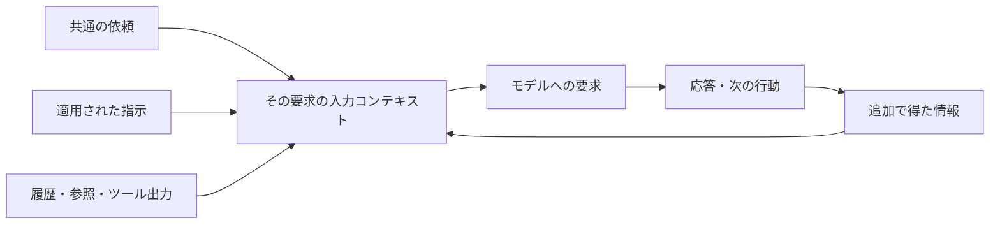

# SEC-03: Custom InstructionsとAGENTS.mdの設計

> **状態: DRAFT / 検討中**
>
> 指示の設計・適用・比較体験を具体化した設計者向けの案です。
> 本リポジトリには実行用の指示ファイルや比較用アプリを追加していません。
> 人の受講者による、指定のVS Codeでの通し試走は未実施です（試走担当による実機試走は[準備ガイド第10節](../workshop-preparation.md#10-vs-codeによる実機試走)に記録）。独立コピーで行ったCLIのA/B/C補助比較は[準備ガイド](../workshop-preparation.md#7-ローカル補助試走の記録)に記録しており、この詳細案自体は効果や利用量の実測報告ではありません。

続く章順のCLI試走では、Aの範囲逸脱やCの中断も含めて[別の記録](../workshop-preparation.md#8-copilot-cliによる章順の試走)に保存しました。前回の比較結果で上書きしません。

[文書一覧](../../../README.md) / [共通シナリオ](../common-scenario.md) / 前: [要件と計画](02-discovery-and-planning.md) / 次: [AgentsとSkills](04-custom-agents-and-skills.md)

共通教材の[SEC-03章別原稿](../../../workshops/agentic-copilot/chapters/03-custom-instructions.md)に、受講者への説明・問い・ヒント・解説をまとめています。講師も同じ教材を使います。

## 1. このセクションの役割と学習目標

SEC-02で作ったS1の調査・計画メモを使い、確認できた事実と採用した方針を、継続的に使える指示へ整理する。
「指示ファイルを作れた」で終わらず、適用されたか、改修中の行動と結果にどう関わったか、別の開発にも使える判断かを確かめる。
リファクタリングはそのための題材であり、設計パターンや大規模な構造変更を網羅するセクションにはしない。

**今回の通常経路:** S1と既存指示を分類する → Aを観察する → 共通・条件付き指示を設計する → 独立したB/Cで試す → 採否と根拠を本編へ戻す。
参加者は個人で依頼・判断・記録を行う。モデルと非Previewの機能・観測、段階的ヒントは[共通シナリオ](../common-scenario.md)第2・10節に従う。
この章の比較は指示の設計を学ぶためのものであり、SEC-08の関連ファイル明示の比較とは変える条件が違う。比較用の改修結果を本編へ移さない。

### 確認済みの範囲

| 方針 | このセクションでの扱い |
| --- | --- |
| GitHub Copilotが主体 | 実演・参加者の操作はCopilotで行う。CLAUDE.mdはClaude Code利用者向けの比較説明に使う |
| 二つの形式を必須にする | 既存AGENTS.mdの評価・改善と、対象を絞った`*.instructions.md`の定義・適用を扱う |
| 他の形式は比較する | `.github\copilot-instructions.md`とCLAUDE.mdは位置づけを説明する。同じ規則を全形式へ複製しない |
| 小さな改修を試す | 本編から分離した比較用環境で、外部仕様を変えないリファクタリングとテストを行う |
| 3条件を比べる | Aは既存指示、BはAGENTS.md改善のみ、CはBと同じAGENTS.mdに条件付き指示を追加する |
| 本編の状態を保つ | 指示と比較記録だけを本編へ引き継ぐ。比較用のコード変更やDBは持ち込まない |

これらの範囲は[管理文書](../decisions-and-open-questions.md)のD-014〜D-017に記録する。
7段階の進行や具体的な小課題は設計提案であり、確認済みの範囲と試走済みの手順を混同しない。
本編の絞り込みはSEC-05で実装する。SEC-03の比較が成功しても、S3の実装候補や、役割・Skillを含むS2全体が完成したことにはならない。

### 参加者が示せるようにすること

| 学習目標 | 理解・実践の根拠 |
| --- | --- |
| 情報を分類する | 恒常的なルール、今回のAC、対象限定の指示、役割、作業手順、未確認の仮説を分ける |
| 根拠から設計する | パス・コマンド・維持条件をコードや設定と照合し、採用・不採用の理由を説明する |
| 適用範囲を選ぶ | 共通指示と条件付き指示の使い分け、対象の実行基盤と設定を説明する |
| 適用と結果を確かめる | 発見、要求への組み込み、実際の遵守を別々の根拠で確認する |
| 品質と負担を評価する | 指示の追加量だけでなく、品質、探索、再試行、手戻り、取得できた利用量を見る |
| 別の開発へ応用する | 文章の丸写しではなく、残す情報・置き換える事実・確認方法を選び直す |

## 2. 指示ファイルの位置づけ

### 2.1 Custom Instructionsは仕組みの総称

AGENTS.mdはCustom Instructionsと無関係な別機能ではなく、プロジェクト指示の形式の一つ。
まず「誰が使う情報か」「どの作業で必要か」を決め、その後に利用環境が対応する形式を選ぶ。

| 形式 | 主な用途 | 本編で学ぶこと |
| --- | --- | --- |
| ルートの`AGENTS.md` | 対応する複数のエージェントで共有するプロジェクト指示 | 構成の地図、非自明な維持条件、確認の入口を根拠付きで整理する |
| `.github\copilot-instructions.md` | Copilot向けのプロジェクト全体の指示 | AGENTS.mdとの目的の重なりと、正本・重複の扱いを比較する |
| `.github\instructions\*.instructions.md` | ファイルや作業に対象を絞った指示 | 適用条件を定義し、必要な場面で使われるか確かめる |
| `CLAUDE.md` | Claude Codeで用いられるプロジェクト指示 | 既知の仕組みからCopilotの指示設計を理解する。操作実演は行わない |

これは「その製品だけが読める」という排他的な対応表ではない。
VS CodeのLocalとAgent Host、選択された実行基盤、設定によって発見・読み込みが変わる。
**CopilotでClaudeモデルを選ぶことと、Claude Codeを使うことも別**である。

確認した[VS Codeの公式仕様](https://code.visualstudio.com/docs/agent-customization/custom-instructions)では、LocalのAGENTS.md対応に`chat.useAgentsMdFile`、CLAUDE.mdの互換対応に`chat.useClaudeMdFile`が関係する。
入れ子のAGENTS.mdには`chat.useNestedAgentsMdFiles`があり、Localでは既定で無効と説明されている。
これらの設定名を、すべての実行基盤に共通する操作として教えない。入れ子の指示は必須演習にはしない。

[Claude Codeの公式仕様](https://code.claude.com/docs/en/memory#agents-md)には、v2.1.277以降のAGENTS.md直接読み込みが記載されている。
既定では作業ディレクトリや祖先にCLAUDE.md系のファイルがある場合とない場合で読み込みが分かれ、設定や組み込みプラグインの状態による条件もある。
したがって、「AGENTS.mdへ名前を変えれば、どの環境でも同じ動作になる」とは説明しない。
比較に必要な位置づけまでを扱い、Claude Codeの設定変更・インポート手順の実演には広げない。

### 2.2 常時使う情報と、今回だけの要求を分ける

| 情報 | 配置の考え方 | 避けること |
| --- | --- | --- |
| 確認済みの構成、調査の入口、継続的な維持条件 | AGENTS.md等の共通指示 | READMEや設計書の全文を常時指示へ移す |
| 今回の変更目的、AC、対象外、比較条件 | 依頼・S1の計画・共通課題票 | 別の改修でも古い要求を実装させる |
| テスト等の特定の作業だけに必要な規則 | 条件付き指示 | 無関係な要求へ全規則を追加する |
| 担当の責任と利用するツール | SEC-04のCustom Agent | AGENTS.mdだけで役割や権限を強制できると考える |
| 多段階の手順、失敗時の分岐、補助資料 | SEC-04のAgent Skill | 長い手順を毎回必須の本文にする |
| 機械的に確認できる書式や安全上の制限 | 既存のリンター・テスト・権限設定等 | 指示文を強制機構の代わりにする |

S1の仮説を、AIがもっともらしく説明したという理由だけで共通指示へ格上げしない。
一つの規則について、根拠、適用する場面、必要な行動、理由、確認方法を説明できることを重視する。
相反する指示は、偶然の読み込み順やモデルの判断に任せず、正本を確認して整える。

## 3. 講師の準備と比較用の小課題

### 3.1 始める前に揃えるもの

| 準備 | 確認すること |
| --- | --- |
| S1の調査・計画メモ | 確認済みの事実、今回のAC、人の判断、仮説を区別できる |
| 参加者向けの開始版 | 元のアプリと指示の版、配布時の変更、架空データ、既存確認を識別できる |
| A/B/Cの独立コピー | コード・データを同じ初期状態にし、他条件の成果や本編の作業を混ぜない |
| 共通の課題票と品質確認 | 同じ目的・対象外・品質基準を全条件へ渡せる |
| 実行環境 | Copilotの実行基盤、固定モデル、ツール、指示の設定が対応している |
| 診断と記録 | 観測方法を試行前に準備し、取れない値や追加介入を記録できる |
| 復旧と代替 | 参加者の成果を保持し、準備済みの別コピーや講師記録で再開できる |

参照元のAGENTS.mdには、構成、維持条件、確認コマンドが既にある。
また、講師用完成例への参照も含むため、参加者版へ移す前に配布依存を整理する必要がある。
この整理はA/B/C共通の前処理であり、Aだけから必要な情報を取り除く操作ではない。
完成例パッチとそれに依存するテストを片方だけ外すことも避け、Q-005と[テンプレート方針](../template-strategy.md)で扱う。

組織やユーザーの安全条件を、比較のために無効化・上書きしない。
別コピーでも親ディレクトリの指示やユーザー設定が共通に作用し得るため、発見された指示を確認する。
他条件の成果や解法を本試行へ混入させない。共通教材にヒント・解説が含まれることも条件票へ残し、参照・提示した内容を記録する。フォルダー分けや折りたたみをアクセス制御とは説明しない。

### 3.2 小課題の候補と共通の品質条件

固定参照版の`request_portal\__init__.py`にある、一覧系のクエリ検証`_validate_query_keys`の分岐・責務を整理し、公開挙動を維持する回帰テストを補う案とする。
既存コードに不具合や重大な設計問題があると断定するものではない。
特定の抽出先やクラスを正解にせず、変更理由、読みやすさ、既存の責務との整合、振る舞いの維持を評価する。
不要な抽象化を増やすだけになる場合は、課題自体をQ-013で見直す。

参照版では、`_validate_query_keys(allowed)`が許可集合にないキーと重複を拒否し、`scoutTheme`を例外的に許可している。
`read_requests()`は空の許可集合を渡し、UIとAPIの一覧から共通に呼ばれる。
この時点で部署・状態の検索は未実装である。AGENTS.mdにある将来のAND条件を、現在の検索機能の存在と取り違えない。

| 観点 | 比較課題で維持すること |
| --- | --- |
| 未指定 | 既存の一覧を返し、取得順序、UI/APIの対象、APIの`items`と`count`の関係を変えない |
| 配色の指定 | `scoutTheme`の空値、`light`、`dark`を許可する既存動作を維持する |
| 配色の不正値 | 大文字や余分な空白等を勝手に正規化せず、既存の不正値の扱いを維持する |
| 重複 | 同じ値でも異なる値でも、同一キーを重複指定した場合を正常扱いしない |
| 未対応の検索キー | 未知のキーだけでなく、開始版の`department`・`status`も受け入れない |
| エラー | HTTPステータス、日本語の説明、UIとJSONの形式を維持する。複数不正時の判定順も元コードと照合する |
| 既存機能 | 一覧以外の作成・詳細・状態変更、入力検証、配色、安全上の既存条件へ無関係な変更を加えない |
| 改修の境界 | 検索機能、依存、外部接続、大きな新規アーキテクチャを追加しない |

これらは**開始版を変えない比較改修の条件**であり、共通シナリオのACを書き換えるものではない。
例えば、開始版で`department`を拒否することと、SEC-05で採用済みACに従って検索を実装することは両立する。
比較改修で守った一時的な条件を、そのまま恒常的な禁止事項としてAGENTS.mdへ残さない。

既存の`tests\test_portal.py`には、一覧契約、不明・重複クエリ、配色、エラー表示等のテストがある。
`tests\conftest.py`には`tmp_path`配下のDBを使う`app`と`client`のfixtureがある。
これらは静的に確認した事実であり、今回テストを実行して成功したという意味ではない。
既存テストだけで表の全条件が網羅されているとも扱わない。

講師は全条件に同じ品質確認を用意し、参加者が改修中に追加するテストとは分けて評価する。
参加者のテストでは、既存資産の再利用、意図に合うアサーション、不要な複製や期待値変更がないかも見る。
コードを変えずに済むという判断は理由とともに残す。差を出すために、元のコードや指示をわざと悪化させない。

### 3.3 A/B/Cで共通に使う改修依頼

次の依頼を比較の正本とする。配布時には必要な共通品質条件を課題票へ切り出し、この設計書全体や講師のヒントを片方だけに添付しない。
目的・品質条件を隠してAを不利にせず、比較したい指示の全文を依頼に重複掲載することもしない。

```text
この比較用アプリの一覧で使うクエリ検証を、外部から見える動作を変えずに整理してください。
対象はrequest_portal\__init__.pyの_validate_query_keys周辺と、その回帰確認です。
現在のコードと既存テストを根拠に、変更する理由を確認してから小さく改修してください。

UI/APIの共有経路、一覧の内容と順序、配色用クエリの扱いを維持してください。
不正値、未知のキー、重複時のHTTPステータス、日本語の説明、応答形式も変えません。
複数の不正条件が同時にある場合も、従来の判定を確認してください。
部署・状態による絞り込み、新しい依存、外部接続、大規模な構造変更は追加しません。

必要な回帰テストを追加・更新し、変更に対応する確認を実行してください。
最後に、変更理由、変更箇所、実行したコマンドと結果、未確認事項を分けて示してください。
```

同じ依頼でも、生成されるコードや探索が一致する保証はない。
比較では、依頼、添付、出力条件、利用ツールを揃え、追加の指示や支援は別途記録する。
具体的な品質確認、課題の成立性、停止点、反復回数はQ-013で試走して確かめる。

## 4. 7段階の詳細設計

準備・指示設計・結果分析用のチャットと、A/B/Cの改修試行を分ける。
下の開始・追加プロンプトには準備や分析のためのものもある。改修の本試行は、各条件で新しいチャットに第3.3節の共通依頼を送って開始する。
試行中に追加プロンプトで介入した場合は、その内容と利用量も当該試行の記録に含める。

### 段階1: 指示の役割と現状を理解する

**目的**は、ファイル名から書き始めず、何を繰り返し伝える必要があるかを判断すること。
**入力**はS1のメモ、参加者版の既存AGENTS.md、コードと設定の参照先、利用する実行基盤の情報。

**参加者の作業**は、指示を構成・維持条件・今回の要求・手順・仮説に分類し、根拠がある項目とない項目を分けること。
**講師の介入**では、CLAUDE.mdとの類似点を入口にしつつ、モデルと実行基盤の違いを補足する。
「AGENTS.mdにあるから現在実装済み」という読み方には、開始版と将来の検索要件の違いを使って問い返す。

**開始プロンプト案**

```text
S1の調査・計画メモと既存AGENTS.mdを照合してください。まだ編集はしません。
各項目を、確認済みの構成・継続的な維持条件・今回だけの要求・作業手順・未確認の仮説に分けてください。
根拠のあるファイルや設定と、確認できていない点を示してください。
Copilotで使う共通指示と対象限定の指示へ分ける候補も挙げてください。
```

**追加プロンプト案**

```text
分類した項目のうち、資料には書かれていても現在のコードでは確認できないものを取り上げてください。
将来の要件と現状を区別し、恒常的な指示へ残すか、今回の計画へ戻すか、保留するかを提案してください。
存在しない構成・コマンドや、根拠のない設計意図は補わないでください。
```

**成果**は、指示の棚卸しと根拠・配置候補の表。
**人の判断・終了条件**は、参加者が代表的な項目の分類理由を説明し、仮説を確定方針へ変えていないこと。
Claude Code利用経験の有無によらず、必須の操作がCopilotであると理解できれば次へ進む。

### 段階2: 共通条件を固定し、Aを観察する

**目的**は、定義後の結果だけを見て効果を判断せず、比較可能な開始状態と観察の基準を作ること。
**入力**はAの独立コピー、既存指示、共通依頼・品質条件、固定する環境条件と記録欄。

**参加者の作業**は、初期状態と適用される指示を確認し、新しいチャットでAを実行して、変更・テスト・探索・追加介入を記録すること。
**講師の介入**では、Aの指示を弱めたり、結果を誘導するヒントを加えたりしない。
依存不足や観測の不備は準備上の問題として分け、アプリの不具合や指示の効果と扱わない。

**開始プロンプト案**

```text
比較の準備として、渡した条件票とこの作業コピーを照合してください。
初期コード・データ、指示の版、共通依頼、品質確認、利用環境について、
確認できた項目、不一致、確認できない項目を分けてください。
この準備ではファイル変更やテスト実行をせず、取得できない設定や数値を推定しないでください。
```

準備用チャットの調査履歴を本試行へ流し込まない。
準備が整ってから別の新しいチャットで共通依頼を使い、既存指示での改修とテストを行う。

**追加プロンプト案**

```text
Aの実際の差分と実行記録を、共通品質条件に照らして整理してください。
成功、失敗、未実施を分け、余分だった探索や判断に迷った箇所は観察事実として示してください。
指示が原因と断定せず、コード・環境・要求・観測の問題という別の可能性も残してください。
まだ指示ファイルは変更しないでください。
```

**成果**は、条件票、Aの結果、改善候補の根拠。
**人の判断・終了条件**は、試行の条件と到達状態を説明でき、初期状態や記録が不足する部分を未確認として残せること。
Aがうまく進んだ場合も、そのまま記録する。

### 段階3: 必要な指示を設計する

**目的**は、一度の失敗への対症的な追記ではなく、今後の作業でも役立つ、範囲が明確な指示を作ること。
**入力**はS1、棚卸し、Aの観察、根拠となるコード・設定・テスト。

**参加者の作業**は、AGENTS.mdの改訂案と、テスト等に限定した指示を作り、各規則の根拠・理由・確認方法を説明すること。
**講師の介入**では、長さや追記数を成果にせず、既存の内容で十分な箇所を残す判断を促す。
今回だけの「検索を追加しない」という条件を、今後の機能追加まで禁止する共通規則へ変えていないかを見る。

**開始プロンプト案**

```text
コード、S1の人の判断、Aの観察を根拠に、指示の改訂案を作ってください。
AGENTS.mdに残す共通情報と、テストを扱うときだけ必要な指示を分けてください。
各変更について、根拠、適用する場面、期待する行動、必要な理由、確認方法を示してください。
まず提案までにとどめ、同じ規則の複製や、仮説を確定事項にする追記は避けてください。
```

**追加プロンプト案**

```text
提案した規則を、別の改修でも必要か、既存のリンターやテストで確認できないか、
現在の指示と重複・矛盾しないかという観点で見直してください。
採用、対象を限定、依頼・計画へ戻す、役割・Skillへ分ける、不採用を区別してください。
Aで問題が起きなかったことだけを理由に、規則を増やしたり劣化させたりしないでください。
```

#### AGENTS.mdの見直し例

次は考え方を示す抜粋であり、既存AGENTS.md全体を置き換える完成ファイルではない。
既存の構成の地図と安全条件を保ち、必要な箇所だけを採用する。

```markdown
## 変更の判断

- 実装済みの振る舞いと今回採用した要件を分け、仕様変更には計画上の根拠を示す。
- UIとJSON APIの一覧は同じ取得処理を使い、表示側だけに別の取得条件を作らない。
- 変更対象と対応するテストから調べ、追加で読む場所は必要性に応じて広げる。

## 確認と報告

- このリポジトリで確認済みのコマンドを使い、変更に対応する確認から始める。
- 実行したコマンドと対象、成功・失敗・未実施を分けて報告する。
- 今回だけの要求や比較条件は計画・課題票を参照し、共通指示へ全文を複製しない。
```

参照元のAGENTS.mdには、次のコマンドが記載され、対応するツールの宣言をpyproject.tomlで確認できる。
これはアプリのルートで使う参照例であり、アプリ未移植のこの教材リポジトリでは実行できない。

```powershell
uv run --locked pytest tests\test_portal.py -q
uv run --locked ruff check .
uv run --locked mypy
```

新しいテストファイルを作ったなら、そのファイルも検証対象に含める。
全体の確認コマンドや配布版のテスト構成はQ-005で照合し、完成例パッチへの依存が残る全体テストをそのまま参加者の合格基準にしない。
コマンドは正本に残し、条件付き指示やSkillへ同じ一覧を重複させない。

#### 条件付き指示の定義例

配置候補は`.github\instructions\python-tests.instructions.md`。
次の例はファイルパターンによる適用を確認するため、`applyTo`だけを指定している。
実行用のファイルを本リポジトリへ追加したものではない。

```markdown
---
applyTo: "tests/**/*.py"
---

- テストを追加・更新する前に、tests/conftest.pyと近くのテストを確認し、同じ用途のfixtureやヘルパーがあれば再利用する。
- 同じ目的で入力条件だけが異なるケースは、既存のpytest.mark.parametrizeの使い方を参考に整理する。
- UIとJSON APIはそれぞれの公開契約に合うアサーションを置き、HTTPステータスだけで必要な応答内容まで確認したことにしない。
```

この例は、すべてのプロジェクトにそのまま適用する規約ではない。
対象が別の言語やテスト構成なら、パス、テスト資産、適用パターンを調べ直す。
規則を加えても効果が見られない場合は、維持費と必要性を含めて採否を判断する。

**成果**は、採用する改訂案、対象限定の指示、採用・不採用の理由。
**人の判断・終了条件**は、参加者が各規則の根拠と適用範囲を説明でき、比較用の一時的条件と恒常的な指示を分けていること。
採用後にB/Cの指示を保存し、同じ条件の試行中には変更しない。

### 段階4: 発見と適用を確認する

**目的**は、ファイルを置いたことやAIの自己申告を、指示が使われた証拠と取り違えないこと。
**入力**は採用した指示、条件票、選択した実行基盤、利用できるカスタマイズ一覧と診断。

**参加者の作業**は、準備・診断用の領域で、ファイルの発見、要求への組み込み、適用対象を確認すること。
**講師の介入**では、環境で使えない設定を無理に操作させず、表示・ログから分かる範囲と未確認を分ける。
指示やログに含まれる組織情報を、演習のために無断で共有させない。

**開始プロンプト案**

```text
準備した指示と、利用できるカスタマイズ一覧・診断を照合してください。
ファイルの存在、対象の実行基盤での発見、今回の要求への組み込みを分けて整理してください。
どの表示や記録が根拠になり、何がまだ確認できないかを示してください。
「読みました」という自己申告だけで適用済みとせず、設定や権限は勝手に変更しないでください。
```

**追加プロンプト案**

```text
条件付き指示について、対象のテストファイルを追加・更新する場合と、
そのテストに関係しない文書だけを扱う場合の記録を比べてください。
パターン一致以外に、手動添付、参照リンク、作業との関連性による読み込みがなかったかを分けてください。
適用を確認できない場合は、その理由と次に必要な確認を示してください。
```

VS Codeの公式手順では、対象の実行基盤を選び、**Chat: Open Customizations**等で発見を確認し、要求の**References**や利用可能な診断で使用を確認する。
表示名や取得できる情報は受講環境で事前に確認する。
テストの追加・更新がパターンによる適用の対象になることを試し、読み取りだけの依頼で証明したことにはしない。
診断用の変更を行ったコピーは本試行へ使い回さず、B/Cは所定の初期状態から始める。

`description`を指定すると作業との関連性による読み込みにも関わるため、`applyTo`との役割を分ける。
パターン不一致でも、別の経路で内容を読んでいれば「適用されなかった」とは判断できない。
`applyTo`はアクセスを禁止する仕組みではない。適用条件とアクセス制御を混同しない。
カスタム指示を、入力中のインライン提案にも一律に効くものとして説明しない。

**成果**は、発見・適用の証拠、対象条件、診断で取れない項目。
**人の判断・終了条件**は、確認できた段階と未確認の段階を区別し、本試行の条件を整えられること。
診断が使えない場合は講師の準備済み記録へ切り替え、参加者自身の適用確認とは分ける。

### 段階5: BとCを独立して試す

**目的**は、AGENTS.mdの改訂と条件付き指示の追加を、一度にまとめて評価しないこと。
**入力**はB/Cの独立コピー、凍結した指示、共通依頼・品質条件、Aと同じ環境条件。

**参加者の作業**は、BとCのそれぞれで新しいチャットを開き、共通依頼で改修とテストを行い、結果を記録すること。
**講師の介入**では、Aの完成コードを渡したり、片方だけに修正方針を教えたりしない。
指示どおりにならない場面も観察対象とし、何が起きたかを先に確認する。

**開始プロンプト案**

```text
BとCの条件票を確認してください。
BはAGENTS.mdの改訂だけ、CはBと同じAGENTS.mdに対象限定の指示を追加した条件です。
コード・データ・共通依頼・品質確認・モデル・ツールに、意図しない違いがないかを示してください。
この準備では改修を始めず、前の試行のコードや会話を次へ持ち込まないでください。
```

準備ができたら、各本試行の新しいチャットへ第3.3節の共通依頼を送る。
本試行の共通依頼を条件名に合わせて書き換えたり、Cだけに「追加した指示を守って」と追記したりしない。

**追加プロンプト案**

```text
この試行で実際に失敗した確認について、実行コマンド、対象、エラーと期待を整理してください。
環境不備、テスト不備、実装不備、仕様未確認を区別し、根拠のある修正だけを提案してください。
共通品質条件を緩めたり、テストを無効化したり、実行していない確認を成功扱いにしたりしないでください。
```

失敗対応を続けた場合は、追加介入と再試行を当該条件の記録に含める。
修正のために指示自体を変えるなら、同じ試行の途中変更にせず、別の指示版・試行として識別する。
指示の遵守と実装の正しさは別であり、指定コマンドを選べてもテストが失敗する場合がある。

**成果**は、B/Cのコード差分、テストと実行の記録、遵守状況、追加介入。
**人の判断・終了条件**は、各条件の品質と到達状態を説明でき、本編のコピーを変更していないこと。
所定の停止条件に達した場合は未完了として記録し、低い利用量だけを成功としない。

### 段階6: 結果とトークンを解釈する

**目的**は、指示を追加すれば必ず品質が上がり、利用量が下がるという結論を先に置かないこと。
**入力**はA/B/Cの条件票、差分、実行結果、行動記録、取得できた利用量と追加介入。

**参加者の作業**は、A/BとB/Cを分けて比較し、言えることと言えないこと、採用する指示を整理すること。
**講師の介入**では、品質未達同士の費用比較、欠測の0扱い、キャッシュの二重計上、一回の結果の一般化を止める。
結果が同じ場合も、既存指示やモデルの通常の能力で十分だった可能性を残す。

**開始プロンプト案**

```text
A/B/Cの条件票と実際の結果を使い、A対B、B対Cを別々に比較してください。
品質、指示の適用・遵守、探索、確認コマンド、失敗と再試行、人の介入、
取得できた利用量を整理してください。未取得・未実施・未完了は区別してください。
この試行から言える違いと、原因を特定できない違いを分けてください。
```

**追加プロンプト案**

```text
指示による改善という解釈について、別の説明を点検してください。
初期状態、追加ヒント、モデル設定、実行順、キャッシュ、観測範囲に違いはありませんか。
指示の増加分と、減った可能性のある探索・手戻りを区別し、
採用、修正して再評価、不採用、判断保留の理由を示してください。
```

**成果**は、比較の要点、条件差・不確実性、指示の採否。
**人の判断・終了条件**は、参加者が品質と負担を併せて説明し、観測していない削減率や一般的な優位性を主張していないこと。
数値の取得ができなくても、その範囲を明記して行動と品質の比較を行う。

### 段階7: 汎用化して本編へ戻す

**目的**は、今回のPythonアプリ向けの文章を、すべての開発に適用するテンプレートと取り違えないこと。
**入力**は採用した指示、比較の根拠、S1、役割・手順へ分ける候補。

**参加者の作業**は、別の構成を想定して残す判断方法と置き換える事実を整理し、本編への引き継ぎを作ること。
**講師の介入**では、実顧客のコードや秘密情報を持ち込まずに一般化できる問いを使う。
比較用に作った指示の適用パターンが、本編の配置でも合うかを確認させる。

**開始プロンプト案**

```text
採用した指示を別の言語・構成のWebアプリへ応用すると仮定してください。
そのまま使える判断方法と、調査し直すパス・コマンド・業務条件を分けてください。
根拠を確認していない具体的な設定やコマンドは作らず、確認する対象を示してください。
どの規則を残し、限定し、役割・Skillへ分け、削除するかの判断も整理してください。
```

**追加プロンプト案**

```text
SEC-04へ渡すメモを、採用した指示と配置、適用の証拠、比較の要点、
未確認事項、役割・手順へ分ける候補に絞って作ってください。
本編のS1の計画と初期コードを保ち、比較用コード・DB・会話全文は引き継がないでください。
本編で再確認すべき適用条件と、将来ルールを見直すきっかけも示してください。
```

**成果**は、本編への引き継ぎと、他の開発への適用メモ。
**人の判断・終了条件**は、指示の根拠・対象・保守方法を説明でき、比較のコード変更を本編へ混ぜていないこと。
ファイルの移動だけで適用を保証せず、本編の配置でも確認してからSEC-04へ渡す。

## 5. 比較条件と評価の正本

### 5.1 何を揃え、何を変えるか

| 項目 | A | B | C |
| --- | --- | --- | --- |
| 初期コード・データ | 共通の開始状態 | Aと同じ開始状態 | A/Bと同じ開始状態 |
| AGENTS.md | 参加者向けに整理した既存版 | 採用した改訂版 | Bと同じ改訂版 |
| 今回追加する条件付き指示 | なし | なし | 採用した対象限定の指示 |
| 依頼・品質確認・対象外 | 共通 | 共通 | 共通 |
| モデル・設定・実行基盤・ツール | 固定 | 同じ | 同じ |
| 添付と参照の渡し方 | 固定 | 同じ | 同じ |
| 改修試行の会話 | 新しいチャット | 別の新しいチャット | 別の新しいチャット |

「なし」は、組織やユーザーを含むすべての指示を消す意味ではない。
今回の対象以外に有効な指示やメモリがある場合は、その有無・影響を確認し、揃えられない条件は明記する。
診断や準備の途中で変更したファイルも本試行へ持ち込まない。

A/BはAGENTS.mdの改訂、B/Cは改訂版を固定したうえでの条件付き指示の追加を観察する。
これは個々の一文の効果を分離する実験でも、AGENTS.mdだけの効果をすべての環境で証明する実験でもない。
CとAの差だけから、二つの変更の寄与を個別に断定しない。
Bが変更不要ならA/Bの指示差分がないと記録し、改善があったことにしない。

3条件は反復回数の指定ではない。具体的な試行数、実行順、停止条件、標準的な支援方法はQ-013で決める。
最初の観察から指示を設計する進行には学習効果があるため、厳密な数値評価をする場合は指示を固定した後の再試行も別に検討する。
新しいチャットにしてもサービス側のキャッシュは完全には消えず、実行順を変えるだけですべての差を除けるわけでもない。

### 5.2 三段階の確認

| 確認 | 根拠 | それだけでは分からないこと |
| --- | --- | --- |
| 発見 | 選択した実行基盤のカスタマイズ一覧・診断に表示される | 今回の要求に組み込まれたか |
| 適用 | Referencesや利用可能なログで、対象要求に指示が含まれたことを確認する | 実際の作業で守られたか |
| 遵守 | 読んだ場所、選んだコマンド、コード・テストの差分、実行結果を照合する | 将来のすべての要求でも守るか |

「AIが指示を読みましたと回答した」は自己申告として扱い、診断の代わりにしない。
今回の確認経路は非Previewの表示・参照・ツール記録に限る。Previewの管理画面やAgent Debug Logsを有効化せず、取得できない層は未確認とする。
必須の適用を確認できない場合はS2へ不足を引き継ぎ、講師の確認済み資料を読んだことと本人の適用確認を分ける。行動が指示に似ているだけで読み込みを証明したとはしない。
指示の遵守、品質条件の達成、トークン効率は別の評価軸である。
例えば、既存fixtureを再利用しても仕様を壊すことがあり、テストが通っても対象外の変更が混ざることがある。

### 5.3 結果の読み方

| 観察 | 解釈の範囲 |
| --- | --- |
| 同じ品質で探索や手戻りが減った | この条件・試行で観察できた改善。指示以外の差も点検する |
| 品質は同じで利用量が増えた | 指示本文、参照、追加確認、再試行等の違いを調べる。指示は常に悪いと一般化しない |
| 差がなかった | 既存情報で十分、適用されていない、観測が粗い等の可能性を分ける |
| 指示は適用されたが守られなかった | 曖昧さ、矛盾、対象のずれ、モデルのばらつき、必要な強制手段を検討する |
| 片方が未完了だった | 品質への到達状態が違う。未完了側の低い利用量を優位性としない |
| 記録や数値が欠けた | 取得できた範囲だけで説明する。欠測を0や推定実績へ置き換えない |

## 6. SEC-01とつなぐトークンエコノミー

中心となる説明は、**その要求に適用される指示はモデルへの入力コンテキストに含まれる**ということ。
入力欄に毎回書かなくて済むことと、モデルが処理する入力トークンが不要になることは別である。
また、ユーザーの一つの依頼の中で、調査・編集・実行のために複数のモデル要求が発生し得る。

次の図は[VS Codeのコンテキスト説明](https://code.visualstudio.com/docs/agents/concepts/context)に基づく概念図であり、実測した内訳や内部実装の図ではない。



| 区別すること | この演習での説明 |
| --- | --- |
| 常時適用と条件付き適用 | 全指示の全文が毎回必ず入るとは限らない。実際の適用条件と読み込みを確かめる |
| 入力欄とモデル入力 | 入力欄を短くしても、指示、履歴、参照、ツール出力を含む入力全体が減るとは限らない |
| コンテキスト容量と累積利用量 | 一回の要求で使う枠と、複数の要求にわたる処理量を混同しない |
| 通常入力とキャッシュ | キャッシュは対応環境で入力処理を再利用する仕組み。指示が無料、またはコンテキストを使わないという意味ではない |
| ファイルの分割と実際の読み込み | 分割・参照にしても、結局すべて読むなら、その本文や結果の負担は残る |
| 指示の長さと総負担 | 必要な指示が再探索や修正を減らす場合も、長い一般論が負担を増やす場合もある |

ファイルの行数・文字数だけから、トークン消費や請求額を独自に算出しない。
利用量を取得できる場合も、入力・出力・キャッシュの区分と集計範囲を確認する。
キャッシュが入力の内訳なら再加算せず、要求別とセッション合計も二重に足さない。
追加の修正依頼、失敗した確認、再試行を都合よく除外しない。

目指すのは最短のAGENTS.mdではなく、品質に必要な情報を保ち、不要な探索・誤り・手戻りを減らせる設計を選ぶこと。
取得できない値は未取得とし、行動と品質の観察までを実施する。
詳細は[Token Economy実践ガイド](../../reference/token-economy.md)を参照し、料金やモデルの説明をこの演習へ重複展開しない。
SEC-08では指示を固定し、関連ファイルの明示だけを変える別の比較を行う。両方の結果を混ぜて削減率を作らない。

## 7. 記録、汎用化、到達判定

### 指示の設計記録

```text
根拠となる版・ファイル・人の判断:
残したい情報と必要な理由:
恒常的な情報か、今回だけの条件か:
適用する対象と配置:
期待する行動と確認方法:
既存指示・リンター・テスト等との重複や矛盾:
採用・限定・移動・不採用・保留とその理由:
今後見直すきっかけ:
```

### 条件票と比較記録

```text
条件A/B/Cと試行ID:
初期コード・データ・指示の識別情報:
共通依頼・添付・品質確認:
実行基盤・モデル・設定・ツール:
発見・適用・遵守の根拠と未確認:
変更と共通品質条件への到達状態:
実行したコマンド・成功・失敗・未実施:
探索・再試行・追加ヒント・許可・中断:
取得できた利用量・単位・集計範囲:
未取得値、条件差、不確実性:
比較から言えること・言えないこと:
```

欄は未記入から始め、架空の成功結果や節約値を埋めない。
生ログには指示、プロンプト、コード、パスが含まれ得る。共有先と内容を確認し、必要な根拠だけを扱う。
講師の準備済み記録を使った場合は、その出所と条件を明記する。

### 他の開発へ移すときの判断

| 残せる判断方法 | プロジェクトごとに確認し直すもの |
| --- | --- |
| 根拠から指示を選ぶ | 実際の構成、採用済み方針、担当者の合意 |
| 継続情報と今回の要求を分ける | その改修の目的・AC・対象外 |
| 関係する対象へ範囲を絞る | ディレクトリ、言語、適用glob、実行基盤 |
| 既存の検証資産を使う | fixture・ヘルパー、実在する検証コマンド、環境 |
| 適用と結果を確認する | 利用できる診断、品質条件、観測範囲 |
| 不要になった規則を見直す | 構造変更、コマンド変更、矛盾、重複、適用されない規則 |

汎用化の確認では、「別の言語のAPI開発なら何を調べ直すか」「文書だけの変更にもこのテスト指示が必要か」等を問いにする。
知らないプロジェクトのコマンドや顧客の規約を作ることは求めない。
共通の書き方を覚えるだけでなく、不要な指示を追加しない・限定する・削除する判断も学習成果とする。

終了時には、採用した指示、採否の理由、発見・適用・遵守の確認、比較の要点と不確実性を説明できること。
未取得の診断や未完了の実行を、説明で埋めて完全実施にしない。
支援ありの到達、講師記録の読解、参加者自身の実行を区別して引き継ぐ。

## 8. つまずきと復旧

| 状況 | 講師・参加者の対応 |
| --- | --- |
| 指示が見つからない | 形式、場所、選択した実行基盤、設定を確認する。無関係な全設定の変更へ広げない |
| 見つかるが使われない | 対象作業、パターン、手動添付等の経路、診断を確認し、発見だけを適用済みとしない |
| 指示同士が矛盾する | 正本と意図を確認する。個人・組織の指示を勝手に無効化しない |
| 指示を守っても品質に達しない | 指示の遵守と実装・テストの問題を分け、根拠のある修正へ戻す |
| B/Cで改善が見えない | 差なしや悪化も記録する。Aを弱めて見せ場を作らない |
| 試行の途中で指示を変えた | 新しい版・試行として識別する。同じ条件だったことにしない |
| 他条件のコード・履歴が混ざった | 成果を保持して準備済みの別コピーから再開し、混入した試行は別扱いにする |
| 適用や利用量を観測できない | 取得できた行動・品質まで評価し、必要なら講師記録を使う。未取得を0としない |
| 課題が過剰な構造変更になる | 範囲を戻し、比較課題の妥当性をQ-013で見直す。大きな抽象化を正解にしない |

「外部送信しない」「ここ以外は編集しない」と書くだけでツールの能力が消えるわけではない。
実行権限とツール構成でも必要な境界を設け、禁止を回避する手順を教材にしない。
本編の未コミット変更を一括破棄したり、他の作業を巻き込むstashを使ったりして比較をやり直さない。
コード、データ、会話、指示の復旧は別々に確認する。

## 9. 後続への引き継ぎと未決事項

SEC-04へ渡すのは、採用した共通指示・条件付き指示、配置と適用条件、比較の根拠、役割・手順へ分ける候補。
本編のS1の計画と初期コードを保ち、比較用のコード差分・DB・会話全文は渡さない。
本編へ反映した指示は、その作業コピーで発見・適用を再確認する。
S2はSEC-04で役割と検証手順を含めて確認し、絞り込みの実装はSEC-05で行う。

| 未決事項 | SEC-03で具体化した確認 |
| --- | --- |
| Q-001 | Claude Code等の利用経験、指示の分類や根拠の読解に必要な支援 |
| Q-002 | Copilotの実行基盤、形式・設定、ツール・権限、主モデルの固定 |
| Q-003 | 発見・適用の診断、利用量の単位・範囲、ログの保存と共有 |
| Q-005 | 共通の開始版、完成例との依存分離、独立コピーと復旧 |
| Q-006 | SEC-04へ渡す役割・Skillの候補と、具体的なツールの確認 |
| Q-011 | 7段階の進行、記入負荷、ヒント、代替進行の成立性 |
| Q-013 | 小課題と共通品質確認、指示の差分、対象一致・不一致、反復・停止条件の試走 |

これらは後続の教材化に必要な確認であり、現在の設計文書の保存が未完了という意味ではない。

## 出典と確認範囲

- [VS Code: Custom Instructions](https://code.visualstudio.com/docs/agent-customization/custom-instructions): 形式、適用範囲、実行基盤、互換対応、診断。公開文書の説明と受講環境での成功を区別する。
- [Claude Code: Memory](https://code.claude.com/docs/en/memory): CLAUDE.mdとAGENTS.mdの位置づけ、読み込み条件。Claude Codeの実機操作は行っていない。
- [VS Code: Context](https://code.visualstudio.com/docs/agents/concepts/context): モデル要求の入力、履歴、指示、ツール出力、会話の分離。
- [VS Code: Optimize AI credit usage](https://code.visualstudio.com/docs/agents/guides/optimize-usage): 品質、再試行、入力、キャッシュ、利用量の観測。
- [VS Code: Chat Debug View](https://code.visualstudio.com/docs/agents/agent-troubleshooting/chat-debug-view): 診断の提供条件を確認する参照先。Agent Debug LogsはPreviewのため今回使用しない。非Previewの確認経路はQ-003で事前確認する。
- [参照元AGENTS.md](https://github.com/shinyay/python-portal-sample-app/blob/1a411cd13c02f28bb6f3ac30844af204f1f61d48/AGENTS.md): 既存の地図、維持条件、確認コマンド。参加者向け確定版ではない。
- [固定版のHTTP処理](https://github.com/shinyay/python-portal-sample-app/blob/1a411cd13c02f28bb6f3ac30844af204f1f61d48/request_portal/__init__.py): クエリ検証、一覧の共有経路、エラー応答。
- [固定版のテスト](https://github.com/shinyay/python-portal-sample-app/blob/1a411cd13c02f28bb6f3ac30844af204f1f61d48/tests/test_portal.py): 既存の期待値と検証対象。今回の実行成功を示すものではない。
- [固定版のfixture](https://github.com/shinyay/python-portal-sample-app/blob/1a411cd13c02f28bb6f3ac30844af204f1f61d48/tests/conftest.py): `app`・`client`とテスト用DBの構成。
- [固定版の開発設定](https://github.com/shinyay/python-portal-sample-app/blob/1a411cd13c02f28bb6f3ac30844af204f1f61d48/pyproject.toml): Python要件とpytest・Ruff・mypyの宣言。

アプリの起動、テスト、3条件比較、指示の実環境での適用は、今回の文書改訂では実施していない。
