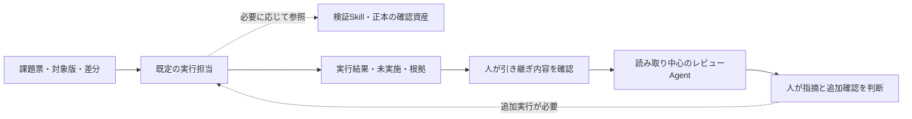

# SEC-04: Custom AgentsとAgent Skillsの設計・比較・引き継ぎ

> **状態: DRAFT / 検討中**
>
> 設計者向けの詳細案です。`.agent.md`・`SKILL.md`と共通差分のCLI補助比較は[準備ガイド](../workshop-preparation.md#7-ローカル補助試走の記録)に記録しています。配布用資産の同梱と指定の参加者環境での試走は未実施です。MOAW制作用Skillとは区別します。

章順のCLI試走での定義作成・比較・同じ版の原記録の受け渡しは[今回の記録](../workshop-preparation.md#8-copilot-cliによる章順の試走)へ分離しています。
> 文書中の定義例を保存しただけで、参加者環境で使えることを確認したとは扱いません。

[文書一覧](../../../README.md) / [共通シナリオ](../common-scenario.md) / 前: [共通指示](03-custom-instructions.md) / 次: [実装とデバッグ](05-implementation-and-debugging.md)

共通教材の[SEC-04章別原稿](../../../workshops/agentic-copilot/chapters/04-custom-agents-and-skills.md)に、受講者への説明・問い・ヒント・解説をまとめています。講師も同じ教材を使います。

## 1. 狙いとワークショップ内の位置づけ

S1の計画と、SEC-03で採用した共通・条件付き指示、比較記録を受け取り、S2のカスタマイズ準備へ進む。
中心に置く問いは、**「誰に、どの責任と道具で任せるか」と「その仕事に必要な知識・手順を、いつ再利用するか」をどう分けて設計するか**である。
ファイルの作成や、Agent・Skillの数を増やすことを到達目標にはしない。

参加者はレビュー専用Custom Agentを1体、検証Skillを1個設計する。
Agentの有無とSkillの有無を別々に比較し、その後に検証結果をレビュー担当へ渡す。
講師が用意する共通の小さな差分を独立した比較用コピーで扱い、検証Skillは検証・失敗の切り分け・報告までとする。
この参加者操作、比較教材の分離、責務の選択はD-018〜D-020で確認済み。以下の8段階と具体的な課題・定義はP-010の設計案である。

SEC-03の比較用コードやDBは使い回さず、本編の絞り込みも先に実装しない。
SEC-04から本編へ渡すのは採用した定義と確認・比較記録であり、コードの修正はSEC-05、実装後の品質判断はSEC-06で行う。
本編への配置・適用確認とS2の判定は第11節に定める。

**今回の通常経路:** レビューAgentの設計・R0/R1 → 検証Skillの設計・V0/V1 → 同じ版の結果の引き継ぎ → 本編での配置・試用とS2。
この三つのまとまりを個人で進め、`.agent.md`と`SKILL.md`の直接編集を基本にする。非Previewの選択・呼び出し・観測経路を事前に確認し、Previewの管理UIを操作手順にしない。
本書の「採用した定義」は演習で使う定義を指す。演習での設計・試用と、実務で常用するかの採否は別であり、実務での見送りを後続の必須利用の省略としない。
ヒント・観測・不足時の扱いは[共通シナリオ](../common-scenario.md)第2・10・11節に従う。

| 学習目標 | 参加者が示す根拠 |
| --- | --- |
| 機能と価値を説明する | 役割の再利用と、知識・手順・資料の再利用を、具体的な仕事に結び付ける |
| 適切な置き場所を選ぶ | 共通指示、Agent、Skill、今回だけの依頼へ分けた理由を説明する |
| 目的から定義する | 入出力、対象外、使用条件、必要なツール、失敗時の戻し先が対応している |
| 有無による違いを観察する | 条件票、実際の適用・行動・結果を示し、差なしや悪化も残す |
| 次の担当へ渡す | 対象の版、根拠、未確認事項、追加実行の依頼を区別する |
| 他の開発へ応用する | 再利用する構造と、環境ごとに調べ直す事項を分ける |

## 2. 機能、価値、使い分け

### 2.1 主に何を設計する仕組みか

| 仕組み | 主に設計するもの | 価値が生まれる場面 | この演習で置く内容 |
| --- | --- | --- | --- |
| 共通・条件付き指示 | 継続的な規則、確認済みの構成、対象限定の規則 | 毎回同じ前提を説明する必要がある | SEC-03で採用したAGENTS.md等を正本として維持 |
| Custom Agent | 担当の役割、期待する出力、確認観点、利用ツール | レビューなどの役割と道具の選択を繰り返す | 読み取り中心のレビュー担当 |
| Agent Skill | 特定の仕事に必要な知識、手順、資料、任意のスクリプト | 検証の進め方や失敗時の判断を繰り返す | 検証対象を選び、実行・切り分け・報告する手順 |
| 今回のプロンプトと入力資料 | 今回の対象、目的、評価条件、依頼範囲 | 対象の版や変更内容が毎回変わる | 課題票、差分、今回のAC、実行結果 |
| ツールと実行環境 | 実際に読める・変更できる・実行できる操作 | 指示だけでは実行できない仕事がある | 利用可能な検索・読取・実行の手段と承認 |

Custom Agentは、役割別の指示とツール、必要に応じたモデル設定を再利用する構成である。
この演習ではモデルを変えず、講師指定のモデルを固定する。役割を変えた効果とモデルを変えた効果を混ぜない。
ファイルの形式と選択方法は[VS CodeのCustom Agents](https://code.visualstudio.com/docs/agent-customization/custom-agents)を参照する。

Skillは「何を・いつ・どのように行うか」を、必要な資料とまとめて再利用する。
既定のエージェントもSkillを使えるため、「Custom Agentを作らないとSkillを使えない」とは説明しない。
Custom AgentとSkillが常に一対一である必要もない。
形式と段階的な読み込みは[VS CodeのAgent Skills](https://code.visualstudio.com/docs/agent-customization/agent-skills)を参照する。

これは主な設計責務の区分であり、Agentに手順を書いてはいけない、Skillに判断基準を書いてはいけない、という排他的な分類ではない。
モデル自体を再学習する機能ではなく、指示・資料・ツール等の使い方を構成する仕組みとして扱う。
一度だけの小さな依頼なら、通常のプロンプトで十分という判断も認める。

### 2.2 担当と権限を分ける

| 担当 | 入力 | 任せる仕事 | 与えない能力・責任 |
| --- | --- | --- | --- |
| 計画 | 変更依頼、コード、AC | 調査、影響分析、計画、未決事項の提示 | 仕様の独断確定、無断編集 |
| SEC-04の検証実行 | 比較用差分、維持条件、既存の確認資産 | 検証の選択・実行、失敗の切り分け、報告 | コード・テストの修正、無断の依存追加・設定変更 |
| SEC-05の実装 | 確認済み計画、共通指示、検証結果 | 計画内の編集、テスト、調査、必要な修正 | 対象外の大規模変更、外部公開 |
| レビュー | 評価条件、差分、コード、実行結果 | 根拠のある指摘と追加確認の提案 | ファイル編集、任意のターミナル実行、最終承認 |

検証Skillの責務は、SEC-05で使う場合も報告までとする。
その結果を受けた実装担当が、計画と権限に基づいて修正を判断・実施する。Skillに無条件の自動修正を埋め込まない。

レビュー担当は読み取り・検索を中心にし、追加実行が必要なら実行担当または人へ戻す。
「読み取り専用」という本文だけでは、許可した編集・シェル・委譲による変更を防げない。
実際の有効ツールを確認し、レビュー担当に検証Skillを使わせて実行制限を回避する構成にはしない。
Skillも、権限の付与や承認の省略を実現する仕組みではない。

役割の選択、同じ会話での切り替え、別コンテキストへの委譲、作業コピーの分離は別の操作である。
本編では人が根拠を確認して順に担当を切り替える。自動並列化や入れ子の委譲を必須にしない。

## 3. 講師が準備する共通教材

### 3.1 開始条件と準備物

本編のS1、採用した指示、初期コードを保持したまま、SEC-04用の比較環境を用意する。
参加者ごとに生成結果が異なるSEC-03の改修は、そのまま共通教材にしない。

| 準備物 | 満たす条件 |
| --- | --- |
| 課題票 | 小差分の目的、維持条件、対象外、必要な確認、既知と未知を示す |
| 共通の小差分 | 変更前後の版と差分を識別でき、全条件で同じものを使える |
| 確認資産 | 対象テスト、fixture、静的確認、必要な回帰と実行環境を準備する |
| レビュー用の結果資料 | 対象版、コマンド、成功・失敗・未実施、必要な出力を両条件に同じ形で渡す |
| 条件別の作業コピー | コード・DB・会話を分け、定義や診断の変更を本試行へ混ぜない |
| 定義の記入用ひな型 | 役割・入出力・境界、Skillの使用条件・手順・分岐を自分で設計できる |
| 構成と観測 | セッション種別、モデル、実効ツール、定義の出所、適用証拠、利用量の取得範囲が分かる |
| 停止・復旧と講師資料 | 未実施の記録方法、追加ヒント、代替の確認済み記録、再開方法を用意する |

これらは後続で準備する教材であり、現在のリポジトリには存在しない。
参加者版は完成例パッチへの依存を整理し、単独で確認できるものにする。具体的な分離はQ-005、比較の成立性はQ-014で扱う。
外部Skillや拡張機能の新規インストール、秘密情報、新しいMCP接続は本編の準備条件にしない。

### 3.2 小差分の候補と維持条件

候補は、固定参照版`1a411cd13c02f28bb6f3ac30844af204f1f61d48`の一覧系クエリ検証を、外部仕様を変えずに小さく整理する差分とする。
SEC-03と同じ入口を使えても、ここでは参加者にリファクタリングを生成させず、講師準備の共通差分を読む・検証する。
差分の具体形や期待する検証結果はまだ確定していない。既存コードの不具合や、必ず発見できる欠陥があると決め付けない。

| 観点 | 固定参照版を踏まえて維持すること | 教材準備で確認すること |
| --- | --- | --- |
| 一覧の経路 | UI/APIが共有する取得・入力検証の関係 | `read_requests()`と呼び出し元の対応 |
| 開始版の契約 | 部署・状態による検索は未実装 | 将来の検索要件を、この小差分の合格条件にしない |
| クエリの扱い | 未対応キー、重複、不正な配色値を黙って受理しない | 複数不正時の判定順序、400、日本語の説明を含む既存の振る舞い |
| 配色 | `scoutTheme`の空値・`light`・`dark`と不正値の扱い | 検索キーと混同せず、既存の扱いを維持する |
| 応答と表示 | APIの`items`・`count`、既存の並び順・表示・全体集計 | UI/APIの結果と集計対象を取り違えない |
| テスト環境 | 既存の`app`・`client` fixtureと一時DBを使う構成 | 本編のDBを変更せず、必要な確認が実際に実行される |

根拠は参照元の`request_portal\__init__.py`、`tests\test_portal.py`、`tests\conftest.py`、AGENTS.md、`pyproject.toml`。
既存テストが比較用の維持条件をすべて網羅しているとは扱わず、不足する確認は講師が事前に準備する。
参照元のコマンドはSEC-05に記載しているが、比較用の対象と実行順序は課題票で確定する。
本リポジトリでアプリを起動・検証した結果ではない。

本編のAC-01〜AC-11は[共通シナリオ](../common-scenario.md)を正本とし、この小差分の維持条件で置き換えない。
特に、未実装の検索を開始版の欠陥として指摘させない。SEC-06のAND/OR欠陥の発見・修正も前倒ししない。

## 4. 有無を比較する設計

### 4.1 二組に分けて観察する

| 組 | 条件 | 意図する違い | 共通にするもの |
| --- | --- | --- | --- |
| レビュー | R0: 既定の担当、R1: レビュー専用Agent | レビュー用の役割定義を使うか | 小差分、課題票、結果資料、モデル、指示、対象範囲、出力の最低条件 |
| 検証 | V0: 対象Skillなし、V1: 対象Skillあり | 検証Skillを利用できるか、実際に使われたか | 同じ既定の担当、モデル、ツール、コード・データ、依頼、品質条件、指示 |

R0/R1とV0/V1は二組の比較であり、「通常／Agentだけ／Skillだけ／両方」の四条件の要因実験ではない。
SEC-03のA/B/C、本編のS0〜S6、SEC-08のA/Bとも別の識別名である。
最後の引き継ぎは連携を学ぶ活動とし、二組の比較に勝手に追加した測定条件にはしない。

R0/R1の実効ツールは、両方とも読み取り・検索に必要なものへ揃える案を基本にする。
ツール設定を役割と一緒に再利用できる価値は、段階3の構成確認でも扱う。
実行基盤の制約で揃えられない場合はツール構成も条件差として記録し、役割本文だけの効果とはしない。
両条件に対象の検証Skillを使わせず、同じ実行結果資料を渡す。R0だけから安全条件や必要な情報を外さない。

V0/V1は、同じ既定の実行担当で検証し、コード・テストを修正しない。
V0は「明示的に呼ばない」だけではなく、対象Skillが利用できない条件として準備する。
親・ユーザー・組織・プラグイン等から同じSkillが読まれないかも確認する。
安全条件を無断で無効化して比較環境を作らず、条件を揃えられなければ参考観察として区別する。

### 4.2 試行を独立させる

各条件を、同じコード・データの初期状態を持つ独立コピーと、新しいチャットで開始する。
定義の作成、診断、比較後の分析に使った会話を、本試行の履歴へ入れない。
共通指示や対象外のカスタマイズは各組で固定し、出所、版、利用可能な機能を記録する。
定義を改訂したら別版・別試行として扱い、比較の途中で条件を変えない。

テスト実行に伴う一時DBやキャッシュ等の副作用と、ソース・期待値の改変は区別する。
各試行の開始時と終了時に差分とデータの扱いを確認し、無断の変更があればその試行を正常な比較として集計しない。
参加者の作業を一括破棄せず、保持したうえで新しい明示的な比較コピーから再開する。

本試行の依頼は次の二本を正本とする。
各組の中で文言と添付資料を揃え、「今回はAgentがあるので」「Skillを使って」といった誘導文を片方だけ追加しない。
最低限の品質条件を両方に伝えたうえで、専用の役割・手順を再利用する違いを見る。既定の担当でも十分な結果を出せる比較にする。

### 4.3 R0/R1共通のレビュー依頼案

```text
この比較用差分を、課題票の目的・維持条件と、変更前後のコード・共通の実行結果資料に基づいてレビューしてください。
課題票が対象にしていない機能追加や、まだ実装しない将来要件は求めません。
問題を指摘する場合は、対象の版、該当箇所、問題が起こる条件、根拠、関係する維持条件を示してください。
コードから考えられることと、提供された結果で確認できることを分けてください。
ファイル編集、コマンド実行、他の担当への委譲は行いません。
追加実行が必要なら、確認したいことと必要な実行を提案してください。
指摘がない場合も、確認範囲と未確認事項を示してください。一定件数の指摘は必要ありません。
```

R1はレビューAgentを選択してから同じ依頼を使う。
課題票、差分、結果資料に条件名ごとのヒントを追加しない。
レビューの品質は指摘数や文章量ではなく、根拠、対象版との対応、未確認の明示、役割の遵守で評価する。

### 4.4 V0/V1共通の検証依頼案

```text
この比較用差分について、課題票の目的・維持条件を確認する検証を行い、結果を整理してください。
プロジェクトの指示と既存の確認資産を根拠に、対象の版・データに合う確認を選んでください。
コード、テスト、期待値、依存、設定は変更しません。課題で認められた検証と一時的な出力の範囲で作業してください。
実行できない確認や不足するテストは、未実施・未確認として残してください。
失敗した場合は、環境・テスト・実装・未決仕様のどこに原因がありそうかを、根拠とともに示してください。
実行したコマンドと対象、起動・終了の状態、成功・失敗・未実施、必要な追加確認を報告してください。
この場では修正せず、判断や変更が必要な事項を担当へ返してください。
```

V1の本比較では、この依頼からSkillが選ばれるかを観察する。
自動で読み込まれなければ「配置・発見済みだが本試行では未使用」と記録する。
その後の明示呼び出しは、たとえば`V1-manual`という別試行にし、元のV1を自動選択に成功した結果へ書き換えない。
明示呼び出しの例と診断の扱いは第7節に示す。

## 5. 8段階の進行案

| 段階 | 主に学ぶこと | 残す成果 |
| --- | --- | --- |
| 1 | 役割と再利用手順を見分ける | 使い分けと採否の理由 |
| 2 | 共通教材と比較条件を固定する | 条件票と共通依頼 |
| 3 | レビューAgentを定義し適用を確認する | 定義案、構成・適用の根拠 |
| 4 | Agentの有無を比較する | R0/R1の結果と限界 |
| 5 | 検証Skillを定義し呼び出しを確認する | 定義案、参照・呼び出しの根拠 |
| 6 | Skillの有無を比較する | V0/V1の検証・比較記録 |
| 7 | 検証結果をレビューへ引き継ぐ | 引き継ぎ票と人の判断 |
| 8 | 結果を解釈し本編へ移す | 採用する定義、汎用化の判断、到達記録 |

以下の開始・追加プロンプトは、準備・設計・診断・分析を支援する計16本の案である。
R0/R1とV0/V1の本試行には、第4節の共通依頼を新しいチャットで使う。
本試行中に追加質問やヒントが必要になったら介入として記録し、追加の負担を比較から隠さない。

### 段階1: 役割と再利用手順を見分ける

**目的・入力:** S1、SEC-03の採用指示と比較記録から、継続的な規則、今回の条件、担当の責任、繰り返す手順を見分ける。

**参加者の作業:** 「既存の契約を守る」「根拠付きでレビューする」「検証を選び失敗を分ける」等を分類し、正本と参照先を決める。
通常の依頼だけで十分な候補も挙げる。まだ定義ファイルを作らない。

**講師の介入:** 「レビュー」という名前だけで役割を定義できたことにしない。何を受け取り、何を返し、何をしない担当なのかを問い直す。
AgentとSkillのどちらにも書ける内容は、更新責任と再利用の単位から判断させる。

**開始プロンプト案**

```text
S1の計画、採用した共通・条件付き指示、SEC-03の比較記録を読み、再利用したい内容を整理してください。
共通ルール、今回だけの条件、担当の役割、検証の知識・手順に分け、置き場所の候補と理由を示してください。
同じ内容を複数の定義へ複製せず、通常の依頼だけで十分なものも挙げてください。
まだファイル作成やアプリの変更は行わないでください。
```

**追加プロンプト案**

```text
分類した候補について、誰が何度使うのか、何を受け取り何を返すのかを確認してください。
AgentにもSkillにも置けそうな内容は、責任の境界、更新箇所、参照の負担から比較してください。
既存の正本に残すものと、新しい定義を作る理由を分けて示してください。
```

**成果・人の判断・終了条件:** 分類と採否の理由が説明できる。共通指示を全文コピーしただけのAgent・Skillは採用しない。

### 段階2: 共通教材と比較条件を固定する

**目的・入力:** 講師の課題票、小差分、確認資産、結果資料、第4節の共通依頼を用い、何を変えて何を揃えるかを決める。

**参加者の作業:** R0/R1とV0/V1の条件票を作り、作業コピー、コード・データ、モデル、指示、ツール、観測、停止・復旧を確認する。
対象版と維持条件が分からない資料は、推測で補わず講師へ返す。

**講師の介入:** 各条件の正当な安全制約を維持する。比較用の維持条件と本編の検索ACを混ぜず、未準備の教材をその場の生成結果で置き換えない。
品質の評価方法と試行の停止点を参加者と共有する。

**開始プロンプト案**

```text
課題票、比較用差分、共通の確認資産と結果資料から、R0/R1とV0/V1の条件票を作ってください。
各組の変更要因、固定条件、必要な入力、評価方法、実施できない場合の記録を分けてください。
資料だけでは確認できないモデル設定、ツール、定義の出所は、確認済みにせず確認項目として残してください。
```

**追加プロンプト案**

```text
この条件票で、前の会話、別コピーのDB、親やユーザーの指示・Skill、追加ヒントが混入する経路を確認してください。
同じ品質条件を満たせる比較になっているかも見直してください。
安全条件を外す提案はせず、揃えられない差と解釈の限界を示してください。
```

**成果・人の判断・終了条件:** 二組の条件票と共通依頼、未確認事項が揃う。比較の開始条件が不足していれば、診断や講師支援へ戻す。

### 段階3: レビューAgentを定義し適用を確認する

**目的・入力:** 分類結果、役割表、課題票、第6節の構造例、参加者環境のツールカタログから、レビュー担当を設計する。

**参加者の作業:** `.github\agents\portal-reviewer.agent.md`を作る演習を行う。
役割、入力、観点、出力、情報不足時の扱い、対象外を本文へ書き、必要な読取・検索ツールを実在する識別子で設定する。
診断用コピーで発見・選択・実効ツール・出力を確認し、本試行前に定義の版を固定する。

**講師の介入:** 未設定例を完成版として配らない。本文の禁止と実際の権限を照合し、編集・任意の端末実行・無制限の委譲を残さない。
モデルを変更して挙動を調整するのではなく、講師指定のモデルを維持する。

**開始プロンプト案**

```text
分類結果と課題票から、読み取り中心のレビュー担当の定義案を作ってください。
役割、必要な入力、確認観点、根拠付きの出力、情報不足時の扱い、担当しない仕事を示してください。
共通指示を複製せず、今回の差分や未実装の将来要件を恒常的な前提にしないでください。
ツールは確認できた識別子だけを使い、不明なものは未設定として区別してください。モデルは変更しません。
```

**追加プロンプト案**

```text
作成した定義と、診断用コピーで確認した構成・行動の記録を照合してください。
発見されたこと、選択されたこと、実際に有効なツール、役割に沿った出力を別々に確認してください。
読み取り専用という本文と矛盾する能力や、未確認なのに設定済みと扱った項目があれば示してください。
```

**成果・人の判断・終了条件:** 利用環境に合わせた定義と、発見・適用・ツールの根拠がある。確認できない項目をAIの自己申告だけで埋めない。

### 段階4: Agentの有無を比較する

**目的・入力:** 固定した条件票とAgent、同じ小差分・結果資料を使い、役割定義を再利用したときの違いを観察する。

**参加者の作業:** 独立コピーと新しいチャットで、R0とR1に共通のレビュー依頼を送る。
根拠となった箇所、維持条件との対応、追加確認、役割の遵守、探索と出力を記録する。
比較後の分析は本試行と別の会話で行う。

**講師の介入:** 指摘数が多い方を高品質としない。既定の担当でも十分だった結果、差がない結果、誤った指摘も残す。
ツール差や追加ヒントがあれば、役割本文だけに結果を帰属させない。

**開始プロンプト案**

```text
レビュー比較を始める前に、R0/R1の条件票と準備記録を照合してください。
同じ差分・課題票・結果資料・モデル・共通指示・実効ツールになっているか、確認済みと未確認を分けてください。
本試行の共通依頼は書き換えず、この準備の会話を試行に引き継がないことも確認してください。
```

**追加プロンプト案**

```text
R0/R1の出力と行動記録を、根拠、対象版、維持条件、未確認事項、役割の遵守で比較してください。
指摘件数だけで順位を付けず、改善・悪化・差なしと、条件差で説明し切れない点を示してください。
この比較から役割定義へ戻す改善候補を挙げ、元の試行結果とは分けてください。
```

**成果・人の判断・終了条件:** 同じ評価観点でR0/R1を比較できる。結果を見て定義を直す場合は新しい版にし、元の試行を残す。

### 段階5: 検証Skillを定義し呼び出しを確認する

**目的・入力:** 検証作業の分類、課題票、既存のコマンドと確認資産、第6節の定義例から、再利用する手順を設計する。

**参加者の作業:** `.github\skills\verify-portal\SKILL.md`を作る演習を行う。
何を・いつ使うか、前提、手順、失敗分岐、終了条件、入出力と参照を記述する。
診断用コピーで明示呼び出しと自動選択を別々に確認する。資料やスクリプトを増やす前に、既存資産で足りるか判断する。

**講師の介入:** Skillをコマンドの別冊にせず、選定理由と分岐を持たせる。
「すべての開発で使う」のような広すぎる説明、存在しない参照、隠れた自動修正を見直す。
発見・読み込み・手順の実行を区別し、未使用の記録も受け入れる。

**開始プロンプト案**

```text
課題票と既存の確認資産から、検証・失敗の切り分け・報告に使うSkillの定義案を作ってください。
名前と使用場面、前提、検証対象の選び方、実行、失敗時の分岐、終了条件、報告項目を示してください。
コマンドは正本を参照し、コード・テストの修正は担当しないことを明記してください。
補助資料やスクリプトが本当に必要かも判断し、未作成のものを利用できる前提にしないでください。
```

**追加プロンプト案**

```text
定義案と診断記録を照合し、名前・説明からの発見、本文の読み込み、参照先へのアクセス、実際の手順を分けてください。
明示呼び出しと自動選択のどちらを試した記録かを確認してください。
参照切れ、広すぎる使用条件、権限の不足、実行していないのに成功としている項目があれば示してください。
```

**成果・人の判断・終了条件:** 定義と参照関係、呼び出しの成否・未確認を記録できる。利用可能な状態を確認してから本比較用の版を固定する。

### 段階6: Skillの有無を比較する

**目的・入力:** 固定したSkillとV0/V1の条件票を使い、同じ検証依頼で手順の選択・実行・報告の違いを見る。

**参加者の作業:** 二つの独立コピーで共通の検証依頼を実行し、対象の選定、参照、起動・終了、失敗分類、未実施を記録する。
アプリのテスト結果と、検証・報告の手順を遂行できたかを別に判定する。
自動選択されなかったV1を、後から明示呼び出しで成功した結果に置き換えない。

**講師の介入:** テスト不合格でも、根拠を保って正しく失敗を報告できた点は評価する。ただしアプリが合格したとはしない。
未実行、環境不備、観測漏れ、修正禁止への違反を見落とさず、必要なら停止する。

**開始プロンプト案**

```text
V0/V1の準備記録から、同じ既定の担当・モデル・ツール・指示・コード・データで検証できるか確認してください。
V0で対象Skillが別の経路から利用されないことと、V1の発見・読み込みを何で観察するかを分けて示してください。
コードやテストを修正しない範囲、許可された一時出力、停止条件を確認し、共通依頼は変更しないでください。
```

**追加プロンプト案**

```text
V0/V1の記録を、対象選定、実行の証拠、失敗分類、未実施の報告、無断変更の有無で比較してください。
アプリのテスト成否と、検証手順・報告の品質は別に評価してください。
Skillの未使用、明示呼び出し、追加ヒント、欠測を隠さず、今回の記録で言えることだけを示してください。
```

**成果・人の判断・終了条件:** 検証結果と手順の評価が分かれ、V0/V1の差と限界を説明できる。本編でも確認が必要な事項を、SEC-05への引き継ぎ候補として残す。

### 段階7: 検証結果をレビューへ引き継ぐ

**目的・入力:** 比較後の検証結果、同じ版の差分・課題票、採用候補のレビューAgentを使い、担当間の責任と情報の境界を確かめる。

**参加者の作業:** 実行担当の結果を第8節の引き継ぎ票に整理し、人が確認してレビュー担当へ渡す。
レビュー担当は対象版と根拠を照合し、追加実行が必要なら実行担当または人へ返す。
引き継ぎの操作と記録はR0/R1・V0/V1の本試行から分ける。

**講師の介入:** 前の会話の全文や実行権限まで渡す必要があるかを問い直す。
版が違う結果や根拠不足があれば保留させ、受け手が自分で実行したと報告しないことを確かめる。
不足を例示する場合は診断教材と明示し、元の実行記録を改変しない。

**開始プロンプト案**

```text
今回の検証結果から、レビュー担当へ渡す引き継ぎ票を作ってください。
目的と維持条件、対象版と差分、実行コマンドと結果、原因候補の根拠、未実施、追加確認を整理してください。
レビュー担当は編集や実行をしません。次に判断してほしいことと、実行担当へ戻すことを分けてください。
会話全文を貼るのではなく、必要な資料を再参照できる形にしてください。
```

**追加プロンプト案**

```text
受け取った引き継ぎ票を、差分・対象版・評価条件と照合してください。
どこまで判断でき、何が足りず、どの追加確認を実行担当または人へ返すべきかを示してください。
提供された実行結果と、自分がコードから推測したことを分け、実行していない確認を再現済みと書かないでください。
```

**成果・人の判断・終了条件:** 受け手が必要な根拠をたどれ、実行とレビューの責任が混ざらない。追加確認の採否と次の担当を人が決める。

### 段階8: 結果を解釈し本編へ移す

**目的・入力:** 二組の比較、引き継ぎ、適用確認の記録から、演習で使う定義の改善・本編への移行と、実務での採用・見送りを分けて考える。

**参加者の作業:** 品質、探索、読み込み、出力、介入、引き継ぎの負担を整理する。
本編で試用する定義と記録を選び、配置・参照・適用を確認する。改善が必要なら定義を直して確認し、講師提供版なら支援と記録する。比較用コード、DB、診断変更、会話全文は戻さない。
別の言語・リポジトリへ移すときに調べ直す項目を挙げる。

**講師の介入:** 最短の定義や最少トークンだけを正解にしない。
講師支援、未使用、未確認を残し、必要な適用・利用が未確認ならS2全体を達成したことにしない。

**開始プロンプト案**

```text
二組の比較と引き継ぎの記録から、演習で使う定義と改善点を理由付きで整理してください。
実務での常用を採用・限定・見送りとする判断は別に示し、本編での必須の配置・試用と混同しないでください。
品質が揃っている範囲と、未完了・未使用・欠測で比較できない範囲を分けてください。
本編へ移す定義と記録、移さないコード・DB・診断変更、配置後に確認すべきことを示してください。
```

**追加プロンプト案**

```text
この設計を別の開発へ応用する場合、再利用できる役割・手順の構造と、調べ直すコマンド・パス・業務条件・権限を分けてください。
通常の依頼で十分になる場合や、定義を見直すきっかけも示してください。
今回観測していない効果や削減率は作らず、S2の必須確認と残る未確認事項を照合してください。
```

**成果・人の判断・終了条件:** 採否、汎用化の理由、本編の到達記録が揃う。詳細なS2の条件は第11節に従い、S3・S4の完了とは区別する。

## 6. 定義例と設計上の判断

### 6.1 Custom Agentの構造

配置候補は`.github\agents\portal-reviewer.agent.md`。
`.agent.md`のMarkdown本文に役割を記述し、YAML frontmatterで名前・説明・ツール等を設定する。
形式上、ヘッダーは任意だが、この演習では実効ツールを確認できる明示的な定義を作る。

**以下は構造を学ぶための未設定例である。`tools: []`はツールをまだ割り当てていない状態を示し、そのままではファイルを読んでレビューする完成例ではない。**
参加者環境で読取・検索に使える識別子を確認して設定し、実効ツールを確かめてから試行する。
ツール指定の省略や、未確認の名前の記入を「読み取り専用の完成」と扱わない。

```markdown
---
name: portal-reviewer
description: 社内申請ポータルの変更を、評価条件・差分・実行結果に基づいてレビューする。
tools: []
---

# 役割
変更の目的と評価条件に照らし、根拠のある問題と追加確認を報告する。
共通規則は[AGENTS.md](../../AGENTS.md)を参照し、ここへ複製しない。

## 必要な入力
目的、評価条件、対象の版、差分、関連コード、同じ版の実行結果を確認する。
不足や版の不一致があれば、判断できない範囲と必要な情報を返す。

## 確認すること
今回の変更が契約、入力検証、UI/APIの共有経路、件数・集計、既存操作へ与える影響を調べる。
対象外の機能追加や未実装の将来要件を、現在の差分の不具合と決め付けない。

## 出力
指摘には、該当箇所、問題が起こる条件、根拠、影響する評価条件、追加確認を付ける。
コードからの推測と、提供された実行結果を分ける。
指摘がない場合も確認範囲と未確認事項を返し、一定件数の指摘は要求しない。

## 境界
ファイル編集、コマンド実行、他の担当への委譲、最終承認は行わない。
実行が必要なら実行担当または人へ戻す。自分で再現したとは報告しない。
```

相対リンクは定義ファイルから解決する。上のAGENTS.md参照は、候補どおりアプリのルート配下へ配置した場合の例である。
本文中のMarkdownリンクにはリンク用の区切りを使い、端末で扱う実ファイルパスと区別する。
移植先の正本や配置が違えば参照を調整し、存在とアクセスを確認する。

| 設計箇所 | 判断すること |
| --- | --- |
| 名前・説明 | 何を任せる担当かを利用者が見分けられるか |
| 入力・出力 | 課題票から受け取り、次の人が判断できる根拠を返すか |
| ツール | 必要な読取・検索だけか。編集・シェル・委譲等の変更経路が残っていないか |
| 本文 | 継続的な役割と今回だけの対象を分け、正本を重複させていないか |
| モデル | 演習の固定モデルを維持できるか。別モデルやフォールバック列を持ち込んでいないか |
| 適用 | 名前が一覧に出るだけでなく、選択後の指示・ツール・行動が意図に合うか |

公式仕様では、利用できないツール名が無視される場合がある。構文エラーがないだけでは、意図した構成を保証しない。
Localでは、併用するプロンプトファイルの`tools`がAgentの指定より優先されるため、別の設定を通した実効構成も確認する。
本比較は共通依頼を直接使い、未確認のプロンプトファイルを片方だけに併用しない。
Local／Agent Host等による対応差、具体的な識別子と確認手順はQ-002・Q-006で確定する。

### 6.2 Agent Skillの構造

配置候補は`.github\skills\verify-portal\SKILL.md`。
`SKILL.md`を持つフォルダーを一つのSkillとして扱い、必要なら同じフォルダーに資料・例・スクリプトを含める。
ファイル形式の条件は次のとおり。任意項目の対応は参加者の実行基盤でも確認する。

| 項目 | 定義時に確認すること |
| --- | --- |
| `name` | 必須。小文字・数字・ハイフンを使い、親ディレクトリ名と一致させる。最大64文字 |
| `description` | 必須。何をするかと、いつ使うかを具体的に書く。最大1024文字 |
| `user-invocable` | 既定は`true`。明示呼び出しのメニュー表示を制御する |
| `disable-model-invocation` | 既定は`false`。関連性に基づく自動読み込みを禁止するかを制御する |
| 本文と参照 | 前提、手順、分岐、終了条件、入出力を示し、必要な資料を実在する相対リンクで参照する |

本編では明示呼び出しと自動選択を区別して学ぶため、以下は両方を許す既定の構成例とする。
「自動選択を許している」と「今回、自動的に使われた」は別の事実である。
この例は未試走の定義案であり、正本・確認資産・実効ツールを用意せずに実行できる手順ではない。

```markdown
---
name: verify-portal
description: 社内申請ポータルの変更を検証し、失敗を切り分けて報告する。差分の確認、テストや静的解析の実行、失敗結果の整理を依頼されたときに使う。コードとテストの修正は担当しない。
---

# 検証・切り分け・報告

## 前提と境界
今回の課題票、対象版と差分、データ、実行権限を確認する。
確認コマンドの正本は[AGENTS.md](../../../AGENTS.md)と、そこから参照する実在の確認資産とする。
このSkillを使う検証作業では、コード、テスト、期待値、依存、設定は変更しない。
必要な確認が実行できない場合は、理由と未実施の範囲を返す。

## 手順
1. 目的・維持条件と差分を読み、何を確かめるか整理する。
2. 正本と既存テストを参照し、対象と必要な回帰を選ぶ。足りないテストは未確認事項として残す。
3. 環境、作業ディレクトリ、実行権限、副作用を確認する。未準備なら無断で設定を変えず、担当へ返す。
4. 許可された確認を実行し、コマンド、対象、起動・終了の状態、必要な出力を記録する。
5. 失敗時は読み取りで調べ、環境不備、テスト不備、実装不備、未決仕様の候補と根拠を分ける。
6. 追加確認が必要なら目的と範囲を示す。権限外の実行や修正は行わず、未実施として戻す。
7. 実行結果と未確認事項を報告し、変更が必要な場合は判断・修正を実装担当へ依頼する。

## 終了と出力
対象版・差分・データ、選んだ確認と理由、実行コマンド、成功・失敗・未実施を示す。
原因候補と根拠、追加確認、次の担当へ戻す事項を示す。
プロセスが起動しなかった場合やテスト収集に失敗した場合を、対象の振る舞いを検証した結果にしない。
失敗を報告できたことと、アプリの検証に合格したことを分ける。
必要な確認を終えるか、継続できない理由と残項目を示したところで止める。
修正を続ける場合は、実装担当が別の作業として目的・範囲・権限を確認する。
```

名前と配置の対応、リンク先の存在、正本にあるコマンドと実際の確認対象を人が照合する。
`description`へすべての手順を押し込まず、使用場面を見分ける情報と、読み込んでから使う詳細を分ける。
UIのメニューに出ない場合も、自動読み込みの設定とは別に調べる。

### 6.3 補助資料とスクリプトを追加する判断

| 内容 | 分ける理由 | 確認すること |
| --- | --- | --- |
| ケース別の確認例 | 詳細な例が必要なときだけ参照する | Skill本文からの参照、対象版、期待結果の根拠 |
| 環境別の補足 | 一つの環境の説明を全要求へ混ぜない | 適用する環境、正本、更新責任 |
| 実行スクリプト | 既存コマンドでは不足する反復処理を明確にする | 入力、依存、終了状態、出力、副作用、実行権限 |

スクリプトは必須ではない。今回の候補が既存のコマンドと確認資産で足りるなら、新たに作らない。
資料を置くだけで読まれる前提にせず、Skill本文から必要な参照をつなぐ。
補助資料へ移しただけで内容が常に無料になるわけではなく、読み込んだ分や実行結果の出力も観察対象になる。

### 6.4 避けたい定義と見直し方

| 定義の問題 | 見直す方向 |
| --- | --- |
| 「高品質にレビューする」だけ | 入力、評価条件、根拠の形式、未確認時の扱いを具体化する |
| 全ツールを渡し、本文だけで読み取り専用とする | 実効ツールを絞り、実行が必要なときの戻し先を決める |
| 毎回の対象版や一時的な失敗を恒常的に書く | 今回の依頼・結果資料へ移す |
| AGENTS.mdと同じコマンド一覧を重複管理する | 正本への参照と、選定・分岐の手順を残す |
| Skillの説明を「開発全般に使う」とする | 何を・いつ使うかを具体化する |
| 失敗したら自動で依存追加・期待値変更をする | 失敗の根拠と必要な変更を返し、実装担当が判断する |
| 定義を増やすために単純な仕事を細分化する | 通常の依頼や既存の定義で足りるかを再評価する |

## 7. 適用・呼び出し・実行を確かめる

### 7.1 確認する層

| 対象 | 確認すること | それだけでは分からないこと |
| --- | --- | --- |
| Agentの発見 | 対応する場所・形式で認識され、出所を特定できる | 今回そのAgentを選択したか |
| Agentの適用 | 選択された担当、使われた定義、実効ツールが分かる | 役割に沿った結果になったか |
| Agentの行動 | 読取範囲、出力、禁止した操作の有無が記録される | レビュー対象のすべてが正しいか |
| Skillの発見 | 名前・説明と出所が認識されている | 本文を読み込んだか |
| Skillの読み込み | 対応する診断やツール記録から、本文を使ったことを確認できる | 補助資料をすべて読んだか、手順を実行したか |
| 資料・手順の使用 | 必要な参照、コマンドの起動・終了、結果が記録される | 未実施の条件まで合格したか |

非Previewの選択・参照表示、対応する診断、実際のツール呼び出し・出力を組み合わせる。Previewの管理UIやAgent Debug Logsには切り替えない。
AIが「読みました」「検証しました」と答えたことだけで判定しない。
証拠を取得できない層は未確認とし、利用できる画面や記録方法をQ-003で確認する。

親ディレクトリ、ユーザー、組織、拡張機能・プラグイン、メモリ等の影響も記録する。
同じ名前がある場合は、名前だけでなく実際の出所と定義の版を確認する。
新しいチャットだけで、それらの影響やサービス側のキャッシュが消えるとは考えない。

### 7.2 明示呼び出しと自動選択の診断

診断用コピーでは、同じSkillに対して二つの経路を別のチャットで試す。
対応するVS Code環境での明示呼び出しの例は、`/verify-portal`に課題と必要な資料を添える形である。
これは診断・補助試行用であり、第4節のV1の共通依頼へ無条件に追加するものではない。
実際のメニュー、形式、名前は参加者環境で確認する。

| 診断の結果 | 扱い |
| --- | --- |
| 明示呼び出しで本文を読み、必要な手順も使えた | その経路の利用を確認した。自動選択の成功とは別に残す |
| 明示呼び出しは使えたが、通常の検証依頼では選ばれない | 使用条件・関連性・設定を見直す。元の未使用を残す |
| 一覧に出るが本文の読み込みを確認できない | 発見だけ確認済みとし、本文利用は未確認にする |
| 本文を読んだがコマンドを実行できない | 権限・環境・対象を調べ、実行は未実施として扱う |
| 定義を改善して使えるようになった | 改善版と新しい試行を記録し、前の結果を置き換えない |

既定ではSkillの指示は親のコンテキストへ読み込まれる。
別コンテキストで実行する`context: fork`は実験的な機能であり、今回は発展を含めて使用しない。
Skillを使うこと自体を「独立したエージェントが動いた」と説明しない。

### 7.3 試行記録の形式

```text
試行ID・条件・実行順:
課題票・比較教材・定義の版:
コード・差分・データ・作業コピー:
モデル・セッション種別・実効ツール:
共通指示と、他のカスタマイズの出所:
依頼・添付資料・追加ヒント:
Agentの選択・適用の根拠:
Skillの発見・本文読み込み・使用の根拠:
実行コマンド・対象・起動と終了・結果:
アプリの検証結果:
レビューまたは検証手順・報告の評価:
変更の有無・未実施・未確認:
人の承認・介入・中断・再試行:
利用量の取得範囲・単位・未取得:
```

結果欄は未記入から始め、架空の成功や数値を入れない。
対象外の欄と、取得できない欄は区別する。
実行順、反復数、停止点、ヒント、復旧、講師が持つ既知結果はQ-014・Q-011で試走して決める。

## 8. 検証結果をレビューへ渡す

二組の比較の後に、同じ版の小差分と検証結果で連携を試す。
Skillは実行担当が必要に応じて参照する手順であり、常に独立した作業者ではない。



この図は情報と責任の流れであり、作業コピーやコンテキストが自動的に隔離されるという意味ではない。
人が必要な資料を渡す構成を基本にし、handoffボタンや自動送信を必須にしない。
VS Codeのhandoffは会話の文脈と次の依頼を伴う担当の切り替えであり、新しい独立環境の生成とは別である。

```text
目的と評価条件:
対象の版・差分・データ:
今回しないこと:
実行担当と、使用した定義の版:
実行コマンド・対象・起動と終了:
成功・失敗・未実施と必要な出力:
原因候補・根拠・まだ確定できないこと:
参照するコード・結果資料:
レビュー担当に判断してほしいこと:
実行担当または人へ戻す追加確認:
```

レビュー担当は、結果が同じ版・データのものかを最初に確かめる。
修正前の結果や別コピーの出力を、現在の差分の合格根拠にしない。
不足があれば、何をどの条件で再確認すべきかを返す。実行していないレビュー担当が、自分で再現したとは報告しない。
この段階でコード修正が必要になっても実施せず、SEC-05で扱う判断材料として残す。
比較用差分にだけ存在する問題を、そのまま本編の修正課題へ持ち込まない。本編にも当てはまるかを改めて確認し、必要なら計画へ戻す。

## 9. SEC-01・SEC-03とつなぐトークンエコノミー

役割指示や利用ツールの説明、Skillの名前・説明、読み込んだ本文・資料、実行結果は入力の負担に関係する。
Skillはメタデータ、本文、必要な補助資料を段階的に読むため、すべての資料を毎回同時に渡す設計とは異なる。
一方、ファイル化しただけで入力が無料になる、Skillを増やしても負担がない、とは説明しない。

| 観察するもの | 改善につながる場合 | 負担が増える場合 |
| --- | --- | --- |
| 役割と道具の固定 | 毎回の説明やツール選択を再利用できる | 小さな仕事にも長い役割本文を読む |
| 検証手順の再利用 | 必要な確認の選択や失敗分類を揃えられる | 関係の薄いSkillや長い資料を読む |
| 正本への参照 | 重複した指示や古いコマンドの維持を避けられる | 参照切れや過剰な分割で探索が増える |
| 結果の引き継ぎ | 次の担当が必要な根拠から始められる | 全文の再生成、読み直し、重複調査、往復が増える |
| 品質の確認 | 漏れや誤った完了判断を減らせる | 不要な全体実行や同じ失敗を反復する |

R0/R1とV0/V1はそれぞれの仕事の品質を先に評価し、同じ評価条件で比較できる範囲の利用量を見る。
確認を省いた結果、根拠のない「問題なし」、未実施の多い短い報告を、安い成功として採用しない。
アプリのテスト不合格と、適切に検証して失敗を報告した手順の評価は別に残す。

取得できる入力・出力・キャッシュ等の内訳と、要求別・セッション合計の範囲を記録する。
未取得を0にせず、セッション合計と要求別の値を二重計上しない。
定義の作成・診断、比較の本試行、引き継ぎを分けて記録し、導入や保守の負担を無視した「総コスト削減」とは説明しない。
文字数から独自に課金額を計算せず、実測していない利用量・改善率・所要時間を作らない。

単発の観察から、一般的な優位性や一定割合の削減を主張しない。
差なし・悪化・既定の担当で十分だった結果も、次の設計判断に使う。
SEC-03の指示比較、SEC-04の二組の比較、SEC-08の関連ファイル明示の比較は、それぞれ条件と記録を分ける。
計測の詳細は[Token Economy実践ガイド](../../reference/token-economy.md)を参照する。

## 10. 他の開発へ応用する

ポータル固有の定義をそのまま移すことではなく、設計の判断方法を持ち帰る。
特定の言語やフレームワークを問わず使える役割・手順の構造と、調べ直す必要がある情報を分ける。

| 再利用しやすい構造 | 移植先で調べ直すもの |
| --- | --- |
| 目的、入力、出力、対象外、戻し先 | 業務要件、品質条件、承認する人 |
| 根拠・仮説・未確認を分ける報告 | 参照するコード、版、結果資料 |
| 対象選定、実行、失敗分類、報告の流れ | テスト、コマンド、依存、データ、副作用 |
| 正本と必要な補足資料を参照する構成 | ファイル配置、リンク、読み込み条件 |
| 最小限のツールと実際の利用を確認する方法 | 実行基盤、利用可能な識別子、組織の権限 |

見直しのきっかけは、正本やコマンドの変更、実行基盤の更新、同じ確認漏れの反復、参照切れ、誤った自動選択、使われない定義の増加とする。
利用者が少ない一回限りの仕事なら、通常の依頼へ戻すことも検討する。
AgentとSkillを作るために仕事を分割せず、繰り返す責任や手順があるから分ける。

採否のメモには、対象の仕事、困っていた反復、選んだ仕組みと理由、観測した結果、未確認事項、見直す条件を残す。
実顧客のコードや秘密情報を持ち込まず、一般化した作業で考える。

## 11. 成果、S2の判定、つまずき

### 本編へ渡すもの

| 成果 | 必要な根拠 |
| --- | --- |
| 演習で採用したAgent・Skill | 定義の版、責務、配置理由、正本と参照先。実務での常用の採否は別記 |
| 共通指示との分担 | SEC-03の指示を維持し、重複や矛盾を整理した判断 |
| 構成と利用の記録 | 実行基盤、実効ツール、発見・適用・使用を確認した証拠 |
| 二組の比較記録 | 条件票、結果、品質評価、介入、未使用・未実施・欠測 |
| 引き継ぎの記録 | 同じ版の根拠、追加確認、次の担当、人の判断 |
| 汎用化と残課題 | 採否の理由、調べ直す項目、未確認事項 |

本編へは上記の定義と記録だけを移し、比較用コード、DB、診断用の変更、会話全文を持ち込まない。
比較記録を渡すことと、その結果を本編の実行成功として流用することは別である。
本編でも配置・参照・読み込み・実効ツールと必要な利用を確認する。既存機能の確認を使い、絞り込みは実装しない。
SEC-05以降では、その時点の本編のコードに対して検証とレビューを新たに行う。

S2は、指示・役割・検証手順の分担を説明でき、採用した定義の必須の適用・利用を確認した状態とする。
実務では定義を追加しないという判断も認めるが、それによって演習のS2を無確認で通過しない。非Previewで必須機能を利用できなければ、通常のプロンプトを機能の代用実績にせず、実施計画へ戻す。
ファイルの存在や比較教材での成功だけではS2全体の完了にしない。
必須の確認が残る場合はS2未到達と記録する。講師の確認済み教材で再開した場合も、参加者自身の確認と支援利用を分ける。
講師記録を読解しただけで、自力で適用・実行・観測したことにはしない。
S3の本編実装とS4の品質判断は、後続で別に判定する。

### つまずきと戻り先

| 状況 | 対応 |
| --- | --- |
| Agentが見つからない | 配置、形式、実行基盤、表示設定、出所を確認する |
| 読み取り担当が編集・実行できる | 本文だけでなく実効ツールと他設定の影響を見直す。本試行を続けない |
| Skillが見つからない | 名前とディレクトリの一致、形式、探索範囲、設定を確認する |
| Skillが自動選択されない | 元の未使用を残し、診断用の明示呼び出しと説明の見直しを分けて行う |
| 手順は読まれたが実行できない | 権限・環境・対象を確認し、未実施として返す。禁止を回避しない |
| 失敗を直し始める | 検証・報告へ戻し、変更を記録する。修正はSEC-05の実装担当へ戻す |
| 比較に差がない、または悪化する | 既定で十分か、定義や参照が過剰かを根拠から考える |
| 別版の結果が引き継がれる | 保留にし、対象版に合う結果を実行担当へ依頼する |
| 診断や利用量を取得できない | 取得範囲を限定するか講師記録を使い、未確認・代替を明記する |

## 12. 未決事項と今回の対象外

| ID | 後続で具体化すること |
| --- | --- |
| Q-001 | 個人での分類・定義・記録読解、既定で非表示のヒントと支援後の説明 |
| Q-002 | VS Code／Codespacesの実行基盤、固定モデル、役割ごとのツール・権限 |
| Q-003 | 適用・読み込み・実行の証拠、利用量の取得範囲、講師記録への代替 |
| Q-005 | 参加者版、条件別コピー、参照依存、本編への引き継ぎと復旧 |
| Q-006 | 実際のAgent・Skill本文、実在するツール名、配置・参照・診断 |
| Q-011 | 8段階、比較と引き継ぎ、支援・停止・再開を含む進行の成立性 |
| Q-014 | 共通差分・品質評価、二組の比較、自動選択と明示呼び出し、既知結果、反復・停止・復旧 |

今回は設計文書の改訂であり、アプリ・差分・確認資産・実行用定義・補助スクリプトの作成や試走は行わない。
モデル比較、Auto／HydraFusionの使用、自動並列化、入れ子の委譲、Skillのforked context、hooks、Marketplace、外部Skillの導入、新しいMCP接続、Claude Codeの操作演習は追加しない。
テンプレート有効化、参加者招待、権限変更、クラウド実行も今回の範囲に含めない。
具体的な日程や所要時間の見積もりは置かない。費用や削減率は未測定のため記載しない。

## 出典と確認範囲

- [Custom agents in VS Code](https://code.visualstudio.com/docs/agent-customization/custom-agents): 役割・ツール・任意のモデル、ファイル形式、配置、選択、ツールの扱い、handoffs。
- [Agent Skills in VS Code](https://code.visualstudio.com/docs/agent-customization/agent-skills): 名前・説明、補助資料、段階的な読み込み、明示呼び出しと自動選択、実験的な別コンテキスト実行。
- [Context concepts](https://code.visualstudio.com/docs/agents/concepts/context): 会話・参照・ツール出力とコンテキストの扱い。
- [参照元AGENTS.md](https://github.com/shinyay/python-portal-sample-app/blob/1a411cd13c02f28bb6f3ac30844af204f1f61d48/AGENTS.md): 構成、維持条件、確認コマンド。
- [参照元のアプリ](https://github.com/shinyay/python-portal-sample-app/blob/1a411cd13c02f28bb6f3ac30844af204f1f61d48/request_portal/__init__.py): 一覧の共有経路、クエリ検証、応答、DB初期化。構造調査のために起動したものではない。
- [参照元のテスト](https://github.com/shinyay/python-portal-sample-app/blob/1a411cd13c02f28bb6f3ac30844af204f1f61d48/tests/test_portal.py)、[fixture](https://github.com/shinyay/python-portal-sample-app/blob/1a411cd13c02f28bb6f3ac30844af204f1f61d48/tests/conftest.py)、[設定](https://github.com/shinyay/python-portal-sample-app/blob/1a411cd13c02f28bb6f3ac30844af204f1f61d48/pyproject.toml): 既存の確認資産と実行環境。比較教材の完成・実行結果ではない。

公開文書と固定版のコードを参照した設計であり、参加者環境で成功を確認した報告ではない。
具体的な機能・配置・診断の対応は実行基盤によって異なるため、Q-002・Q-003・Q-006で確認する。
参照元のアプリはPrivateであり、本リポジトリへのアクセスだけでは閲覧権限を得られない。
