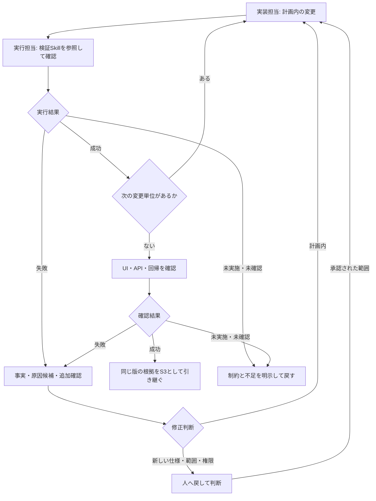

# SEC-05: エージェントによる実装、テスト、デバッグ

> **状態: DRAFT / 検討中**
>
> 実装演習の詳細設計案です。本リポジトリには実行用アプリ、参加者向けテスト、講師の失敗記録はまだありません。
> 以下は教材化・試走のための設計であり、この文書の作成時にアプリの実装・テスト・デバッグを行った報告ではありません。

[文書一覧](../../../README.md) / [共通シナリオ](../common-scenario.md) / 前: [AgentsとSkills](04-custom-agents-and-skills.md) / 次: [レビューと品質](06-review-and-quality.md)

共通教材の[SEC-05章別原稿](../../../workshops/agentic-copilot/chapters/05-implementation-and-debugging.md)に、受講者への説明・問い・ヒント・解説をまとめています。講師も同じ教材を使います。

## 1. このセクションの位置づけ

SEC-02の要件・計画、SEC-03の指示、SEC-04の役割・検証手順を使い、本編の絞り込みを実装する。
コードを生成させるだけでなく、何を任せるかを決め、実行結果から原因を調べ、必要な修正を行い、根拠付きでレビューへ渡す進め方を学ぶ。
到達点はS3の実装候補であり、S4の最終的な品質判断はSEC-06で行う。

**今回の通常経路:** S1・S2から実装依頼を作る → 最初の変更単位で代表ACのテスト先行 → 残りの単位も実装・検証・修正 → 画面・回帰確認 → 根拠付きS3。
代表ACと3単位は具体化する案であり、参加者版での成立は未確認。参加者が個人で計画・期待値・修正を判断し、Pythonやテストの書き方は必要時にヒントを開く。
SEC-04で演習用に採用したSkillを使い、実務で常用するかの判断とは分ける。非Previewの機能と観測、支援・復旧は[共通シナリオ](../common-scenario.md)第2・10・11節に従う。

| 前後のセクション | このセクションでの使い方 |
| --- | --- |
| SEC-02 | 現状理解の根拠、AC、変更対象、対象外、検証方針を実装依頼へつなぐ。全体調査を最初からやり直さない |
| SEC-03 | 採用したAGENTS.mdと条件付き指示を、本編の変更にも適用する。指示本文を毎回の依頼へ複製しない |
| SEC-04 | 採用した定義と確認記録を受け取り、検証Skillを実際の変更に使う。比較コード・DB・診断変更は持ち込まない |
| SEC-06 | 同じ本編の版に対する差分・実行結果・残課題と、委任範囲・人の判断を渡し、レビュー・追加検証・関与方針の学習へ進む |
| SEC-08 | 実装中の探索・実行・手戻り・利用量の観察を渡す。独立したA/B比較の結果とは分ける |

今回確認した学習方針は次の二点。具体的な教材やプロンプトの成立性は、引き続き試走で確認する。

| 方針 | 必須にすること | 必須にしないこと |
| --- | --- | --- |
| D-021: 代表ACのテスト先行 | 代表的な新仕様について、未実装を理由とする失敗から実装後の成功までを確認する | 対象の全ACを、例外なくテスト先行で進めること |
| D-022: 不具合が出ない場合の学習 | 講師が事前に再現確認した失敗記録を読み、原因と追加確認を考える | 成功した参加者の作業へ故障を入れること、SEC-05専用の実行型欠陥演習 |

未実装を示すテストの失敗と、実装後の予期しない失敗を調べるデバッグは、別の学習活動である。
講師記録を読んだだけで、代表ACのテスト先行を自分で実行したことにはしない。
自然な不具合が出なかったことも有効な結果であり、「必ずCopilotが間違える」ことを前提にしない。

## 2. 学習目標と責務

| 学習目標 | 参加者が示す根拠 |
| --- | --- |
| 範囲を定めて任せる | 計画、対象AC、実際の変更、対象外、人へ戻す条件が対応する |
| 要件を確認可能にする | データと期待値をACから説明し、テストの件数ではなく確認する契約を示す |
| 意味のある失敗を確認する | テストが実際に実行され、未実装のために失敗し、実装後に同じ確認が通る |
| 指示とSkillを使う | 定義の存在、読み込み、実際の実行、その結果を区別する |
| 根拠から修正する | 観測した事実、原因候補、追加確認、修正理由、再実行を対応づける |
| 既存機能を維持する | UI/API、結果件数と全体集計、代表的な既存操作を確かめる |
| 結果を引き継ぐ | 同じ版の根拠を揃え、成功・失敗・未実施・未確認を分けて渡す |
| 別の開発へ応用する | 再利用できる判断方法と、移植先で調べ直す条件を説明する |

人は目的・品質・権限の境界を決め、実装担当はその範囲で調査・編集・検証を進める。
毎行の指示や承認を必須にせず、無制限な自律実行にも置き換えない。
通常の実行許可、仕様判断、講師のヒントは異なる介入として記録する。

| 担当・仕組み | 担うこと | 越えない境界 |
| --- | --- | --- |
| 既定の実装担当 | 計画内の実装、テストの追加・正当な更新、検証結果を受けた修正 | 未決仕様の独断、無関係な改修、権限の拡大 |
| 検証Skillを使う実行担当 | 確認の選択・実行、失敗の切り分け、報告 | 検証作業の途中でコード・期待値・設定を変更して成功にすること |
| 参加者・講師 | 要件や範囲の判断、必要な承認、結果の照合、支援・復旧の判断 | 未実施を完了と認定すること、参加者の成果を無断で破棄すること |
| レビューAgent | SEC-06で、渡された差分・根拠を読み取り中心で評価する | 自分で実行していない結果を再現済みとすること、編集・任意実行を追加すること |

Skillは独立した作業者や権限付与の仕組みではない。同じエージェントが続けて担当する場合も、検証結果を確定してから、実装担当として修正判断を行う。
この節のために、新しい実装AgentやテストAgentを増やすことは求めない。

## 3. 開始条件と参加者版の検証契約

### 本編の開始状態

| 確認対象 | 開始時に揃えるもの |
| --- | --- |
| 版と作業 | 指定した参加者版、作業コピー、既存の変更、未完了作業 |
| 計画とAC | S1の確認済み計画、今回の変更単位、未決事項と実装しない範囲 |
| 指示・役割・手順 | 本編での配置・参照・適用・必要な利用を確認したS2、実効ツールと権限 |
| データ | 手動操作用DBと自動テスト用DBの区別、初期状態、作成・更新の有無 |
| 環境 | 講師指定の固定モデル、参加者版の起動・検証方法、許可された実行範囲 |
| 既存の確認 | 配布版の検証契約に沿う開始時の結果、既知の失敗と未実施 |

S2の必須確認が不足している場合は、SEC-04へ戻すか講師の確認済み教材で再開し、自力の到達と支援利用を区別する。
SEC-04の比較結果は、本編の実行成功の根拠にしない。この節で扱うコードに対して新たに確認する。
未決ACの影響範囲は実装しない。依存のインストールや端末の初期設定は事前準備へ分ける。

### 固定参照版から分かっていること

参照元は`shinyay/python-portal-sample-app`の`1a411cd13c02f28bb6f3ac30844af204f1f61d48`。
以下はコードと既存文書を読んで確認した事実であり、参加者版を実行した結果ではない。

| 参照元の事実 | 設計上の注意 |
| --- | --- |
| `read_requests()`は空の許可集合でクエリを検証し、UI/APIの一覧から共有される | 開始版は検索未実装。検索を許可する変更と、共有経路の維持を両方考える |
| `_validate_query_keys`は未対応キーと重複を拒否し、`scoutTheme`には既存の契約がある | 許可する検索キーを追加しても、重複や配色の検証を消さない |
| APIの`count`は返した一覧の件数。画面の全体集計は別の取得処理を使う | 絞り込み後の件数を、そのまま全体集計へ流用しない |
| `create_app`はDBを初期化する | 読み取り調査のために不用意に呼ばない。実行するときはDBの場所と副作用を確認する |
| `app`・`client`のfixtureは`tmp_path`配下のDBを使う | 自動テストと手動画面が同じDBを見ているとは考えない |
| 一部のテストは開始版・完成例の表示や検索対応の有無も確かめる | 教材の開始状態確認と、機能追加後のAC確認を分ける |

### 完成例の依存を分離する

参照元の`tests\test_reference_patch.py`は、完成例パッチ`workshop\filtering.patch`の適用・逆適用と検証を行う。
参加者が独自実装したコードへそのパッチが適用できることを要求すると、正しい実装でも教材側の確認に失敗し得る。
単にパッチだけを削除して、参照するテストやパッケージ検証を残す構成にもできない。

参加者版では、完成例とその検証、開始版の教材状態を確認するテスト、機能追加後のAC・回帰を確認するテストの役割を整理する。
開始版用の「絞り込みUIがない」「有効な検索を400にする」といった期待は、機能追加後にも無条件で要求する契約ではない。
一方、`stage`や表示ラベルを完成例へ変えるだけで品質に合格したことにはしない。

完成例と同じ差分を作ることではなく、共通ACを満たすことを判定基準にする。
配布版単独の開始確認と全体テストの範囲はQ-005で確定する。配布の不備を、当日の意図的なデバッグ教材にしない。
今回、この分離やテストの改修を実行するわけではない。

## 4. 7段階の進行案

| 段階 | 主に学ぶこと | 残す成果 |
| --- | --- | --- |
| 1 | 計画を実装依頼に変える | 依頼、開始状態、任せる範囲 |
| 2 | 要件をテストに変える | ACとの対応、期待値、未実装による失敗 |
| 3 | 確認できる変更単位で実装する | 計画に対応する差分と判断理由 |
| 4 | 検証Skillを使い結果を確かめる | 同じ版の実行結果と未実施 |
| 5 | 根拠から原因を絞り修正する | 事実・仮説・修正・再確認、または講師記録の読解 |
| 6 | 画面・API・回帰を確認する | 振る舞いと維持条件の確認記録 |
| 7 | 根拠付きでレビューへ渡す | S3引き継ぎ票、到達状況、応用の判断 |

以下は開始・追加プロンプト各7本、計14本の案。
一度ずつ順番に実行して終えるのではなく、変更単位ごとに段階3〜5を反復する。代表ACのテスト先行は、対応する実装より前に行う。
追加プロンプトは必要なときに使い、進行のために全件を機械的に投入することは求めない。

### 段階1: 計画を実装依頼に変える

**目的・入力:** S1・S2、参加者版、現在の差分・データ・開始確認から、今回任せる仕事と判断の境界を明確にする。

**参加者の作業:** 対象AC、変更単位、維持条件、対象外、利用できるツール、相談が必要な条件を整理する。
本編の開始状態を確認し、元からの失敗と今回の変更に伴う失敗を分けられるようにする。

**講師の介入:** 「全部よくする」といった依頼を、確認できる目的へ戻す。全体調査のやり直しや、指示全文の再掲は求めない。
未決仕様やS2の不足を見つけたら、影響範囲を止め、戻り先を示す。

**開始プロンプト案**

```text
S1の確認済み計画、対象AC、本編で採用した指示と検証手順を参照してください。
現在の版・差分・データと、参加者版の開始確認の結果を整理してください。
最初に任せる変更単位、維持する挙動、今回しないこと、必要な確認を示してください。
新しい仕様判断、依存追加、対象外の変更が必要なら人へ戻す条件も示してください。
この段階ではアプリやテストを編集せず、開始確認で実行したことと未実施を区別してください。
```

**追加プロンプト案**

```text
その依頼から、共通指示に既にある説明と、今回だけ必要な条件を分けてください。
実装方法を過度に固定している箇所と、判断が足りない箇所を示してください。
元からの失敗や未決事項は、今回の変更で直す対象と勝手に同一視しないでください。
```

**成果・人の判断・終了条件:** 実装依頼、開始状態、未決事項が揃い、人が対象と権限を確認できる。
許可されていない操作や未決ACの影響範囲を、「任せる」の一言で広げない。

### 段階2: 要件をテストに変える

**目的・入力:** 代表ACと開始版から、何を満たせばよいかを、実装とは独立した期待結果として表す。

**参加者の作業:** 小さな既知データを使って期待集合を説明し、対象テストを追加・更新する。
アプリの実装前に実行し、未実装による失敗か、テスト・環境の不備かを確認する。

**講師の介入:** 「テストが赤い」だけで通過させない。対象の確認が起動・実行されたことと、失敗したアサーションの意味を問い直す。
生成された期待値を、生成された製品コードへそのまま合わせる進め方を止める。

**開始プロンプト案**

```text
選んだ代表ACについて、必要なデータ、期待する応答と申請の集合、確認方法を示してください。
期待値はACと既知データから決め、製品コードの絞り込み処理だけから計算しないでください。
対応するテストを追加・更新し、アプリの実装ファイルはまだ変更せずに実行してください。
テストが実行されたか、どの期待と実際が違ったか、未実装が理由といえるかを報告してください。
既存テストを変える場合は、仕様変更との対応を示してください。
```

**追加プロンプト案**

```text
その失敗は、対象の振る舞いを確認した失敗ですか、それとも起動・収集・準備の失敗ですか。
コマンドと出力を根拠に区別し、期待値自体が誤っていないかACへ戻って確認してください。
未実装を示す結果が得られていなければ、得られたことにせず必要な確認を示してください。
```

**成果・人の判断・終了条件:** 代表ACに対応する期待値と、未実装を理由とする実行済みの失敗を説明できる。
環境不備を解消しただけでは到達としない。講師支援で確認した場合は、その支援を残す。

### 段階3: 確認できる変更単位で実装する

**目的・入力:** 確認済みの依頼、代表ACの失敗、既存指示から、目的と差分が結びつく実装を進める。

**参加者の作業:** 一つの変更単位を任せ、対象ファイル、共有処理、既存の検証資産との関係を見る。
途中で計画との差が出た場合は、根拠と影響を確認する。

**講師の介入:** ファイルごとの機械的な分割にも、無関係な整理を含む一括改修にも寄せない。
テストの正当な更新と、失敗を消すための契約の弱体化を区別させる。

**開始プロンプト案**

```text
確認済み計画の今回の変更単位を、対象ACと採用した指示に従って実装してください。
UIとAPIで条件の解釈と取得処理を共有し、既存の入力検証・表示・操作を維持してください。
追加・変更したテストと実装を対応づけ、変更した版・差分と必要な確認を検証作業へ渡してください。
新しい仕様判断、不要な依存、認証・通知・ページ分割・クラウド配備は追加しません。
計画外の変更が必要になったら、先に理由と選択肢を返してください。
```

**追加プロンプト案**

```text
今回の差分を、対象ACに必要な変更、維持のための変更、計画外の提案に分けてください。
UIとAPIが別々の検索ロジックになっていないか、参照関係を示してください。
テストの期待値を変えた箇所は、旧期待値と新期待値、要件上の理由を示してください。
```

**成果・人の判断・終了条件:** 今回の目的に対応する差分があり、計画との差と判断理由を説明できる。
生成が終わっただけでは成功とせず、段階4の実行結果を待つ。

### 段階4: 検証Skillを使い結果を確かめる

**目的・入力:** 現在の差分、対象AC、採用した検証Skillから、必要な確認を実行し、結果を確定する。

**参加者の作業:** Skillの読み込み・利用を確認し、対象に合うテストと静的確認を実行させる。
修正前の結果を流用していないか、実行できなかった項目があるかを見る。

**講師の介入:** 「Skillが一覧にある」「コマンドを提案した」「成功と答えた」を、実行結果の代わりにしない。
この検証作業中に実装や期待値を直し始めたら、報告を確定してから実装担当へ戻す。

**開始プロンプト案**

```text
採用した検証Skillと確認資産の正本を参照し、現在の差分とACに必要な確認を選んで実行してください。
この依頼は検証・切り分け・報告までです。コード、テスト、期待値、依存、設定は変更しません。
対象版・データ・実行コマンド・起動と終了・結果を記録してください。
Skillの利用を確認できた範囲、成功・失敗・未実施、追加確認の必要性を分けて返してください。
```

**追加プロンプト案**

```text
その結果は現在の差分と同じ版のものですか。何を根拠に照合しましたか。
コマンドの提示だけ、途中終了、対象外のテストだけで確認済みにした項目がないか示してください。
必要な確認が実行できなかった場合は、制約を回避せず未実施と理由を残してください。
```

**成果・人の判断・終了条件:** 実行した確認とその結果が確定し、未実施や失敗を説明できる。
失敗時は段階5へ、成功時は次の変更単位または段階6へ進む。アプリの不合格と、適切な検証・報告の遂行は別に評価する。

### 段階5: 根拠から原因を絞り修正する

**目的・入力:** 自分の実行結果、または講師が再現確認した失敗記録から、事実と原因候補を分け、判断の根拠を辿る。

**参加者の作業:** 環境・テスト・実装・未決仕様の候補を整理し、候補を確かめる追加確認を選ぶ。
自分の不具合なら実装担当が計画内の修正を行い、修正後に再実行する。講師記録なら読解と根拠の照合を行う。

**講師の介入:** 最初に浮かんだ原因を断定させず、実行場所・版・データの取り違えも候補に入れる。
同じ失敗を新しい根拠なしに繰り返す、範囲が広がる、要件を緩めようとする場合は止める。

**開始プロンプト案**

```text
入力が自分の実行結果か、講師の失敗記録かを最初に確認してください。
対象版・データ・コマンド・期待・実際・差分から、事実と原因候補を分けてください。
環境・テスト・実装・未決仕様を切り分け、候補を確かめる追加確認を示してください。
自分の結果なら、根拠を確認して計画内の修正を行い、同じ確認と必要な回帰を再実行してください。
講師記録ならファイル変更やコマンド実行はせず、提示済み情報の範囲で判断してください。
新しい仕様や計画外の変更は人へ返し、期待値の緩和や失敗テストの削除で通さないでください。
```

**追加プロンプト案**

```text
どの根拠で原因候補を採用・棄却したか、修正と原因がどう対応するかを説明してください。
修正後だけでなく、修正前の失敗と同じ確認が行われたかを照合してください。
講師記録では、観測事実、あなたの推論、まだ提示されていない情報を区別してください。
自分で実行したこと、記録から読み取ったこと、未確認を混ぜないでください。
```

**成果・人の判断・終了条件:** 自分の不具合では原因・修正・再確認を対応づけ、未解決なら明示して戻す。
講師記録では根拠に基づく原因の絞り方を説明できることを成果とし、自力で再現・修正したことにはしない。

### 段階6: 画面・API・回帰を確認する

**目的・入力:** 実装候補と確認結果を、画面・API・既存操作に対して照合する。

**参加者の作業:** 起動中のコピー・サーバー・DBを確認し、同じ条件で画面とAPIの対象集合・件数を比べる。
条件の選択・解除、0件、全体集計、詳細・作成・状態変更等を確かめる。

**講師の介入:** 自動テストのDBと手動操作のDB、古いサーバーと更新したコードを取り違えていないかを確認する。
静的確認やAPIだけの成功を、画面全体の確認に置き換えさせない。

**開始プロンプト案**

```text
実装候補の版とデータを確認し、UI/APIの一致、件数と全体集計、既存機能の確認手順を整理してください。
利用可能な自動確認を実行し、参加者が画面で行う操作と期待結果は別に示してください。
条件選択・解除・0件、詳細・作成・状態変更・配色を含め、どのACを確かめるか対応づけてください。
手動操作を実際に行ったという報告がなければ、操作済みと推定しないでください。
```

**追加プロンプト案**

```text
UIとAPIの対象集合・結果件数・全体集計を、同じデータ状態で照合できていますか。
作成や状態変更、サーバーの再起動、別コピーの参照が結果へ影響していないか確認してください。
未実施や不一致を残し、必要な再確認を対象と理由付きで示してください。
```

**成果・人の判断・終了条件:** 代表的な画面・APIと必要な回帰の結果があり、未確認の面を特定できる。
不一致があれば段階5へ戻す。追加のブラウザー自動化を使えることは、本編参加の必須条件にしない。

### 段階7: 根拠付きでレビューへ渡す

**目的・入力:** 同じ版の差分・AC・実行結果・残課題を、次の担当が判断できる形にする。

**参加者の作業:** 第10節の引き継ぎ票に必要な根拠と参照先をまとめ、対象版と未確認を照合する。
実装候補、学習課題の達成、支援利用、品質判断の状態を分けて説明する。

**講師の介入:** 会話全文を再生成するのではなく、次の判断に必要な根拠を選ばせる。
講師記録や別コピーの結果が、本編の合格根拠に混入していないかを見る。

**開始プロンプト案**

```text
現在の実装候補を、SEC-06のレビュー担当へ渡す引き継ぎ票にまとめてください。
版・差分、ACと変更箇所、実行コマンドと結果、画面確認、計画との差、残課題を対応づけてください。
成功・失敗・未実施・未確認と、講師支援や記録読解を分けてください。
実行していない確認や、別コピーの結果を現在の版の根拠にしないでください。
ここでは最終品質を認定せず、次の担当が判断・追加確認すべきことを示してください。
```

**追加プロンプト案**

```text
第三者が同じ対象を確認するために不足する版・データ・実行条件はありますか。
この進め方を別の開発へ移すとき、再利用できる判断方法と調べ直す情報を分けてください。
必要な根拠を残したまま、重複説明や不要な全文履歴を減らしてください。
```

**成果・人の判断・終了条件:** S3の実装候補に対応する引き継ぎ票と到達状況がある。
必要な確認が不足していれば不足を明示し、未実施を完了に変えない。レビューAgentによる本編の品質判断はSEC-06へ渡す。

## 5. ACからテストを設計する

### 確認する契約の対応表

ACの正本は[共通シナリオ](../common-scenario.md)。次の表は確認の設計であり、別の受け入れ条件を定義するものではない。

| AC | データ・入力の観点 | 確認する結果・根拠 |
| --- | --- | --- |
| AC-01 | 未指定、空文字、片方だけ空文字 | 有効な条件がなければ全件、片方が有効ならその条件を適用する |
| AC-02 | 同じ部署と異なる部署の申請 | 指定部署の必要な申請が返り、他部署が混じらない |
| AC-03 | 同じ状態と異なる状態の申請 | 指定状態の必要な申請が返り、他状態が混じらない |
| AC-04 | 両方一致、片方だけ一致、両方不一致 | 両条件を満たす対象集合だけを返す。単独条件の成功で代替しない |
| AC-05 | 有効だが該当しない組み合わせ | 正常な0件、空の`items`と`count: 0`、画面の説明と解除手段 |
| AC-06 | 不正値（大文字・前後の空白を含む値など、コードと完全に一致しない値）、未知のキー、同値を含む重複 | 400と説明。無視して全件や正常な0件にしない |
| AC-07 | UI/APIに同じ条件を指定 | 結果集合の一致と、条件解釈・取得処理を共有するコードの参照関係 |
| AC-08 | 絞り込み前後でデータを変えない | 一覧の実数と結果件数、全体集計が独立していること |
| AC-09 | 条件を選択し、その後に解除 | 選択値の表示、解除後の条件なし一覧への復帰 |
| AC-10 | 既存の詳細・作成・状態変更・入力検証・表示 | 処理済み申請の再変更を拒否し、並び順・配色を含む既存挙動を維持 |
| AC-11 | 差分、SQLへの値の受け渡し、依存・実行設定 | パラメーター化と変更範囲の制約。完全なセキュリティ審査とは別 |

「返ったすべての行が条件を満たす」だけでは、必要な行の欠落を検出できない。
逆に件数だけでは、同じ件数の誤ったデータを見逃す。期待集合、実際の一覧の長さ、内容を照合し、既存の並び順も別に確認する。
期待値を製品コードと同じ絞り込み処理だけから生成すると、実装とテストが同じ誤りを共有する可能性がある。

### 代表ACのテスト先行

代表ACの候補は、部署による絞り込みを表すAC-02とする。実際の採用、テストの粒度、fixtureはQ-015で試走する。
共通シナリオの説明用データを専用fixtureとして準備するなら、`department=engineering`で期待する対象はF1とF2になる。
F1・F2は説明用ラベルであり、そのまま実DBのIDとして使用しない。fixtureが生成した識別子との対応を明示する。
既定fixtureの初期デモデータを残したまま、説明用6行だけの期待値と比較しない。使用するデータ集合と識別子をfixture側で揃える。

| 時点 | 教材化時に確認すること |
| --- | --- |
| テスト作成前 | 指定開始版と既存の確認結果が分かり、今回の新仕様をまだ実装していない |
| 新しいテストの実行 | 新仕様として正常応答と対象集合を期待し、開始版が有効な検索を拒否する違いを検出する |
| 失敗の判定 | 対象テストが実行され、起動・収集不備ではなく、期待と現在の振る舞いの不一致で失敗する |
| 実装後 | 同じAC・データ・期待値による確認が通り、必要な既存契約も維持される |

これは期待する学習経路であり、取得済みの実行ログではない。
HTTPステータスの不一致でテストが止まった場合、後続の集合のアサーションまで実行されたとはしない。何を検出した失敗かを残し、実装後は対象集合の確認まで実行する。
追加したテストが未実装でも通るなら、データやアサーション、対象版を確認する。都合のよい失敗を作るためだけに製品コードを壊さない。
新しいテスト自体に不備があった場合は根拠を示して直し、訂正後の同じ確認について失敗と成功を確かめる。変更前後の異なる期待値を、同じテストの成功へまとめない。
実装後にテストを訂正した場合は、参加者の作業を巻き戻さず、保持した開始版の別コピーで失敗を確かめる。確認できなければ、そのテストの失敗から成功までの対応は未確認とする。

### 既存テストの更新を判断する

| 変更の種類 | 判断 |
| --- | --- |
| 新しく対応する有効な検索を、400から正常応答の期待へ変える | 対象ACに基づく正当な仕様変更。対応する正常・異常の確認を揃える |
| 開始版限定のUI不在・表示の確認を整理する | 配布時の開始確認と、機能追加後の検証契約を区別する。Q-005で準備する |
| 未対応キー、不正値、重複のテストを一律に削除する | 検証契約を弱めているため採用しない |
| 実装の実際の出力へ、理由なく期待値を合わせる | ACからの根拠がないため採用しない |
| fixtureやテストコードの誤りを直す | 誤りの根拠と新旧期待値を示し、正しい確認を再実行する |
| 完成例パッチの適用失敗を避けるため、参加者コードを完成例へ置き換える | 独自実装の品質確認ではない。教材依存の分離へ戻す |

既存のエラーの判定順や日本語の説明、配色の扱いを、検索対応と無関係に変えない。
複数の不正条件がある場合の扱いや追加の正規化は、既存契約とQ-004を確認して判断する。

## 6. 実装の区切りと任せ方

### 確認できる変更単位

以下は進行を組み立てるための候補であり、試走済みの分割ではない。

| 単位 | 対象の例 | 区切りで確かめること |
| --- | --- | --- |
| 最小の絞り込み経路 | 部署の指定を共通処理で解釈し、UI/APIの一覧へつなぐ | URLで同じ条件を渡した結果、代表ACのテスト、既存の条件なし一覧 |
| 条件と入力境界の拡張 | 状態、複合AND、未指定・空文字、0件、不正値・重複 | 組み合わせと入力契約。片方だけ一致するデータも含める |
| 画面操作と表示の完成 | 条件選択・表示・解除、0件案内、結果件数と全体集計 | 実際の画面操作、APIとの一致、必要な全体回帰 |

UI/APIの共通処理、既存入力検証、SQLのパラメーター化等は、最後にまとめて考える条件ではない。
各単位で維持し、全体集計を検索結果へ置き換えるような中間変更も避ける。
未実装の予定ACは明示し、途中の成功を全機能の完成としない。意図した未実装、予期しない退行、確認自体の未実施を区別する。

小さな変更なら一度に任せる方が説明の重複を減らせる場合もある。
分割の数ではなく、原因を追えるか、結果を確認できるか、毎回の引き継ぎが過剰になっていないかで判断する。

### 計画内で進めることと、人へ戻すこと

| 判断 | 具体例 |
| --- | --- |
| 計画内で進める | 必要な関連箇所の読取、既存の仕組みを使う実装、許可された確認と根拠のある修正 |
| 先に確認する | 計画外のファイル・設計への拡大、依存追加、未決入力の正規化、確認条件の変更 |
| 本編の対象外へ戻す | 認証、通知、ページ分割、多段階承認、クラウド配備、新しいフレームワーク |
| 止めて状況を整理する | 無関係な大規模整理、同じ失敗の根拠のない反復、参加者の変更の破棄、実データ・秘密情報・外部公開 |

共通指示と今回の依頼が矛盾する場合は、どちらかを黙って無視せず、人が正本と範囲を確認する。
恒常的な規則の変更はSEC-03、Skillの手順の見直しはSEC-04の設計へつなぎ、今回の失敗を通すためだけに定義を緩めない。

## 7. 検証と修正を反復する

### 実行の範囲と証拠

検証Skillが選ぶ対象は、現在の差分、対象AC、既存の確認資産から決める。
対象確認から関連回帰へ広げ、変更単位の終了や引き継ぎ前に必要な全体確認を行う。
毎回の無差別な全体実行も、効率を理由に必要な回帰を省くことも避ける。

参照元に記載されている確認コマンドの例。実際には参加者版と追加・変更したテストに合う対象を選ぶ。

```powershell
uv run --locked pytest tests\test_portal.py -q
uv run --locked ruff check .
uv run --locked mypy
```

上の1ファイルだけで全ACを確認できるとは限らない。
全体の`uv run --locked pytest -q`は、第3節の参加者版の検証契約を整理した後に使う。
静的確認の成功は検索結果や画面の正しさの証明ではなく、pytestの成功も、その実行で対象にした確認の結果に限る。

| 状態 | 記録すること |
| --- | --- |
| Skillを発見した | 名前・配置・出所。本文を利用したかは別に確認する |
| 本文・資料を参照した | 利用を確認できた根拠と範囲。自己申告だけでは断定しない |
| コマンドを提案した | まだ実行していなければ、実行済みの欄へ入れない |
| 起動・実行した | 対象、コマンド、起動の成否、終了状態、必要な出力 |
| 結果を判定した | 成功・失敗・未実施、ACとの対応、確認していない範囲 |

必要なSkillの利用が未確認なら診断・再確認し、必要に応じた明示呼び出しも記録する。
本編で明示呼び出しに成功しても、SEC-04の元の比較試行が自動選択に成功したことにはしない。
取得できない適用証拠や実行情報は未確認として残し、権限の制約を迂回しない。

### 失敗の切り分け

| 原因候補の分類 | 調べること | 誤った近道 |
| --- | --- | --- |
| 環境 | 実行場所、依存、対象版、起動中のプロセス、DB、ポート | 原因を確かめず依存や設定を増やす |
| テスト | fixture、期待値の根拠、収集対象、実行されたアサーション | 失敗したテストを削除する、実際の出力に期待を合わせる |
| 実装 | 再現入力、共有処理の経路、直前の差分、例外・戻り値 | 検証を外す、例外を握りつぶす、正常値で埋める |
| 未決仕様 | AC、既存契約、追加の正規化やエラー順序の判断 | 自分に都合のよい仕様を先に実装する |

分類は調査の出発点であり、相互排他的な確定原因ではない。複数の要因がある場合も、証拠を得た範囲で整理する。
例えば有効な検索が400になるなら、受け取った値、許可するキー、値の検証、取得処理を辿る。入力検証の削除を最初の解決策にしない。
再現条件が揃わない場合は、観測できた失敗と推測を分け、再現済みと報告しない。

実装後の反復は、次の責任の流れとして扱う。



この図は担当と情報の流れであり、自動委譲や独立環境の生成を要求するものではない。
修正後は必要な確認を再実行する。修正前、別コピー、比較教材の結果を現在の差分の成功として流用しない。

## 8. 自然な不具合が出なかった場合の学習

実装と確認が順調に進んだ場合は、D-022に沿って講師の再現済み記録を読む。
参加者のコードを壊さず、原因候補の選び方、追加確認の意味、修正と根拠のつながりを学ぶ。
具体的な失敗記録はまだ作成していない。候補として、有効な検索を拒否する処理の修正漏れ等を検討するが、実在する既知の欠陥とは断定しない。

### 講師記録の準備条件

| 必要な資料 | 準備時に確認すること |
| --- | --- |
| 対象と期待 | 版・差分・データ・対象AC・期待結果を特定できる |
| 失敗時の記録 | 実際のコマンド、起動・終了、対象の失敗が確認できる出力がある |
| 調査の根拠 | 原因候補を確かめた追加確認と、その結果を対応づけられる |
| 修正と再確認 | 原因に対応する変更、同じ確認の回復、必要な回帰を示せる |
| 提示の順序 | 最初に観測情報、後で調査・修正・再確認の根拠を示せる |
| 公開範囲 | 架空データのみで、機微情報・解答・履歴の閲覧範囲を確認している |

講師は実際に再現してから記録を用意し、生成した架空ログや推測の終了結果を実測として配布しない。
原記録の再参照先を残しつつ、教材に必要な範囲を整理する。機微情報を取り除いたことと、参加者に解答を見せる時点の判断も区別する。
参照元がPrivateであることに依存せず、参加者に必要な範囲の資料を配布できる状態にする。

### 読解の進め方

1. 観測情報を読み、期待と実際の違い、分かっていること、足りない情報を整理する。
2. 原因候補と、候補を確かめる最小限の追加確認を考える。
3. 講師の調査記録を受け取り、候補を採用・棄却した根拠を照合する。
4. 修正と再確認の記録を読み、症状を隠しただけでないか、同じ契約を確かめたかを説明する。

提示されていない記録を、Copilotが推測して補った事実として扱わない。
参加者の成果は「記録を根拠に切り分けを説明できたこと」。自分で再現・修正・再実行した成果とは別に記録する。
講師記録を本編の合格根拠にせず、本編の確認は段階4・6で別に行う。
SEC-06のAND/OR欠陥、SEC-08の件数不整合を先取りせず、題材・提示・支援の具体化はQ-015で管理する。

## 9. 画面・API・既存機能の確認

ブラウザー自動化は必須にせず、参加者自身が画面を操作する構成を基本にする。
自動化を利用できる場合も、対象版と実際の操作結果を確認し、操作予定を操作済みへ変えない。

| 観点 | 確認内容 |
| --- | --- |
| 対象の一致 | 起動中のコピー、コードの版、サーバー、ポート、DB、ブラウザーが同じ対象か |
| 検索 | 単独・複合・未指定・空文字の条件と、画面/APIの対象集合が対応するか |
| 件数 | APIの`count`、実際の`items`の長さ、画面の結果件数が一致するか |
| 全体集計 | データを変更しない比較で、全申請の総数・状態別集計が絞り込みに影響されないか |
| 操作 | 選択条件を確認でき、解除で条件なしの一覧へ戻れるか |
| 空状態・異常 | 正常な0件では説明と解除手段があり、不正入力は400として説明されるか |
| 回帰 | 詳細、作成、状態変更、処理済みの再変更拒否、入力検証、並び順、配色を維持したか |

全体集計の比較中に作成・状態変更を行うと、検索の影響とデータ更新の影響を分けられなくなる。
作成・更新の回帰は記録を分け、その後のデータを初期状態のままと扱わない。
データを戻す必要がある場合は、対象と影響を明示した準備済みの手順を使う。

参照元の起動方式は変更後の自動再読み込みを前提にしていないため、参加者版の手順に合った再起動を行う。
古いサーバーや別コピーの画面を見て、現在の変更が反映されたと誤認しない。
初回データの件数や`stage`の表示だけで合格にしない。結果の正しさと対象版の識別は別に確かめる。

## 10. 記録、S3の判定、引き継ぎ

### 実行・調査の記録

```text
記録の種別: 自分の実行 / 講師記録の読解 / 講師支援
対象: 版、未コミット差分の識別、作業コピー、データの状態
目的: 対象AC、期待する応答・集合・維持条件
実行: 担当、使用した定義、コマンド、実行場所、起動・終了
結果: 成功・失敗・未実施、必要な出力と全文の参照先
調査: 観測事実、原因候補、追加確認とその結果、未確定のこと
修正: 対象差分、原因・ACとの関係、人が行った判断
再確認: 修正後の版、同じ確認と必要な回帰、結果、残課題
```

原因に関係する出力は残し、無関係な全ログの反復貼り付けは避ける。
全文を捨てるのではなく、必要な箇所と再参照先を整理する。秘密情報や実データを含むログは渡さない。
実行できなかった理由や環境不備も記録し、失敗をアプリの不具合へ自動的に帰属させない。

### SEC-06への引き継ぎ票

```text
実装候補: 対象版・差分・作業コピー
要件と計画: 対象AC、変更箇所、維持条件、計画との差と判断理由
テスト: ACとの対応、実行コマンド・結果・対象版、未実施
画面とAPI: 操作した条件・データ、結果集合・件数・全体集計、未確認
回帰: 確認した既存操作、結果、残る範囲
学習と支援: 代表ACの失敗→成功、デバッグの種別、講師支援
委任と人の判断: 任せた範囲、人へ戻した仕様・範囲の判断、通常の承認との区別
残課題: 未解決の失敗、未決仕様、制約、追加確認
次の依頼: レビュー担当に判断してほしいこと、実行担当へ戻すこと
根拠の参照先: コード、差分、実行記録、必要な資料
```

コミット番号だけで未コミットの変更まで特定できるとは考えない。実行時の差分も対応づける。
修正後に関連する確認を再実行していなければ、その結果は修正後の版の根拠として扱わない。
別会話へ履歴が暗黙に共有されることや、handoffが独立した作業環境を作ることも前提にしない。

SEC-06では、この記録を使ってHITL／HOTLの判断点・委任範囲を具体化する。
ここまでの相談や実行を、監督・停止・再開の実操作まで学習済みという記録に置き換えない。SEC-06のHOTLは方針と介入・継続・再開の判断を必須にし、自動進行の実操作は発展扱いとする。

### S3と学習の到達を分ける

| 判定するもの | 必要な根拠 |
| --- | --- |
| S3の実装候補 | 計画内の差分、関連する実行結果、代表的な画面・APIの確認、残課題 |
| 代表ACのテスト先行 | 対象の確認が実行され、未実装で失敗し、実装後に同じ契約で成功した記録 |
| デバッグの学習 | 自分の再現・修正・再確認、または講師記録に基づく原因の切り分け。どちらかを明記 |
| 支援利用 | 提供されたコード・記録、ヒント、自分で作成・確認した範囲 |
| S4の品質判断 | SEC-06でのレビュー、必要な追加確認と修正、指摘の採否。ここでは未実施 |

S3は、全ACの最終品質を認定するS4とは異なる。
ただし、必要な関連確認や代表的な操作を行っていなければ、記録の見出しだけを揃えてS3到達にしない。
実装候補の有無、個々の確認の成否、学習課題の達成を分け、失敗・未実施・未確認を隠さず渡す。
重大な未解決や制約がある場合も、完成品と説明せず、影響と次の作業を明記する。

## 11. トークンエコノミーと実務への応用

実装時の効率は、短い依頼や少ないツール呼び出しだけでは評価しない。
品質条件を満たすまでの探索、生成、実行、手戻り、人の判断を一連の作業として見る。

| 観察 | 改善を考える点 | 省かないもの |
| --- | --- | --- |
| 調査のやり直し | S1の根拠と関連ファイルを再利用できるか | 必要になった追加調査 |
| 長い指示の重複 | 共通・条件付き指示と今回の依頼を分けられるか | 対象AC、維持条件、権限 |
| 小分けのしすぎ | 引き継ぎや再説明が実装より大きくなっていないか | 原因を追える変更単位 |
| 大きなログの反復 | 関係箇所と再参照先を整理できるか | 失敗理由、実行条件、原記録 |
| 同じ失敗の反復 | 新しい根拠を得ず修正していないか | 原因候補を確かめる確認 |
| 確認対象の選択 | 対象確認と節目の全体確認を使い分けられるか | 必要な回帰、UI/APIの確認 |

取得できる利用量は、入力・出力・キャッシュ等の区分、要求別・セッション合計の範囲とともに記録する。
未取得を0にせず、同じ利用を二重計上しない。利用量を取得できなければ、行動や手戻りの観察として説明する。
講師記録の読解や支援の負担も分け、参加者自身の実装の利用量へ無断で合算しない。
品質確認を省いた少ない利用量を改善とせず、文字数から課金額や削減率を独自に作らない。

この節は本編実装の観察であり、新しい比較実験ではない。
SEC-08では独立した同じ開始状態で関連ファイルの明示だけを変える。本編の途中コードやDB、異なる条件の記録を、そのA/Bの結果に混ぜない。
詳細な観測方法は[Token Economy実践ガイド](../../reference/token-economy.md)を参照する。

他の開発へ持ち帰るのは、目的から任せる範囲を決め、要件から確認を作り、事実と仮説を分け、実行結果に基づいて修正する方法である。
コマンド、パス、DB、業務条件、利用ツール、権限は移植先で調べ直す。
SEC-03の「外部仕様を維持する整理」と、この節の「合意した仕様を追加する変更」で、何を維持し何を変えるかの判断が異なることも説明できるようにする。

## 12. つまずき、復旧、教材化の条件

| 状況 | 対応 |
| --- | --- |
| 初期状態から失敗する | 開始版・環境・検証契約を確認し、既知の失敗を今回の変更へ帰属させない |
| 新しいテストが起動・収集できない | 機能の失敗と分け、準備不備を解消してから対象の確認を行う |
| 未実装なのにテストが通る | 対象版、データ、アサーションを確認する。製品コードを壊して赤くしない |
| 完成例パッチの検証が失敗する | 配布版の依存分離へ戻す。完成例へ実装を合わせない |
| Skillが使われない・実行できない | 配置・参照・利用条件・権限を確認し、未使用・未実施を残す |
| テストは通るが画面が変わらない | コピー、サーバー、ポート、再起動、DB、ブラウザー状態を確認する |
| 仕様や期待値を勝手に変える | ACと変更理由へ戻し、未決なら実装を止める |
| 同じ失敗を繰り返す | 新しい根拠があるかを確認し、原因候補と最小の追加確認を整理し直す |
| 自然な不具合が出ない | 本編を壊さず、準備済みの講師記録で切り分けを学ぶ |
| 講師記録が準備できていない | 架空ログで補わず、学習の未実施として扱う。教材化前にQ-015を確認する |
| 進行が止まり支援が必要 | 自分の作業を保持し、講師の別コピーで再開する。支援利用と自力の成果を分ける |

復旧ではコード、DB、会話を区別する。一括破棄や完成例の上書きを標準手順にしない。
参加者の変更を巻き込む一括stashや、対象不明のDBリセットも避ける。
モデル、権限、安全条件を無断で変更して進行を揃えない。

| ID | 後続で具体化すること |
| --- | --- |
| Q-001 | 個人の実装・判断、Python・テスト読解のヒント、講師記録を読む負荷 |
| Q-002 | 固定モデル、実行基盤、端末・画面操作、実効ツール・権限 |
| Q-003 | Skillの利用と実行の証拠、利用量の取得範囲、ログの共有条件 |
| Q-004 | 受理する正規化やエンコード等の追加境界と、未決時の停止範囲（完全一致以外を400とする扱いはD-045で確定） |
| Q-005 | 参加者版の検証契約、完成例依存、DB・起動・復旧、配布資料 |
| Q-006 | 実際に使う定義・コマンドの正本、配置・参照、利用環境 |
| Q-011 | 7段階、反復、記録負荷、支援・停止・再開を含む進行の試走 |
| Q-014 | SEC-04の比較教材と本編の分離、採用定義の引き継ぎ |
| Q-015 | 代表ACとfixture・テスト、変更単位、講師の失敗記録、提示順、S3引き継ぎ |

今回の作業は設計文書の改訂であり、アプリ移植・改修、テスト・講師記録・実行用定義の作成、試走、利用量測定は行わない。
SEC-06の独立した欠陥演習とSEC-08の比較は維持し、この節へ前倒ししない。
クラウド操作、テンプレート有効化、参加者招待、権限変更、追加リポジトリ作成は行わない。
日程・所要時間の見積もり、未測定の費用・改善率・効果の保証も記載しない。

## 出典と確認範囲

- [共通シナリオ](../common-scenario.md)
- [SEC-03の指示設計](03-custom-instructions.md)、[SEC-04の役割とSkill](04-custom-agents-and-skills.md): 採用指示、定義と実効ツール、検証・修正の責務。
- [参照元README](https://github.com/shinyay/python-portal-sample-app/blob/1a411cd13c02f28bb6f3ac30844af204f1f61d48/README.md)、[AGENTS.md](https://github.com/shinyay/python-portal-sample-app/blob/1a411cd13c02f28bb6f3ac30844af204f1f61d48/AGENTS.md): 構成、維持条件、起動・確認コマンド。
- [参照元のアプリ](https://github.com/shinyay/python-portal-sample-app/blob/1a411cd13c02f28bb6f3ac30844af204f1f61d48/request_portal/__init__.py): 共有される一覧処理、クエリ検証、件数、全体集計、DB初期化。
- [参照元のテスト](https://github.com/shinyay/python-portal-sample-app/blob/1a411cd13c02f28bb6f3ac30844af204f1f61d48/tests/test_portal.py)、[fixture](https://github.com/shinyay/python-portal-sample-app/blob/1a411cd13c02f28bb6f3ac30844af204f1f61d48/tests/conftest.py): 開始版・完成例に関係する確認、既存の入力・配色の確認、一時DB。
- [完成例パッチの検証](https://github.com/shinyay/python-portal-sample-app/blob/1a411cd13c02f28bb6f3ac30844af204f1f61d48/tests/test_reference_patch.py): パッチの適用・逆適用への依存。参加者の実装品質をその適用可否で判定しない。

固定参照版の文書・コードを読んだ設計であり、アプリの起動・テストや教材の試走を行った報告ではない。
具体的な機能・適用証拠・操作方法は参加者環境で確認する。
参照元はPrivateであり、本リポジトリへのアクセスだけで閲覧権限を得られるわけではない。
