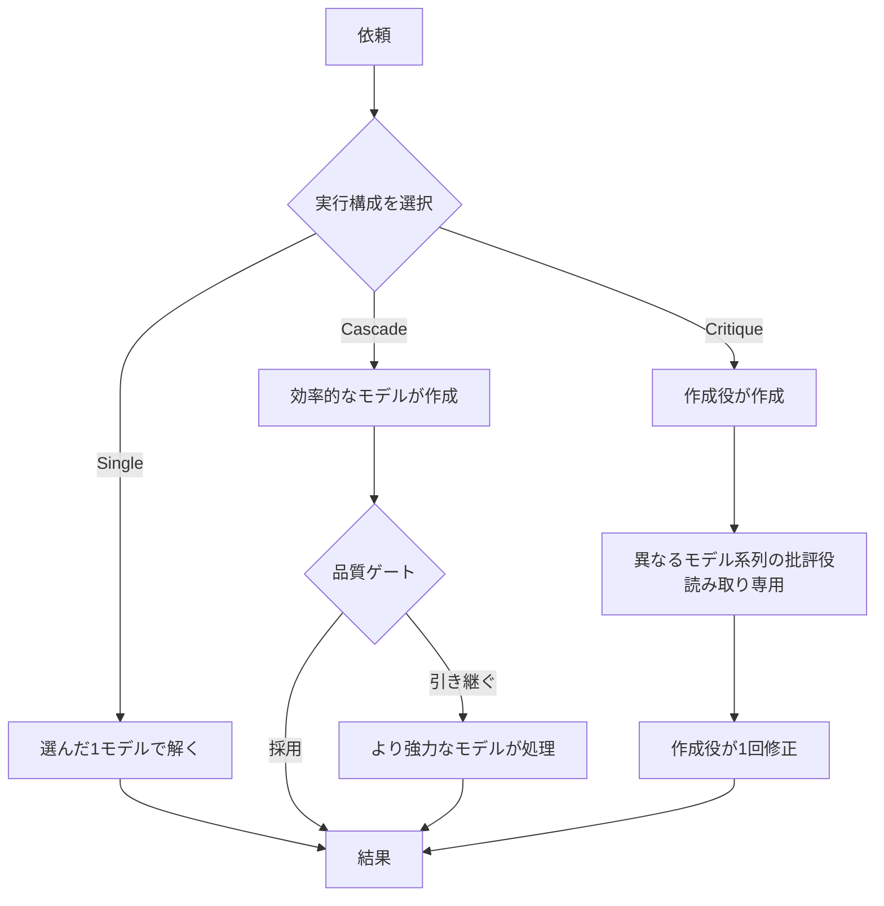
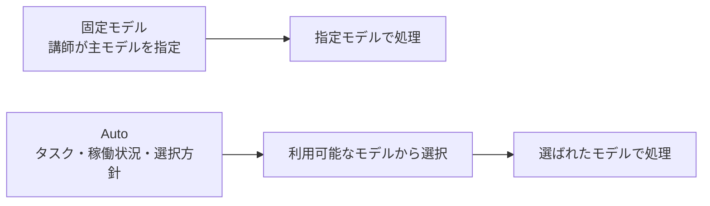

# トークンエコノミーとモデル選択

> **位置づけ: ワークショップ設計を補う解説資料**
>
> [教材一覧](../../README.md) / [共通シナリオ](../design/common-scenario.md)
>
> 題材アプリは別リポジトリで管理します。本資料のアプリ参照版は
> `shinyay/python-portal-sample-app` の `e3bb6eed8d6536270c6a96ccdbe939eb15177979` です。
> 既存設計の参照版を更新するものではありません。設計のDRAFT状態と未決事項は維持します。

この資料は、社内申請ポータルを使うワークショップの受講者・講師向けの解説です。
共通の学習の流れは[MOAW教材原稿](../../workshops/agentic-copilot/workshop.md)にまとめています。講師・受講者が同じ教材を使い、本資料も必要時の補足として参照します。
対象は**VS CodeのCopilot Chat**で、ローカルとCodespacesのVS Codeを含みます。
公開情報の確認日は**2026-10-10**です。提供条件、料金、画面の表示は変わるため、
開催前に[出典と再確認事項](#出典と開催前の再確認)を確認してください。

> **演習では、講師が指定するチャットの主モデルを明示的に選択します。**
> **AutoとHydraFusionは、仕組みを学ぶ対象であり、演習では使用しません。**
> 主モデルを固定して、モデル選択による変動を減らします。生成結果の完全な再現性は保証しません。

**2026-10-16の実施条件:** 実施時点の最新VS Code Stableを使い、InsidersとPreview／Experimental機能は使用しません。
主モデルの候補はGPT 5.6 Luna、GPT 5.6 Terra、GPT-6.1 Terraです。GPT-6.1 Terraは2026-11-07に加え、推論の度合いMax、Context Size 872Kで使います。候補の非Previewでの利用可否を確認し、一つを講師が指定する案とします。
これは[共通シナリオ](../design/common-scenario.md)の条件の更新であり、本資料の料金・全機能の公開仕様を同日に再確認したという意味ではありません。
本資料にあるPreview機能の説明や設定例を、今回の操作手順へ取り込まないでください。

本資料では「Hydra Fusion」を公式表記の「HydraFusion」で記載します。
アプリの[起動手順][app-start]と
[演習の受け入れ条件][app-exercise]は、題材アプリのREADMEを参照してください。

モデル選択以外の最適化は、[Token Economy実践ガイド](token-economy.md)で扱います。
コンテキスト、キャッシュ、指示、ツール、会話管理、計測を含めた総合的な手順です。

## 目次

- [このワークショップでの扱い](#このワークショップでの扱い)
- [トークンエコノミーの基本](#トークンエコノミーの基本)
- [トークンと料金を分けて考える](#トークンと料金を分けて考える)
- [Autoによるモデル選択](#autoによるモデル選択)
- [HydraFusionによる実行構成の選択](#hydrafusionによる実行構成の選択)
- [固定モデルとAutoとHydraFusionの比較](#固定モデルとautoとhydrafusionの比較)
- [申請ポータルでの判断例](#申請ポータルでの判断例)
- [演習前の確認と振り返り](#演習前の確認と振り返り)
- [よくある誤解](#よくある誤解)
- [出典と開催前の再確認](#出典と開催前の再確認)

## このワークショップでの扱い

学ぶことと、比較のために揃える条件を分けます。

| 学ぶこと | 演習で揃えること |
| --- | --- |
| モデルの能力・消費・時間の関係 | 講師指定の主モデルと、対応する推論設定 |
| Autoがモデル選択を担う意味 | 演習中はAutoへ切り替えない |
| HydraFusionが実行構成まで選ぶ意味 | 演習中はHydraFusionを有効化・実行しない |
| コンテキストや依頼の改善 | 初期アプリ、指示、ツール、受け入れ条件 |

AutoやHydraFusionを使わないのは、両機能が常に不安定、あるいは不適切だからではありません。
今回は、要件整理やコンテキストの渡し方を変えたときに、モデル選択まで変わって
比較しにくくなることを避けます。結果は、文章の一致ではなく、受け入れ条件の達成で評価します。

候補のうちどれを使うかは、開催前に講師が参加者の契約・組織ポリシー・非Previewでの利用可能性と演習内容を確認して指定します。すべての候補が使えることや、どれかが優れることを本資料から推定しません。
どの候補も使えない場合は実施計画へ戻し、別モデルやPreview機能へ無断で切り替えません。
同じモデルでも、会話履歴、推論設定、ツール結果、サービス側の更新などで結果は変わり得ます。
また、ここで固定するのはチャットの主モデルです。コード補完など、
VS Code内のすべてのAI機能のモデルを一括で固定するという意味ではありません。

出典：[VS Codeの言語モデルの説明][model-concepts]、
[モデルと推論設定の選択][model-settings]。

## トークンエコノミーの基本

本資料では、トークンエコノミーを**必要な品質に到達するまでのAI利用量と費用を考えること**
として扱います。安いモデルを選ぶ、回答を短くする、依頼の回数を減らすだけでは、
作業全体の消費が少なくなるとは限りません。

### 依頼文だけが入力ではない

モデルへ渡される入力には、現在の依頼文に加えて、会話履歴、カスタム指示、
関連ファイル、検索結果、ツールの出力などが含まれます。
Agentは、モデルが要求したツールを実行し、その結果を次のモデル呼び出しへ渡します。
そのため、**ユーザーの1回の依頼と、モデルの1回の呼び出しは同じ単位ではありません**。

たとえば「絞り込みを実装して」という1回の依頼でも、ファイルを探す、コードを読む、
編集する、テストする、失敗を調べて修正するという処理が続けば、入力と出力が積み重なります。
短い依頼文でも、必要な条件が曖昧なら、確認ややり直しが増える可能性があります。

| 見るもの | 意味 | 混同しないこと |
| --- | --- | --- |
| 入力トークン | その呼び出しでモデルへ渡す情報 | 自分が入力した文字数だけではない |
| 出力トークン | モデルが生成する内容 | 画面に見える最終回答の長さだけでは消費を判断できない |
| キャッシュ | 条件を満たす既存の入力を再利用する仕組み | 再利用される入力が、処理対象から消えるわけではない |
| 推論設定 | 対応モデルが推論へ割り当てる処理の設定 | 高い設定なら、すべての作業で有利とは限らない |
| コンテキストウィンドウ | 1回に扱える情報の範囲 | セッション全体の累積消費とは異なる |
| 累積消費 | 複数の呼び出し・試行で使った量の合計 | 現在のコンテキスト使用率からは求められない |

出典：[VS Codeの入力・Agent処理・コンテキストの説明][model-concepts]、
[個人向けの利用量の説明][individual-billing]。

### 単価ではなく完了までを見る

軽量モデルが短い作業を十分な品質で終えられるなら、高能力モデルを使う必要はありません。
一方、安いモデルで失敗や修正が続けば、高能力モデルで終える場合より総消費が増えることもあります。
どちらが有利かは、作業と受け入れ条件によって変わります。

比較するときは、次の軸を分けます。

| 評価軸 | 確認すること |
| --- | --- |
| 完了と品質 | 同じ受け入れ条件を満たしたか。既存機能を壊していないか |
| AI利用量 | 失敗・再試行・修正も含め、いくら消費したか |
| 所要時間 | 最初の応答の速さだけでなく、完了までにどれくらいかかったか |
| 人の作業 | 確認、修正、判断にどれくらい時間が必要だったか |

人の作業時間をAI creditsへ換算したり、未完了の作業を「安く完了した」と数えたりしません。
このアプリでの削減率や品質改善率は測定していません。
実際に比較する場合は、同じ条件で複数回確かめ、失敗した試行も記録します。
本ワークショップでは、Auto／HydraFusionを実行する比較実験は行いません。

出典：[VS CodeのAI credit利用を最適化するガイド][optimize-usage]。

## トークンと料金を分けて考える

### AI creditsとトークンは別の単位

現行の利用量ベースの課金では、モデルと消費したトークンの種類・量に応じて
コストが計算され、AI creditsへ換算されます。**1 AI creditは0.01 USD**です。
公式料金表のトークン単価は**100万トークンあたり**で、モデルによって異なります。

通常の入力、キャッシュ済み入力、キャッシュ書き込み、出力など、適用される区分を確認します。
長いコンテキストに別の料金区分があるモデルもあります。
キャッシュ書き込みの扱いはモデルによって異なるため、入力と出力だけで
すべてのモデルの実額を計算できるとは限りません。

利用量ベースの課金を理解するための概念式は、次のとおりです。

```text
モデル利用コスト（USD）
  = すべてのモデル呼び出しについて、
    適用される各トークン区分の
    （トークン数 ÷ 1,000,000 × その区分の単価）を合計

AI credits = 適用される割引などを反映したモデル利用コスト（USD）÷ 0.01
```

実際の集計では、料金表と利用量の定義に従い、同じトークンを重複計上しないでください。
たとえば、入力の総数にキャッシュ分が含まれる表示へ、キャッシュ分をもう一度足してはいけません。
推論トークンも、利用量の表示で出力に含まれているなら別途加算しません。
この式は請求処理の全仕様を示すものではなく、実額はCopilotの利用量・請求表示と照合します。

**AI creditsの消費と、追加の請求額も別です。**
契約に含まれる利用枠があり、個人向けと組織向けでは枠の持ち方や予算の扱いが異なります。
利用枠を消費しただけで、必ず同額が追加請求されるわけではありません。
組織の予算を使い切ったときに、Autoが安いモデルへ切り替えて利用を継続させる保証もありません。

出典：[GitHubのモデル別料金表][model-pricing]、
[個人向けの課金][individual-billing]、[組織・Enterprise向けの課金][organization-billing]。

### 説明用の計算例

以下は、**架空のモデルと仮定した消費量による計算例**です。
実在するモデルの料金、実測結果、見積もり、品質の優劣を示すものではありません。
同じ受け入れ条件を満たす変更を1件作る場合を考えます。

計算を単純にするため、1試行を1回のモデル呼び出しとし、毎回の入力を20,000トークン、
出力を2,000トークンと仮定します。キャッシュ、割引、追加の料金区分はない例です。
実際のAgent処理では、この呼び出し数や消費量は一定ではありません。

| 架空のモデル | 入力単価／100万トークン | 出力単価／100万トークン | 1試行のコスト | 1試行のAI credits |
| --- | --- | --- | --- | --- |
| A：軽量モデル | 1 USD | 4 USD | 0.020 + 0.008 = 0.028 USD | 2.8 |
| B：高能力モデル | 3 USD | 12 USD | 0.060 + 0.024 = 0.084 USD | 8.4 |

| 仮定した完了までの経過 | 合計コスト | 合計AI credits |
| --- | --- | --- |
| Aが1試行で完了 | 0.028 USD | 2.8 |
| Aが4試行で完了 | 0.028 × 4 = 0.112 USD | 11.2 |
| Bが1試行で完了 | 0.084 USD | 8.4 |

Aが1回で終わるならAが低コストです。しかし、Aで4回の試行が必要なら、
Bで1回で終える場合より消費が大きくなります。
「高能力モデルを使えば1回で終わる」という予測ではなく、
**単価と、完了までに必要な処理量の両方が必要**だと理解するための例です。
人の確認時間とCodespaces自体の費用は、この計算に含めていません。

### 旧来のプレミアムリクエストとの違い

GitHubは2026-06-01に利用量ベースの課金へ移行しましたが、
既存の年間Copilot Pro／Pro+契約には、従来のプレミアムリクエスト課金に残る例外があります。
旧方式のモデル倍率は利用量ベースの課金には適用しません。
また、旧方式に残る年間契約では、新しいモデルや機能へのアクセスに制約があります。

「1回の依頼 × 倍率」という旧方式の説明と、トークン種別に基づくAI creditsの計算を
混ぜないでください。古い教材や画面に倍率が見えても、全員へ同じ方式を当てはめず、
自分の契約と最新の利用量表示を確認します。
外部プロバイダーのAPI価格も、Copilotの価格としてそのまま転用しません。

出典：[年間契約向けの旧モデル倍率][legacy-multipliers]、[GitHubのモデル別料金表][model-pricing]。

## Autoによるモデル選択

### 何を任せる機能か

Autoは、ユーザーがモデル名を選ぶ代わりに、Copilotへモデル選択を任せる機能です。
現行のVS Code向け説明では、タスクの複雑さに加え、モデルの稼働状況と利用可能性を考慮します。
日常の作業で、その都度モデルを選び直す負担を減らすための選択肢です。

Autoは、契約や組織ポリシーの制約を無視してモデルを選ぶものではありません。
候補となるモデルは変わり得るため、「この依頼なら必ずモデルXになる」とは指定できません。
また、Autoはモデルの選択を指し、編集やツール実行を無条件で承認する設定ではありません。

GitHub Docsでは、不要なキャッシュ関連コストを避けるため、
自然なキャッシュ境界や会話の複雑さの大きな変化を考慮してルーティングすると説明しています。
「会話中ずっと同じモデル」とも、
「すべての内部呼び出しで無条件に別モデルへ切り替わる」とも捉えないでください。

出典：[Autoの公式説明][auto]。

### 3つのtierは優先度の違い

VS Codeでは、Autoの`Optimize for`で選択方針を指定できます。
各tierはモデルを固定する設定ではありません。

| tier | 優先すること | 読み違えないこと |
| --- | --- | --- |
| Efficiency | コスト | 常に最安のモデルだけを使うという意味ではない |
| Balance | コスト、品質、応答時間のバランス | 消費額や応答時間が一定になるという意味ではない |
| Intelligence | 品質 | 単純な依頼でも常に最大のモデルを使うという意味ではない |

3つのtierで利用可能なモデル集合は同じで、変わるのは選択の優先度です。
たとえば、Intelligenceでも単純な依頼に小さなモデルを使う可能性があります。
組織で初期tierを指定できる場合もありますが、
本ワークショップではAutoそのものを使用しません。

出典：[Autoのtierの説明][auto]、[tier追加の告知][auto-tiers]、
[VS CodeのAuto設定][model-settings]。

### コストと結果の見方

確認日時点では、有料CopilotプランでAutoを使うと、モデルコストに10%の割引が適用されます。
**トークン数が10%減るという意味ではありません。**
選ばれたモデルと消費量が変われば、割引があっても、任意の固定モデルより安いとは限りません。
旧来の年間契約では、10%割引をモデル倍率へ適用する説明が別にあります。

利用できる環境では、VS Codeの応答にポインターを重ねると、
使用モデルやそのターンの消費を確認できます。
Autoを評価するなら、選んだtierだけでなく、実際のモデル、完了状況、
累積消費、時間、やり直しを確認する必要があります。
これは機能の読み方の説明であり、演習中にAutoを起動する手順ではありません。

出典：[Autoの割引と使用モデルの確認][auto]、
[旧課金方式での割引][legacy-multipliers]、[VS Codeの利用量確認][optimize-usage]。

## HydraFusionによる実行構成の選択

### 単一の基盤モデルではない

HydraFusionはモデルピッカーに表示されますが、新しい単一モデルの名前として
捉えると、コストや動作を誤解します。公開情報では、依頼に応じてモデルと
実行パターンを選び、必要に応じて複数モデルを組み合わせる仕組みです。

Autoとの中心的な違いは、**処理するモデルだけでなく、どう解くかという実行構成も選ぶこと**
にあります。「最初から全モデルを並列に動かして多数決する」仕組みではありません。
必要な品質に届くと見込む、なるべく単純な構成を選ぶという研究上の方針が説明されています。
常に最小コストになるという保証ではありません。

出典：[VS Code向けHydraFusionの告知][hydra-announcement]、
[Project HydraFusionの研究説明][hydra-research]。

### 3つの実行パターン

| パターン | 処理の流れ | トークンエコノミーの観点 |
| --- | --- | --- |
| Single | 選んだ1モデルで直接解く | 複数モデル連携の追加処理が不要な場合の構成 |
| Cascade | 効率的なモデルが作成し、品質ゲートが採用または強いモデルへの引き継ぎを判断する | 最初の試みで済む可能性と、引き継ぎまで含めた消費の両方を見る |
| Critique | 作成役が作成し、別のモデル系列の読み取り専用の批評役が確認した後、作成役が1回修正する | 別の視点を加える利点と、批評・修正に必要な追加処理を比較する |

Cascadeの品質ゲートは、このアプリの受け入れ試験に合格したという保証ではありません。
Critiqueの批評役はコードを書き換える役ではなく、修正は作成役が行います。
Singleも含むので、「HydraFusionなら必ず複数モデルを呼ぶ」とは言えません。
各パターン内で必要になるツール処理やモデル呼び出しの数も、
ユーザーの依頼回数だけからは決まりません。



通常の処理経路を示す概念図です。内部の判定基準や、再試行・キャンセルの全経路を
表すものではありません。表と図の根拠は[公開告知][hydra-announcement]と[研究説明][hydra-research]です。

### 追加の処理を含めて評価する

複数モデルを組み合わせても、常にトークンや費用が減るわけではありません。
最初の作成、批評、修正、より強いモデルへの引き継ぎが発生すれば、
それらの入力・出力も評価に含める必要があります。
異なるモデル間で同じキャッシュが使えると、無条件に仮定してはいけません。

公開ブログは、下書き、批評、修正、引き継ぎ、再試行、フォールバックを含む
すべての処理段階のコストを集計する設計方針を説明しています。
ただし、これは**実行コストの評価方針**であり、
HydraFusion固有の利用者向け請求仕様の全容を示したものではありません。
固定の利用倍率や、各段階の厳密な請求内訳は、今回確認できた公開資料だけでは確定できません。
公開資料で確認できない判定の閾値、固定のモデル構成、料金を推測して表へ埋めないでください。

「複数モデルだから高い」「賢く組み合わせるから必ず安い」のどちらでもなく、
**同じ受け入れ条件までに必要だった総処理量**で評価します。

出典：[Project HydraFusionの設計原則とコスト集計][hydra-research]。

### 研究プレビューとベンチマークの読み方

2026-09-30の告知では、VS Code 1.140以降またはInsidersでの研究プレビューが案内されています。
告知時の対象プランはPro、Pro+、Business、Enterpriseで、
Business／Enterpriseでは管理者によるプレビュー機能の許可が必要とされています。
これは告知時点の条件であり、最新の提供範囲は再確認が必要です。

同告知には`chat.copilot.hydraFusion.enabled`という有効化設定も記載されています。
**この演習のために有効化する必要はありません。**
HydraFusionを使わないため、その提供条件を演習全体の必須バージョンに読み替えたり、
Dev Containerへ設定を追加したりしません。

研究ブログの結果を読むときは、少なくとも次の条件を確認します。

| 条件 | 確認する理由 |
| --- | --- |
| ベンチマークとその版 | 課題の種類が、このワークショップと同じとは限らない |
| 比較対象のモデルと推論設定 | 異なる基準の結果を並べないため |
| ワークフローとモデル集合 | 調整済みの特定構成の結果を、すべての実行へ一般化しないため |
| 品質の定義 | 「正答が確認できた課題の割合」と、文章の印象を区別するため |
| コストの範囲と料金の仮定 | 最後のモデルだけでなく、全処理段階を含むか確認するため |
| 評価環境と実利用の違い | オフライン評価の推定コストを、実際の請求額と混同しないため |

公開ブログの数値を、このアプリの削減率や研修効果として紹介することはできません。
この題材アプリで比較実験はしていません。
研究プレビューではモデル、ワークフロー、結果、提供条件などが変わり得るため、
将来も同じ振る舞いになるとは扱わないでください。

出典：[VS Code向けの提供告知][hydra-announcement]、
[ベンチマークの条件と研究上の留保][hydra-research]。

## 固定モデルとAutoとHydraFusionの比較

| 観点 | 固定モデル | Auto | HydraFusion |
| --- | --- | --- | --- |
| 主な選択 | 人が主モデルを指定 | Copilotが処理するモデルを選択 | モデルに加えて実行構成も選択 |
| 実行の捉え方 | 指定した主モデルで進める | 選ばれたモデルで進める | Single／Cascade／Critiqueを使い分ける |
| 消費を見る単位 | 完了までの全呼び出し・試行 | 選択されたモデルと完了までの処理 | 作成・批評・修正・引き継ぎなど全処理 |
| 選択に関する利点 | 主モデルの選択を自分で管理できる | 都度のモデル選択を任せられる | モデル間の役割分担や引き継ぎの組み立てを任せられる |
| 残る変動要因 | 生成の非決定性、文脈、推論、ツール、更新など | 生成・文脈などに加え、モデルの選択 | 生成・文脈などに加え、モデルと実行構成の選択 |
| 今回の演習 | 講師指定の主モデルを使用 | 解説のみ。使用しない | 解説のみ。有効化・実行しない |

固定モデルであっても、Agentの処理が1回のモデル呼び出しで終わるとは限りません。
この表は主モデルと実行方式の比較であり、
内部の補助処理や他のAI機能まで、すべて同じモデルになるという意味ではありません。



モデル選択の責任の違いを示す概念図です。内部呼び出しの回数や処理時間を示していません。
製品上の違いは[Autoの公式説明][auto]と[HydraFusionの告知][hydra-announcement]、
生成結果の変動は[VS Codeの言語モデルの説明][model-concepts]に基づきます。
演習での使い分けは、このワークショップの方針です。

## 申請ポータルでの判断例

次の例は、モデル選択を考える練習です。
Autoの選択先やHydraFusionの実行パターンを予測するものではありません。
**実際の演習では、どの工程でも講師指定の主モデルを使います。**

| 工程 | このアプリで考えること | コストだけで判断しない理由 |
| --- | --- | --- |
| 既存アプリの理解 | 変更対象と対応するテストを絞れるか | 短い説明でも重要な経路を見落とすと、後の読み直しが必要になる |
| 要件整理 | 部署と状態はAND条件か。不正値や該当なしをどう扱うか | 曖昧な条件のまま実装すると、生成が速くても手戻りが発生する |
| 実装 | UIとJSON APIで同じ条件・結果にできるか | 一部の画面だけ動く変更を、完了とは数えられない |
| 回帰確認 | 詳細、作成、状態変更、入力検証を維持できるか | 新機能の成功だけでは、既存動作を壊していないと判断できない |
| レビュー | 差分と確認結果から、見落としを説明できるか | 「問題なし」という短い回答自体は、品質の証拠にならない |

小さな文言の変更と、UI・API・SQL・テストをまたぐ変更では、求める判断の重さが違います。
日常業務でモデルを選ぶときは、軽量モデルで十分か、より強い推論が必要か、
別の視点での確認が役立つかを、こうした条件から考えます。
「この工程には必ずこのモデル」という固定の対応表にはしません。

演習ではモデルを変える代わりに、依頼の条件と渡すコンテキストを改善します。
たとえば、最初に対象と確認事項を整理し、条件を確定してから実装へ進みます。
不要な依存やキャッシュの全文を渡さず、該当ファイルとテスト結果を使って確認します。
詳細は[題材アプリのREADMEのコンテキストの渡し方][app-context]を参照してください。
講師用の完成例パッチは解答確認用であり、実装中の材料には使いません。

## 演習前の確認と振り返り

### 開始前に揃える条件

1. 講師が、参加者の環境で利用できる主モデルを事前に確認して指定します。
2. 参加者は、VS Codeのチャット入力欄のモデルピッカーでそのモデル名を選択します。
   Auto／HydraFusionではないことを確認します。
3. 対応モデルでは、モデルを選ぶ画面で推論の度合い（VS Code 1.145の表示は`Effort Level`）とContext Sizeを、
   講師指定の設定に揃えます。表示されない設定は「該当なし」と記録します。
4. 初期アプリ、作業の開始状態、指示、会話の開始条件、利用ツールと承認設定を揃えます。
   VS CodeとCopilot拡張のバージョンも記録します。
5. 利用できる枠や予算を確認し、途中で指定モデルが使えなくなった場合の対応を講師と確認します。
   自己判断でAuto／HydraFusionへ切り替えません。

同じ推論設定でも、内部の推論量や出力が完全に固定されるわけではありません。
Codespacesを使う場合も、コンテナーのPython環境が同じことと、
Copilotのモデル・利用権限・組織ポリシーが同じことは別です。

出典：[VS Codeのモデルと推論設定][model-settings]、
[モデルの非決定性と推論][model-concepts]。

### 指定モデルが表示されない場合

**「手動で指定モデルを選べること」は、今回の演習の事前条件です。**
確認日時点の個人向け公式説明では、Copilot Free／StudentはAutoのみのモデル選択とされています。
その状態では、この固定モデル方針どおりには参加できません。
参加前に主催者へ利用条件を確認してください。資料のために契約の購入・変更を求めるものではありません。

有料プランでも、組織ポリシー、提供状況、VS Codeの状態などによって表示は異なります。
VS CodeのRestricted Modeでは、モデルピッカーにAutoだけが表示されるという制約もあります。
表示を増やすために、内容や安全性を確認せずワークスペースを信頼する設定へ変更しないでください。
理由を確認できない場合は講師へ相談し、参加方法を決めてから始めます。

出典：[個人プランのモデル選択条件][individual-billing]、
[VS CodeのRestricted Modeとモデル表示][model-settings]、
[Autoに適用されるポリシー][auto]。

### 観察できる量を記録する

VS Codeでは、対応するバージョン・課金方式で次の表示を利用できます。
旧バージョンには利用量や料金の表示が古い場合があるため、実際の画面と契約も確認してください。

| 確認したいこと | 公式ガイドで案内されている場所 |
| --- | --- |
| 1ターンの消費 | チャット応答にポインターを重ねた表示 |
| セッションの累積コストやトークンの内訳 | チャット入力欄のコンテキスト表示を選択、またはポインターを重ねた表示 |
| 月間の利用状況 | ステータスバーから開くCopilotのダッシュボード |
| 詳細なトークン、ツール、エラー、時間 | 必要に応じてAgent Debug Logs |
| キャッシュの利用状況 | 必要に応じてCache Explorer |

月間の消費率は他の作業も含み得るため、単独の演習の消費量と同一視しません。
コンテキストの使用率だけを「今回使ったトークンの総数」として記録するのも避けます。
表示を確認していない値は、ゼロや推定値で埋めず「未取得」とします。

演習の振り返りには、たとえば次の項目を使えます。空欄は実績ではありません。

| 記録項目 | 記入する内容 |
| --- | --- |
| 開始条件 | 開始時のコミット、初期アプリ、会話の開始条件、指示・ツールの範囲 |
| モデルと環境 | 主モデル、推論設定、VS Code／拡張のバージョン |
| 課金方式 | AI credits、または該当する旧課金方式。利用量の単位も記載 |
| 観測した利用量 | 画面に表示された累積消費と、どの範囲を記録したか |
| トークン内訳 | 確認できた区分と値。確認できない区分は「未取得」 |
| 作業の経過 | 所要時間、試行・修正の回数、失敗した処理 |
| 完了と品質 | 満たした受け入れ条件、未完了の条件、回帰確認の結果 |
| 人の判断 | 人が直した箇所、追加で確認した内容 |

ログには入力やコードなどが含まれる場合があるため、全文の共有や外部へのアップロードを
演習の必須作業にしません。必要な指標だけを扱います。
この資料はアプリへ計測器や外部送信機能を追加せず、Auto／HydraFusionの比較実行も要求しません。

出典：[VS Codeの利用量・キャッシュの確認][optimize-usage]、
[旧バージョンの表示に関する注意][individual-billing]。

## よくある誤解

| 誤解 | この資料での整理 |
| --- | --- |
| Autoは常に最安モデルを使う | タスク、稼働状況、選択方針などを考慮する。最安モデルへの固定ではない |
| Autoの10%割引でトークンも10%減る | コストまたは旧方式の倍率への割引であり、トークン削減率ではない |
| Intelligenceなら常に最大モデル | 各tierのモデル集合は同じで、単純な依頼に小さなモデルを使うこともある |
| HydraFusionは複数モデルの同時実行だけ | Singleもあり、CascadeとCritiqueは異なる役割・流れを持つ |
| HydraFusionの品質ゲートが通ればテスト不要 | このアプリの受け入れ条件・回帰確認の代わりにはならない |
| 短い回答なら必ず低コスト | 入力、推論、ツールとの往復、失敗や修正まで含めて考える |
| 固定モデルなら毎回同じ結果 | 生成の非決定性と、モデル選択による変動は別の問題 |
| 研究ベンチマークの結果がそのまま研修効果 | 対象課題、設定、料金の仮定が異なる。このアプリでは未測定 |

製品仕様の根拠は[Auto][auto]、[HydraFusion][hydra-announcement]、
[研究説明][hydra-research]、[モデルの基本][model-concepts]です。
受け入れ条件を重視し両機能を実習で使わない点は、このワークショップの運用方針です。

## 出典と開催前の再確認

以下はいずれも**2026-10-10に本文を確認した公開一次情報**です。
GitHub DocsとVS Codeのドキュメントは更新されるため、確認日と公開告知の日付を区別してください。
モデルの候補、料金表、割引、利用可能なプランを恒久的な仕様として扱わないでください。

| 出典 | この資料で参照した内容 |
| --- | --- |
| [GitHub Docs：Auto model selection][auto] | 選択の仕組み、tier、ポリシー、割引 |
| [GitHub Changelog：Autoのtier追加（2026-09-14）][auto-tiers] | Efficiency／Balance／Intelligenceの違い |
| [GitHub Changelog：HydraFusionの提供拡大（2026-09-30）][hydra-announcement] | VS Codeの提供条件、3パターン、研究プレビュー |
| [GitHub Blog：Project HydraFusion][hydra-research] | 実行構成、コスト集計、評価条件と留保 |
| [GitHub Docs：Models and pricing][model-pricing] | トークン別単価、AI credits、キャッシュ、旧方式の例外 |
| [GitHub Docs：個人向けの利用量ベース課金][individual-billing] | 利用枠、課金方式、Free／Studentのモデル選択条件 |
| [GitHub Docs：組織・Enterprise向けの課金][organization-billing] | 利用枠と予算、利用停止の条件 |
| [GitHub Docs：年間契約向けの旧モデル倍率][legacy-multipliers] | 旧方式の対象、倍率と割引、提供機能の制約 |
| [VS Code：AI language models][model-settings] | モデルピッカー、推論設定、Restricted Mode |
| [VS Code：Understand language models][model-concepts] | 入力、コンテキスト、非決定性、推論 |
| [VS Code：Optimize AI credit usage][optimize-usage] | 完了までの消費で比較する考え方、利用量の確認 |

**確認できなかった範囲：** 公開告知からリンクされている
<https://docs.github.com/early-access/copilot/hydrafusion> は、今回の取得ではHTTP 404でした。
HydraFusion固有の厳密な課金内訳などを、そのページで確認したとは扱っていません。
これは「どこにも公開されていない」という意味ではありません。
本資料のVS Code／Codespacesの操作説明は公式ドキュメントに基づき、
参加者の実画面での動作確認や、各モデルでの比較実行を行った記録ではありません。

開催前に講師が、指定モデルの利用可能性、参加者の課金方式・予算、
VS Code／拡張の表示、Auto／HydraFusionの提供条件と公式資料の更新を確認してください。
モデルが利用できなくなった場合は、講師が代替の固定モデルを確認・指定してから再開します。
参加者任せの自動切り替えや、未確認のままの続行はしません。

[auto]: https://docs.github.com/en/copilot/concepts/models/auto-model-selection
[auto-tiers]: https://github.blog/changelog/2026-09-14-configure-cost-and-quality-in-copilot-auto-model-selection/
[hydra-announcement]: https://github.blog/changelog/2026-09-30-hydrafusion-in-vs-code-and-the-github-copilot-app/
[hydra-research]: https://github.blog/ai-and-ml/github-copilot/project-hydrafusion-frontier-quality-via-multi-model-orchestration/
[model-pricing]: https://docs.github.com/en/copilot/reference/copilot-billing/models-and-pricing
[individual-billing]: https://docs.github.com/en/copilot/concepts/billing-and-usage/individuals/billing
[organization-billing]: https://docs.github.com/en/copilot/concepts/billing-and-usage/organizations-and-enterprises/billing
[legacy-multipliers]: https://docs.github.com/en/copilot/reference/copilot-billing/request-based-billing-legacy/model-multipliers-for-annual-plans
[model-settings]: https://code.visualstudio.com/docs/agent-customization/language-models
[model-concepts]: https://code.visualstudio.com/docs/agents/concepts/language-models
[optimize-usage]: https://code.visualstudio.com/docs/agents/guides/optimize-usage

[app-start]: https://github.com/shinyay/python-portal-sample-app/blob/e3bb6eed8d6536270c6a96ccdbe939eb15177979/README.md#インストールと起動
[app-exercise]: https://github.com/shinyay/python-portal-sample-app/blob/e3bb6eed8d6536270c6a96ccdbe939eb15177979/README.md#演習の開始点
[app-context]: https://github.com/shinyay/python-portal-sample-app/blob/e3bb6eed8d6536270c6a96ccdbe939eb15177979/README.md#copilotへのコンテキストの渡し方
