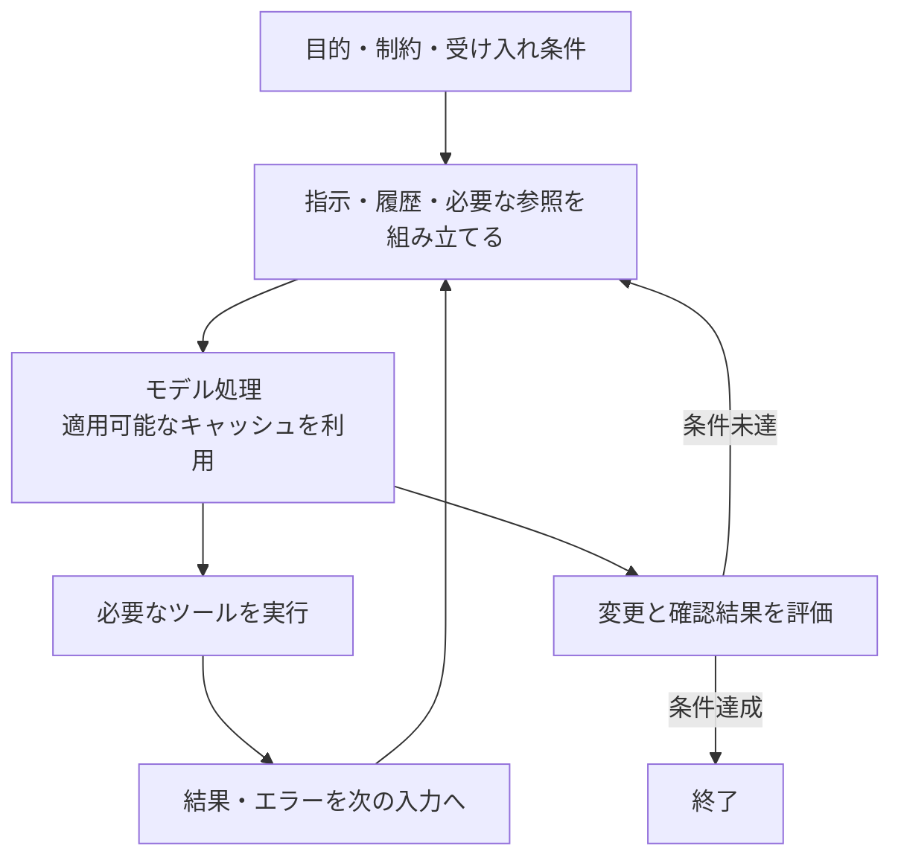
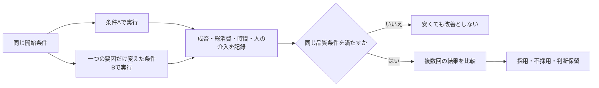

# GitHub CopilotのToken Economy実践ガイド

> **位置づけ: ワークショップ設計を補う解説資料**
>
> [教材一覧](../../README.md) / [共通シナリオ](../design/common-scenario.md)
>
> 題材アプリは別リポジトリで管理します。本資料のアプリ参照版は
> `shinyay/python-portal-sample-app` の `e3bb6eed8d6536270c6a96ccdbe939eb15177979` です。
> 既存設計の参照版を更新するものではありません。設計のDRAFT状態と未決事項は維持します。
> アプリのファイル・コマンド・依頼例は題材アプリの作業環境を対象とし、教材リポジトリでは実行しません。

**必要な品質を保ちながら、作業が完了するまでの総消費を減らす**ための解説です。
共通の学習の流れは[MOAW教材原稿](../../workshops/agentic-copilot/workshop.md)にまとめています。講師・受講者が同じ教材を使い、本資料も必要時の補足として参照します。
対象はGitHub Copilotを使うVS Codeで、ローカルとCodespacesを含みます。
モデル選択だけでなく、入力、検索、指示、会話、キャッシュ、推論、ツール、
サブエージェント、検証、計測、予算管理までを扱います。

公開一次情報の確認日は**2026-10-10**です。
本資料は公開仕様と、この研修用アプリへの適用を考察したものです。
各対策による削減率をこのアプリで測定した報告ではなく、料金や生成品質の保証でもありません。
計算例と依頼例は教材用です。参加者の実環境で機能を操作した記録とは区別してください。

> **演習では講師指定の主モデルを固定し、AutoとHydraFusionは使用しません。**
> モデルと推論設定を勝手に変えず、まず依頼・コンテキスト・作業の進め方を改善します。
> モデルを固定しても生成結果は非決定的です。受け入れ条件と回帰確認で評価します。

**2026-10-16の実施条件:** 個人演習で、実施時点の最新VS Code Stableを使います。InsidersとPreview／Experimental機能は使用しません。
GPT 5.6 Luna、GPT 5.6 Terra、GPT-6.1 Terraの候補から、参加者が非Previewとして利用できる一つを講師が指定する案です。GPT-6.1 Terraは2026-11-07に加え、推論の度合いMax、Context Size 872Kで使います。参加者の環境での利用可否は未確認です。
本編は品質・時間・人の介入を記録し、AI利用量は非Previewの標準表示で取得できる範囲だけを評価します。
以下には演習範囲外の一般的な手法もあります。Previewの診断・管理機能や実験的な設定を今回の操作・復旧手順へ取り込まず、具体的な進行は[共通シナリオ](../design/common-scenario.md)を正本にします。
この条件追記は、本資料の全公開仕様・料金を同日に再確認したことを意味しません。

[モデル選択・Auto・HydraFusionの詳しい解説](model-selection.md)と、
[題材アプリの演習要件][app-exercise]を併せて参照してください。
この長いガイド自体を、毎回のプロンプトや常時適用の指示へ全文コピーする必要はありません。
必要な節を選んで使う、人向けの参照資料です。

## 目次

- [判断の軸と適用範囲](#判断の軸と適用範囲)
- [最適化の全体像](#最適化の全体像)
- [必要なコンテキストを段階的に渡す](#必要なコンテキストを段階的に渡す)
- [検索と除外を使い分ける](#検索と除外を使い分ける)
- [依頼と出力の条件を明確にする](#依頼と出力の条件を明確にする)
- [指示と再利用の仕組みを整理する](#指示と再利用の仕組みを整理する)
- [会話を続けるか分けるかを判断する](#会話を続けるか分けるかを判断する)
- [キャッシュを保ちながら不要な履歴を減らす](#キャッシュを保ちながら不要な履歴を減らす)
- [モデルと推論設定を作業に合わせる](#モデルと推論設定を作業に合わせる)
- [ツールとターミナルの往復を減らす](#ツールとターミナルの往復を減らす)
- [サブエージェントの効果と追加消費を見極める](#サブエージェントの効果と追加消費を見極める)
- [計画と検証で手戻りを防ぐ](#計画と検証で手戻りを防ぐ)
- [利用量を正しく観察する](#利用量を正しく観察する)
- [比較実験を設計する](#比較実験を設計する)
- [申請ポータルで使う依頼例](#申請ポータルで使う依頼例)
- [予算と安全性を最適化と混同しない](#予算と安全性を最適化と混同しない)
- [症状から対策を選ぶ](#症状から対策を選ぶ)
- [調査から得られる判断指針](#調査から得られる判断指針)
- [出典と更新時の確認事項](#出典と更新時の確認事項)

## 判断の軸と適用範囲

### 小さくする対象を分ける

Token Economyは、この資料ではAI利用の効率を考える言葉です。
文字数、トークン数、AI credits、追加請求額、所要時間は同じものではありません。
次のどれを改善したいか、先に決めます。

トークンは、モデルが文章などを扱う単位です。1文字や1語と常に一致するわけではなく、
同じ文章でもモデルによって数え方が異なります。

| 対象 | 意味 | 単独では判断できないこと |
| --- | --- | --- |
| 入力トークン | モデルへ渡す指示、履歴、ファイル、ツール結果など | 少なくても重要な条件が欠ければ失敗が増える |
| 出力・推論 | モデルが生成する内容や推論に使う処理 | 最終回答が短くても内部の処理量は分からない |
| コンテキストウィンドウ | 1回の処理で扱える情報の範囲 | 現在の占有量は、過去の処理を含めた累積消費ではない |
| モデル呼び出し | Agentの処理中に行われるモデルとの往復 | ユーザーの送信回数とは一致しない |
| AI credits | モデル・トークン種別・消費量に基づく利用量 | コンテキスト使用率や文字数からは計算できない |
| 追加請求 | 契約に含まれる枠を超えた利用など | AI creditsの消費額と必ず同額ではない |
| 完了までの時間 | 調査、生成、実行、確認、修正にかかる時間 | 並列化で短くなっても総消費が減るとは限らない |
| 人の作業 | レビュー、修正、判断の負担 | AI creditsへ自動換算しない |

利用量ベースの料金表では、入力、キャッシュ済み入力、対応モデルのキャッシュ書き込み、
出力などを区別します。単価の基本単位は100万トークンで、1 AI creditは0.01 USDです。
推論トークンが出力に含まれる表示では、それを別に足して二重計上しないでください。
個人向けの旧年間契約にはプレミアムリクエスト方式が残る例外もあるため、
契約方式の異なる数値を一つの比較表へ混ぜません。

課金の詳しい区分と計算例は[モデル選択資料](model-selection.md#トークンと料金を分けて考える)にあります。
この資料の「コスト」は、特記しない限りCopilotのモデル利用を指します。
Codespacesの計算資源、外部サービス、BYOK（自分のAPIキーで使うモデル）の料金を
含めた総請求額ではありません。

出典：[モデル別料金表][pricing]、[個人向け課金][individual]、
[VS Codeの最適化ガイド][optimize]。

### VS Codeでも実行基盤を確認する

同じVS Code内でも、セッションの実行基盤である**ハーネス**によって、
指示の読み込み、ツール選択、Plan、サブエージェントの設定が異なります。
本資料では、特に**CopilotのAgent Hostセッション**と**Localセッション**を区別します。
「Local」はセッション種別の名称で、ローカル端末とCodespacesの区別とは別です。
使用モデルだけでなく、Session Target、VS Code、Copilot拡張の情報も記録してください。

| 範囲 | この資料での扱い |
| --- | --- |
| Copilot Chatでの依頼・関連情報の選択 | 基本的な実践として扱う |
| 特定ハーネスやPreviewの設定 | 一般解説として適用条件を示す。Preview／Experimental機能は今回の演習では使用しない |
| CLI専用のコマンドやSDKの実行上限 | VS Codeの操作として転記しない |
| Auto／HydraFusion | 別資料で解説。演習では使わない |
| 設定・指示・スキルの例 | 説明用。本リポジトリへ自動適用しない |
| 利用量やログ | 必要な値を確認する方法を説明。収集や外部送信は実装しない |

出典：[指示の対応範囲][instructions]、[ツール選択][tools]、
[Planの違い][planning]。

## 最適化の全体像

1回の依頼を処理する間にも、モデルとツールの往復が発生します。
ユーザーの依頼文だけを短くするのではなく、どこに不要な処理があるかを探します。



Agentの処理を説明する概念図です。すべての依頼がこの回数や順序になるという意味ではありません。
図の根拠は[コンテキストの組み立て][context]と[ツールの役割][tools]です。

最初からすべてを調整せず、次の順序で取り組みます。

| 優先 | 対策 | 最初に見る証拠 |
| --- | --- | --- |
| A | 目的・対象・終了条件を明確にする | 要件の聞き直し、無関係な編集、同じ失敗の反復 |
| B | 必要なファイル・検索範囲・指示に絞る | 無関係な検索結果、大量の添付、繰り返すファイル読取り |
| C | 履歴・ツール・設定を整理する | 長い入力、不要なツール、説明の繰り返し |
| D | キャッシュと推論設定を確認する | 再利用率だけでなく入力内訳、消費、時間、品質 |
| E | 委譲や再利用を導入する | 分離で得られる利点が、起動・引き継ぎ・統合の負担を上回るか |

これは本資料の実践上の優先順位です。削減率のランキングではありません。
実際のボトルネックが分かっているなら、その箇所から改善します。

## 必要なコンテキストを段階的に渡す

### 関連情報を増やすことと全文を渡すことは違う

VS Codeは、ユーザーの依頼、履歴、カスタム指示、明示的な参照、編集状況、
ツール結果などからモデルへの入力を組み立てます。
ワークスペースの意味検索用インデックスは関連箇所を探すためのもので、
リポジトリ全体が毎回そのまま入力になるわけではありません。

既に対象を知っているなら、ファイルやシンボル、エラー、受け入れ条件を示します。
分からないなら、探してから必要な箇所を読むよう依頼します。
「関連ファイルを全部先に特定しないと使えない」と考える必要はありません。

| 状況 | 渡す情報 | 避けたい渡し方 |
| --- | --- | --- |
| 対象が分かる | 該当ファイル、関数名、期待動作、対応するテスト | リポジトリ全体を貼り付ける |
| 対象が不明 | 問題の現象、入口、既知の制約 | 根拠なく一つのファイルへ限定する |
| エラー調査 | 実行コマンド、終了状態、該当エラーと前後の文脈 | 成功ログを含む全履歴を繰り返し送る |
| 外部仕様が必要 | 対象バージョンと公式資料の該当箇所 | 古い仕様と新しい仕様を区別せず添付する |
| 見た目の不具合 | 必要な画面と再現条件 | テキストで十分なエラーまで大きな画像だけで渡す |

選択範囲、ファイル参照、`#`メニュー、**Add Context**を用途に応じて使います。
添付しただけで、その内容が必ず正しく理解されたことにはなりません。
重要な条件が回答や実装に反映されたかを確認します。

### 暗黙のコンテキストを過信しない

現在のVS Codeの説明では、Askはアクティブなファイルの内容を使い、
Agentはアクティブなファイルを添付候補として提示するという違いがあります。
「開いたタブの全内容が、どの機能でも必ず全部送られる」とは書けません。
必要な情報は明示し、実際の入力を確認したい場合はChat Debug Viewを使います。

このアプリでは、[AGENTS.md][app-agents]の地図から始め、
[READMEの受け入れ条件][app-exercise]、
該当実装、対応テストへと順に範囲を広げる方法が適しています。
これは必要な経路を省くという意味ではありません。UIを変えるならAPIとの共通処理など、
要件に関係する範囲まで追います。

出典：[コンテキストの組み立て][context]、[ワークスペースの理解][workspace]、
[Chat Debug View][debug]。

## 検索と除外を使い分ける

### 検索方法を目的に合わせる

| 探したいもの | 手段の候補 | 次の確認 |
| --- | --- | --- |
| 概念に対応するコード | 意味検索。必要なら`#codebase`を明示 | 返された箇所が今回の処理経路か |
| 正確なエラーや識別子 | テキスト検索・grep | 類似文字列ではなく、実際に呼ばれる箇所か |
| ファイル名が分かるもの | ファイル名・globによる検索 | 必要なファイルだけを読む |
| 関数の参照や実装の関係 | Usagesなどの言語機能 | 定義、利用箇所、テストの関係 |
| 個数や全件の判定 | 適切な決定的コマンドやテスト | 検索の抜粋だけで全件と扱っていないか |

検索結果の抜粋もコンテキストになります。
無関係な生成物が大量にヒットするなら、検索範囲を絞る意味があります。
一方、結果が0件でも「実装が存在しない」と即断せず、
検索語、除外条件、インデックスの状態、別の処理経路を確認してください。
意味検索が使えなくても、他の検索や言語機能で調査できる場合があります。

### 除外設定は用途が異なる

| 設定 | 主な役割 | 注意点 |
| --- | --- | --- |
| `.gitignore` | 意味検索のインデックスやテキスト検索・grepの対象から除外 | 開いているファイルや選択範囲などの例外がある |
| `files.exclude` | Explorerから隠し、検索やインデックスからも除外 | 人がファイルを見つけにくくなる影響もある |
| `search.exclude` | テキスト検索・grepから除外し、Explorerには残す | これだけで全経路の参照やインデックスから消えるとは扱わない |

以下はVS Codeの設定の形を説明する例です。適用する場合は既存設定を置き換えず、
ワークスペースの用途に合わせて必要な項目だけを検討します。

```jsonc
{
  "search.exclude": {
    "**/.venv*/**": true,
    "**/__pycache__/**": true,
    "**/browser-checks/**": true
  }
}
```

題材アプリのリポジトリでは、仮想環境、キャッシュ、`instance`、ブラウザー確認結果などを
[.gitignore][app-ignore]で既に除外しています。重複設定を追加すること自体を目的にしません。
`uv.lock`や依存情報を無条件に隠すと、依存関係の調査では困ることがあります。
普段の演習で全文を読み込まないことと、必要時にも読めなくすることは別です。

**これらの除外は、機密情報を守るアクセス制御ではありません。**
開いたファイル、明示的な添付、ターミナル、他のツールなど、経路を区別してください。
秘密情報を置いて「検索から除外したから送られない」とは考えません。

出典：[検索ツール・インデックス・除外の公式説明][workspace]。

## 依頼と出力の条件を明確にする

### 短さより曖昧さを減らす

よい依頼には、目的、現状、対象、維持する条件、確認方法、終了条件があります。
すべてを長く書く必要はありませんが、重要な条件を省いて推測させるのも得策ではありません。
入力を少し増やしても、確認や作り直しが減る場合があります。効果は実際の結果で判断します。

| 曖昧な依頼 | 改善する観点 |
| --- | --- |
| 「これを直して」 | どの画面・操作で、何が起き、どうなるべきかを示す |
| 「いい感じにリファクタリング」 | 対象と維持する振る舞い、変更しない範囲を示す |
| 「全部調べて」 | 何を判断するための調査か、必要な出力を示す |
| 「テストもよろしく」 | 要件に対応する検証と既存機能の回帰確認を示す |
| 「できるだけ改善して」 | 受け入れ条件に達したら終了し、無関係な改修をしないと示す |

同じ説明を何度も言い換えるより、具体的な入出力例や既存テストを示す方が
意図を伝えやすい場合があります。ただし、例だけを仕様のすべてとして扱わず、
不正値、空値、例外、既存動作などの条件を残します。

### 出力形式は作業に必要なものへ絞る

コードをファイルへ編集した後、変更ファイルの全文をチャットへ再掲させる必要があるか考えます。
通常は、変更の要点、確認結果、残る問題、参照先があればレビューを始められます。
それでも分からない箇所だけ追加で説明させます。

| 要求 | リスクを抑えた指定 |
| --- | --- |
| 回答を短くしたい | 結論と必要な根拠に絞る。ただしエラーや未確認事項は残す |
| コードを確認したい | 変更箇所や差分を示す。必要がなければ全文を重複表示しない |
| 比較をしたい | 評価軸を指定し、同じ列で比較する |
| 機械処理したい | 本当に必要な項目だけの構造化出力にする |
| 推論を節約したい | 最終回答の長さと、モデルの推論設定を区別する |

文字数とトークン数は同じではありません。
日本語を機械的に英語や略語へ置き換えても、どのモデルでも安くなるとは断定できません。
要件や日本語UIの意味を壊さず、実際の消費で判断してください。
詳細な内部思考の再現を求める代わりに、判断に必要な根拠と確認結果を求めます。

出典：[GitHubのプロンプト設計][prompting]、
[目的・文脈・終了条件による最適化][github-optimize]。

## 指示と再利用の仕組みを整理する

### 毎回必要なルールと必要時だけの手順を分ける

| 仕組み | 向く内容 | Token Economy上の注意 |
| --- | --- | --- |
| `AGENTS.md`／`.github/copilot-instructions.md` | 技術、ファイルの地図、維持条件、確認コマンド | 長い一般論や一度だけの事情を蓄積しない |
| `*.instructions.md` | 特定のファイル種別や作業に適用するルール | `applyTo`や`description`の適用範囲を確認する |
| Agent Skills | 専門作業の手順、必要に応じて読む資料やスクリプト | 本文・参照資料・実行結果の消費は残る |
| カスタムエージェント | 役割、ツール、必要に応じたモデルの組み合わせ | 指示・ツール・モデルの上書きを把握する |
| Prompt files | 繰り返す依頼の手動実行 | 現行仕様ではLocal向け。Agent Hostでは読み込まれない |

本アプリには既に`AGENTS.md`があります。
同じルールを別ファイルへ複製したり、全体の説明を毎回添付する構成へ変えたりする前に、
地図と制約が正確で、必要な場面で参照されているかを確認します。
複数の指示に矛盾がある場合、偶然の読み込み順で解決することを期待せず、元の記述を揃えます。

次は、テストに関係する指示へ範囲を付ける場合の**説明用の例**です。
このファイルはリポジトリへ追加していません。

```markdown
---
description: "Pythonのテストを作成・更新するときの確認事項"
applyTo: "tests/**/*.py"
---

- 既存のfixtureとヘルパーを確認し、同じ用途なら再利用する。
- 正常系だけでなく、不正入力と既存動作の回帰も確認する。
- 失敗したテストを無効化して成功扱いにしない。
```

`applyTo`は対応するファイルへの適用、`description`は作業との関連性による読み込みに関係します。
どの形式・場所・設定が有効かはハーネスに依存します。
カスタム指示は、エディターで入力中のインライン提案には適用されないという境界もあります。

Localでは、`AGENTS.md`の利用に`chat.useAgentsMdFile`、
入れ子の`AGENTS.md`の発見に`chat.useNestedAgentsMdFiles`が関係します。
後者は既定で無効と説明されています。ファイルを置いただけで適用済みとせず、
実際の読み込みを確認してください。

出典：[カスタム指示][instructions]、[カスタムエージェント][agents]。

### Skillsは段階的に読むための仕組み

公式説明では、まずスキルの名前と説明から用途を判断し、必要なときに`SKILL.md`の本文、
続いて参照された補助資料へと読み込みが進みます。
全スキルの本文を最初から常時渡す構成とは異なります。

ただし、**ファイル化したからトークンが無料になるわけではありません**。
発見用の情報、読み込んだ本文、参照した資料、スクリプトの出力などを区別します。
「よく使う手順を毎回長く説明する」ことを避ける利点と、追加で読み込む量の両方を見ます。
手順を短く分けても、結局すべて毎回読むなら、分割だけで節約を証明したことにはなりません。

大きなスキルを別コンテキストで実行する`context: fork`もありますが、
実験的な機能で、対応設定とハーネスの確認が必要です。
親の会話に中間情報が残りにくくなることと、子の処理が無課金になることは別です。
配布されたスキルにはスクリプトや外部接続が含まれ得るため、内容を確認してから使います。

出典：[Agent Skillsの段階的な読み込みとfork][skills]。

### Prompt filesをすべてのVS Code環境へ勧めない

確認日時点の公式仕様では、Prompt filesはAgent Hostセッションでは非推奨で、
読み込まれません。Localでは引き続き利用できますが、将来の変更も案内されています。
新しい再利用手順を作る際は、対象ハーネスで対応するAgent Skillsなどを検討してください。
古い記事にある`.github/prompts`の例を、そのまま全参加者の必須設定にはしません。

また、テンプレートを使うことは入力の安定化には役立ちますが、
読み込まれるテンプレート本文のトークンがなくなるわけではありません。

出典：[Prompt filesの対応範囲と移行方針][prompt-files]。

### 読み込みと遵守を別々に確認する

1. **Chat: Open Customizations**などで、対象ハーネスにファイルが発見されているか確認します。
2. References、Discoveryイベント、Chat Debug Viewで、必要な指示が入力に含まれたか確認します。
3. 生成された変更と実行結果で、実際に守られたか確認します。
4. 繰り返す失敗だけを、短く具体的なルールへ反映します。

一覧に出たことだけで「読まれた」「守られた」と判断しません。
このガイドの全文を常時指示へ移すより、実際の失敗を防ぐ最小限のルールを保ちます。

出典：[指示の検証][instructions]、[カスタマイズの診断][debug]。

## 会話を続けるか分けるかを判断する

### 新しい会話が常に最適とは限らない

| 選択 | 向く場面 | 引き継ぐもの・注意点 |
| --- | --- | --- |
| 同じ会話を続ける | 同じ問題を、直前の情報を使って進める | 有用な履歴を保てるが、古い情報も増える |
| 新しいチャット・セッション | 無関係な問題、別の条件での比較 | 過去の会話は自動で全部伝わらない。必要な決定を明示する |
| 会話をforkする | 同じ地点から別案を検討する | 元の履歴を引き継ぐ。空の入力や無料の分岐ではない |
| `/compact` | 同じ問題を続けたいが履歴が大きい | 履歴を要約する。細部が省略される可能性がある |

VS Codeのチャット入力欄のコンテキスト表示から、現在の占有量を確認できます。
対応するセッションでは`/compact`や**Compact Conversation**が利用できます。
既に使ったAI creditsが、要約や会話の作り直しで返ってくるわけではありません。

新しいチャットやforkは、ソースコードやDBを初期状態へ戻す操作でもありません。
複数チャットが同じワークスペースを共有する場合は、互いの変更が見えます。
履歴の分離と、ファイル変更の分離を混同しないでください。

出典：[セッション管理][sessions]、[会話とコンテキストの分離][context]、
[forkの使い方][optimize]。

### 要約や引き継ぎで残すもの

このアプリなら、要約へ残す内容を次のように指定できます。
これはVS Codeの対応するチャットで使う依頼例です。

```text
/compact 部署と状態の絞り込みの受け入れ条件、合意した方式、
変更済みファイル、確認結果、未解決のエラー、次の一手を残してください。
初期アプリと完成例の区別、UIとAPIの条件一致、既存機能を維持する制約も残してください。
```

別の会話へ渡す場合も、全履歴のコピーではなく、次の内容を短くまとめます。

```text
目的:
受け入れ条件:
合意した方式と変更しない範囲:
開始状態と現在の変更:
確認済みの結果:
未解決の問題:
必要なファイルと次の作業:
```

要約の後は、重要な制約が残っているか、元の仕様やテストと照合します。
省略された情報が原因で同じ調査をやり直すなら、要約しすぎの可能性があります。
新しい会話へ移す頻度やコンテキスト使用率に、一律の最適な閾値は置きません。

## キャッシュを保ちながら不要な履歴を減らす

### キャッシュは同じ答えを返す機能ではない

プロンプトキャッシュは、対応するモデル・プロバイダーが、
以前の要求と一致する入力の先頭部分を再利用する仕組みです。
最終回答を丸ごと保存して同じ回答を返す、という意味ではありません。
前方の変更によって、その後ろの再利用可能な範囲が減る場合があります。

キャッシュ済み入力は通常の入力とは料金区分が異なり、
モデルによってはキャッシュ書き込みの料金もあります。
有効期限、料金差、再利用条件を、全モデル共通の固定値として扱わないでください。
キャッシュヒット率が高いことだけで、総消費や請求額の減少を証明することもできません。

出典：[Cache Explorerの説明][cache]、[モデル別料金表][pricing]。

### 安定させるものと変更すべきもの

| 工夫 | 期待する効果 | 優先すべき条件 |
| --- | --- | --- |
| 主モデルと推論設定を開始前に決める | 比較中の不要な構成変更を避ける | 問題を解けない設定を節約目的で使い続けない |
| 必要なツールを開始前に選ぶ | ツール定義の途中変更を減らす | 必要なツールは追加する |
| 共通指示を比較中に変更しない | 要求の共通部分を安定させる | 誤った指示は修正し、別条件の試行として扱う |
| 関係ない添付を増減させない | 不要な入力変更を減らす | 必要な証拠は省略しない |
| 長い会話を意図的に整理する | 次の要求へ渡す不要な情報を減らす | キャッシュの再構築や要約による情報損失も評価する |

「履歴を短くする」と「共通の入力を維持する」は、ときに相反します。
長い履歴を温存してヒット率だけを高くするのも、毎回会話を破棄するのも万能ではありません。
有用な情報、累積コスト、作業の正確さを併せて判断します。

### Cache Explorerで調べる

1. Agent Debug LogsのSummaryで、低い再利用率に加え、想定外の時間や入力消費があるか確認します。
2. **Cache Explorer**を開き、同じセッション内の連続したモデル要求を比較します。
3. 最初に違いが現れた場所と、モデル、時刻、再利用入力の情報を確認します。
4. 変更が必要だったか、自分で制御できる箇所かを判断します。
5. 必要な変更を一つだけ行い、新しいセッションで同じ2要求の流れを再現して比較します。

最初の要求には、比較相手となる直前の要求がない場合があります。
モデルやプロバイダーがキャッシュ情報を公開していなければ、値は「未取得」です。
0%と補完しません。

差分は要求の構造についての証拠であり、
プロバイダー内部の請求処理や、応答時間の変化の原因を直接証明するものではありません。
VS Codeや拡張が組み立てる制御できない部分を、
無理なプロンプトの書き換えで回避しようとしないでください。

出典：[Cache Explorerの調査手順と限界][cache]。

## モデルと推論設定を作業に合わせる

モデルの単価、実際のトークン量、試行回数を一緒に見ます。
軽量モデルで十分な作業もあれば、強い推論で手戻りを減らせる可能性がある作業もあります。
「常に最上位」「常に最安」のどちらにも固定した一般論にはしません。

| 調整するもの | 分かること | 分からないこと |
| --- | --- | --- |
| 主モデル | 使用するモデルを選べる | 同じ出力や同じ総消費になる保証 |
| Thinking Effort | 対応モデルの推論への割り当て方を変えられる | 最終回答の長さだけから内部の消費量を特定すること |
| コンテキストの選択 | 必要な入力を整理できる | 上限の大きいモデルに変えるだけで効率が上がること |
| 回答形式 | 最終回答の重複や過剰な説明を減らせる | 推論やツール往復の消費まで同じ比率で減ること |

まず適切な既定値を使い、複雑な問題で必要なときに推論設定を検討します。
本演習では講師指定のモデル・推論設定を維持します。
モデル変更そのものを比較したい場合は、別の比較条件として扱い、
コンテキストの改善効果と混ぜません。

**Planやサブエージェントにも別のモデル設定があり得ます。**
LocalのPlanには`chat.planAgent.defaultModel`、実装への移行には実験的な
`github.copilot.chat.implementAgent.model`という設定が案内されています。
カスタムエージェントの`model`指定や、モデル候補の配列にも注意が必要です。
Localで使うPrompt filesの`model`指定も確認します。
ピッカーで主モデルを指定した事実だけで、全段階が同じモデルだったとは記録しません。

Autoの選択方針、割引、HydraFusionの複合処理は
[モデル選択資料](model-selection.md)へ分けています。
公式の一般的な推奨にAutoが含まれていても、今回の演習で使わない方針は変えません。

出典：[モデル・推論設定][model-settings]、[Planのモデル設定][planning]、
[カスタムエージェントのモデル指定][agents]、[Prompt filesのモデル指定][prompt-files]、
[最適化の考え方][optimize]。

## ツールとターミナルの往復を減らす

### ツールの定義と実行結果を分ける

モデルが参照するツールの説明と、呼び出した後の出力は、別の入力要因です。
必要な能力を揃えつつ、関係のないツールを大量に有効化しないようにします。
ただし、仮想ツールなどの管理方式もあるため、
画面のツール数をそのまま送信トークン数へ換算することはできません。

| 環境 | 選択方法の例 |
| --- | --- |
| Local | チャットの**Configure Tools**で必要なツールを選ぶ |
| Copilot | **Chat: Open Customizations**から**Tools**でクライアント側ツールを管理する |
| カスタムエージェント | `tools`で役割に必要な範囲を指定する |

ハーネス組み込みのツールとクライアント側のツールには違いがあります。
MCPサーバーがあるだけで、今回の作業に必要だと決めつけないでください。
一方、必要な取得手段を削ると、推測や失敗した検索が増える可能性があります。

**ツールを有効にすることと、実行を承認することは別です。**
コストを減らすために承認や安全確認を無条件に外す方法は採りません。
権限不足やツールの不具合も、モデルの能力不足として扱う前に調べます。

出典：[ツールの種類・選択・承認][tools]、[ツールの診断][debug]。

### 決定的な処理は既存の道具へ任せる

同じ形式の処理を何十回もモデルへ一つずつ判断させるより、
既存のテストランナー、フォーマッター、検索、集計コマンドで一括処理できる場合があります。
これらの実行結果も次の入力になりますが、細かな指示と確認の往復を整理できます。

| 対策 | 適用場面 | 注意点 |
| --- | --- | --- |
| 関連する読取りをまとめる | 互いに独立したファイルや情報を読む | 一つの結果で次の対象が変わる処理を先走らない |
| 既存ツールで整形・集計する | 規則が明確な反復作業 | 処理内容と対象を確認し、エラーを保持する |
| 必要な列・範囲だけ返す | 大きな検索結果やログ | 件数、打切り、欠落の有無も伝える |
| 静かな出力のオプションを使う | 冗長な正常ログが多いコマンド | 標準エラーや終了状態を捨てない |
| 長い処理の完了を待つ | ビルド、テスト、サーバーなど | 同じ処理を重複起動したり、過度に状態確認したりしない |

たとえば、このアプリでは変更に対応するテストから始めます。
次はWindowsホストのPowerShellで、既存の環境を使う例です。

```powershell
uv run --locked pytest tests\test_portal.py -q
```

このコマンドの成功だけで、あらゆる変更の検証が完了するわけではありません。
変更範囲に応じて必要なテストと、READMEの静的確認・全体確認へ進みます。
「出力を減らす」と「必要なテストを省く」は別です。

コンテナー内ではLinuxのパス・シェルを使うため、
Windowsのコマンド文字列をそのまま流用せず、[題材アプリのREADME][app-readme]に合わせます。
サーバーが既に起動している場合に同じポートへ二重起動するなど、
環境を確認しない試行も避けます。

### 表示を畳むだけでは節約の証拠にならない

| 操作 | 区別すること |
| --- | --- |
| ツール出力をUI上で折り畳む | 見た目の整理であり、モデルへ渡る量を減らした証拠ではない |
| ログをファイルに保存する | 後から全文を毎回読めば、その入力は残る |
| エラーを隠して成功だけ返す | 消費の最適化ではなく、診断情報の欠落 |
| コマンドをまとめる | 各処理の失敗を正しく検出できる必要がある |

バッチ処理を新しく作ること自体にも開発・保守の負担があります。
一度きりの小さな作業に、専用ツールや新しい依存関係を追加しないでください。

出典：[決定的処理とツールの絞り込み][optimize]、
[ターミナルの実行と表示][tools]。

## サブエージェントの効果と追加消費を見極める

### 親の文脈を小さくできても全体が安いとは限らない

サブエージェントは、独立した調査や限定した作業の中間情報を、
親の会話から分離するのに役立ちます。
ただし、子の指示、入力、推論、ツール実行、結果の返却、親での統合にも消費が発生します。

| 委譲を検討する場面 | 直接処理した方がよい場面 |
| --- | --- |
| 独立して調べられる複数の論点 | 一つの原因を連続して追う調査 |
| 大量の中間情報から小さな結果を返せる | ファイルを一つ読むだけの確認 |
| 別の役割・ツール制約が有用 | 起動と引き継ぎの方が大きい小変更 |
| 並行しても変更が競合しない | 同じファイルを同時に編集する作業 |

並列化は経過時間の短縮には役立ち得ますが、総トークン数の削減を保証しません。
親が子と同じ調査を全部やり直せば、分離の利点も小さくなります。
返してほしい根拠、ファイル、未解決事項を定め、検証が必要な部分を確認します。

### 委譲するなら自己完結した依頼にする

```text
目的: 指定した問題の原因候補と根拠を整理する。
対象: 関係するファイルと、必要なら辿るべき参照。
合意済みの条件: 変更してはいけない動作と前提。
許可する作業: 読取りのみ。コード変更は行わない。
返すもの: 根拠のある発見、該当箇所、未確認事項。
終了条件: 指定した問題の整理が終わったら止める。
```

Local向けの公式仕様では、サブエージェントは親の会話履歴を継承せず、
呼び出しごとに独立しています。一方、指示や選択ツールを継承する場合があるため、
「何も渡らない」とも考えません。別ハーネスへこの仕様を無条件に一般化しないでください。

**主モデルの固定だけでは、子のモデルを固定した証拠になりません。**
Localでは明示的なモデル指定、カスタムエージェントの`model`、
条件付きの`chat.subagents.defaultToAuto`、親モデルという選択経路が説明されています。
演習で委譲を使う場合は、講師が実際のモデルと設定を確認し、
Auto／HydraFusionを使わない条件を子にも維持します。
Localでは、呼び出し時やカスタムエージェントで指定した子モデルのコスト階層（cost tier）が
親より高いと、実行されずエラーになる条件もあります。未実行を成功として数えません。

コンテキストの分離は、worktreeやサンドボックスによるコードの分離ではありません。
同じ作業領域への変更が競合しないようにします。
深い再帰委譲や、同じ内容を複数のエージェントへ何度も依頼する構成は、必要性を再検討します。

出典：[Localのサブエージェント仕様][subagents]、
[コンテキスト分離とコード分離][context]、[過剰なエージェント連携への注意][context-flow]。

## 計画と検証で手戻りを防ぐ

複数の画面・API・保存処理にまたがる変更では、
調査、要件の確認、実装、検証を分けることが役立ちます。
小さく明確な変更まで、毎回長い計画や専用エージェントを作る必要はありません。

| 段階 | 残すもの | 終了条件 |
| --- | --- | --- |
| 調査 | 対象と既存の処理経路、根拠 | 実装判断に必要な情報が揃う |
| 計画 | 要件、変更範囲、未決事項、確認方法 | 未決事項が解消し、方針を確認する |
| 実装 | 依頼範囲の変更 | 受け入れ条件を満たす候補ができる |
| 検証 | 実行結果、差分、残る問題 | 既存機能を含め、必要な条件を確認する |

「まだ編集しないで」と文章で頼むことは、ツールの権限設定を変えることではありません。
専用のPlanを使う場合も、CopilotとLocalで操作や設定が異なります。
Planの承認と、その後のツール実行の承認も区別してください。

段階ごとに新しい会話へ移すなら、合意した計画と必要な根拠を引き継ぎます。
短い作業で、有用な履歴を失うほど分割することは避けます。
役割や会話を増やした数ではなく、手戻りと総消費がどう変わったかで判断します。

テストやlintは、AIに同じ説明を繰り返す代わりに、明確な成否を返す道具にもなります。
ただし、テストに書かれていない要件まで満たしたとは言えません。
READMEの受け入れ条件と照合し、失敗したテストを削除・弱体化して完了扱いにしないでください。

出典：[VS CodeのPlan][planning]、
[段階的なコンテキスト設計][context-flow]、[決定的な検証の役割][github-optimize]。

## 利用量を正しく観察する

### 表示の単位を確かめる

今回の演習では、下表の標準表示のうち非Previewで利用できるものを事前に確認して使います。
Agent Debug Logsと、そのパネルにあるCache Explorerは演習の操作対象ではありません。表は一般的な確認場所の説明であり、すべてを使用する指示ではありません。

| 観測対象 | 確認する場所 | 注意点 |
| --- | --- | --- |
| ターンの消費 | 応答にポインターを重ねた表示 | ユーザー要求と内部のモデル要求を区別する |
| セッションの累積消費 | コンテキスト表示へポインターを重ねるか選択し、セッション情報を開く | 現在の占有量と累積AI creditsを取り違えない |
| 月間の利用状況 | Copilotのステータスダッシュボード | 他の作業の消費を含み得る |
| モデル要求・ツール・エラー・時間 | Agent Debug LogsのSummaryとLogs | 集計範囲と、記録を開始した時点を確認する |
| 実際の指示や参照 | Chat Debug View | 読み込まれたことと正しく使われたことは別 |
| キャッシュ | Cache Explorer | 未提供の値を0と扱わず、原因や料金を断定しない |

出典：[VS Codeの利用量確認][optimize]、
[Agent Debug LogsとChat Debug View][debug]、[キャッシュの診断][cache]。

### ログは問題を再現する前に準備する

**以下は一般的な仕様の解説で、今回の演習では実施しません。**
Previewのログ記録を有効化したり、講師ログをPreviewのビューへインポートしたりせず、標準表示・参照・実行結果で取れない部分は未取得・未確認にします。
講師の実測記録を読む場合は、条件・出所を明示した必要な抜粋を別資料で扱い、自分の実測へ置き換えません。

Agent Debug LogsはPreviewです。確認日時点の公式説明では、
記録の準備に次の違いがあります。設定を変更する場合は、保存される情報と対象環境を確認します。

| 対象 | 公式に案内されている設定・条件 |
| --- | --- |
| メインウィンドウのLocalチャット | 実験的な`github.copilot.chat.agentDebugLog.fileLogging.enabled`を有効にし、ウィンドウを再読み込みしてから対象を再現する |
| Agent Hostセッション | 実験的な`chat.agentHost.agentDebugLog.enabled`を、記録したい活動より前に有効にする |

記録は遡及的ではありません。記録を始める前の活動がログにないことを、
「消費しなかった」「エラーがなかった」とは扱いません。
利用できない設定を別ハーネスへ流用せず、対応するドキュメントと実画面を確認します。

**Developer: Open Agent Debug Logs**、またはチャットのメニューの
**Show Agent Debug Logs**から開けます。
Summaryから対象を絞り、必要なイベントと入力・出力を確認します。
実際に送られた情報を確認する際は、**Developer: Show Chat Debug View**を使います。

ログにはプロンプト、ソース、パス、ツールの引数・結果などが含まれ得ます。
他者へ全文共有することを演習の必須手順にせず、必要な指標と安全に共有できる根拠を選びます。
この資料作成ではログ記録の設定変更や収集を行っていません。

出典：[ログの準備・対応範囲・機密性][debug]。

### 合計と内訳を二重に足さない

親セッションの合計に子の消費が含まれるか、表示や出力の定義を確認してから集計します。
合計とその内訳を足したり、同じ要求を別の一覧から重複して加えたりしないでください。
モデル要求や実験の識別子、開始・終了、対象範囲を記録すると照合しやすくなります。

キャッシュ入力、通常入力、推論、出力も、カウンターの定義に従って扱います。
表示にない値は「未取得」、確認していない成否は「未評価」です。
何が取得できるかは環境次第であり、本資料はすべての内訳の取得を保証しません。

診断にAIを使う場合は、質問と対象を絞ります。
公式ガイドには`/troubleshoot`や`/chronicle:cost-tips`も案内されていますが、
利用可能性と対象データを確認してから使います。
AIによる分析自体も追加の入力・出力を伴うため、比較対象の作業とは分けて記録します。
助言を得ただけで、削減効果を測定したことにはなりません。

出典：[診断イベントのAI分析][debug]、[履歴からの改善提案][optimize]。

## 比較実験を設計する

### 比較の前に固定する条件

本演習はAuto／HydraFusionの性能競争ではありません。
同じ主モデルで、コンテキストや作業の進め方を変えたときの違いを考えます。
実際の比較を行う場合は、利用枠と時間を主催者が確認してから実施します。

| 条件 | 揃える内容 |
| --- | --- |
| 課題 | 同じ受け入れ条件と変更範囲 |
| コード | 同じ開始コミットと未変更の作業状態 |
| データ | 同じ架空データの状態 |
| AI | 主モデル、推論設定、ハーネス、必要なツール、指示 |
| 環境 | VS Code／拡張、依存、実行方法 |
| 履歴 | 新しい会話か、同じ前提の履歴か |
| キャッシュ | 初回と継続時を区別し、比較条件を記録 |
| 介入 | 人の修正・補足、停止条件、試行の上限 |
| 集計 | 作業本体、再試行、委譲、診断のどこまで含めるか |

最初の試行でコードを変更した後、その状態を次の条件の開始点にしないでください。
講師が用意した同じ初期状態のコピーや、分離された作業面を使います。
他の作業を巻き込むリセット、未コミット変更の一括破棄、DBの無断リセットは行いません。

### 一度に一つの要因を変える

例として、Aは通常の依頼、Bは対象・条件・終了条件を明示した依頼にします。
この比較ではモデルや推論設定まで同時に変えません。
また、要件を減らして入力を短くするのではなく、同じ要件を明確にします。

これは比較の考え方を説明する補足例です。
[SEC-08](../design/sections/08-token-economy-and-transfer.md)の本編では、
両条件で目的とACを十分に伝え、関連ファイルの明示だけを変えます。
本編の比較仮説を、この例で置き換えるものではありません。



生成は非決定的です。1回ずつの成功例だけで一般化せず、失敗を含めて複数回確認します。
必要な試行数は、費用・ばらつき・主張したい確かさによって異なります。
特定の回数を実施すれば効果が証明できるという一律の基準にはしません。

出典：[同じ課題を繰り返して比較する考え方][optimize]、
[キャッシュ比較の条件][cache]。

### 失敗した試行も集計から除外しない

以下は説明用の架空の数値で、実測結果ではありません。

| 条件 | 評価した課題数 | 完了した課題数 | 全試行の合計AI credits | 完了1件あたりのAI credits |
| --- | --- | --- | --- | --- |
| A | 4 | 4 | 120 | 30 |
| B | 4 | 3 | 90 | 30 |

Bは合計だけ見ると小さいですが、未完了の課題があります。
同じ品質・完了範囲の成果を低コストで得たとは言えません。
未完了分の消費を捨てて平均を出すことも避けます。

```text
完了1件あたりの消費
  = 失敗・再試行を含む全試行の消費 ÷ 完了した課題数

削減率
  = （基準条件の消費 − 比較条件の消費）÷ 基準条件の消費 × 100
```

完了した課題が0件なら、最初の指標は算出せず「条件未達」とします。
基準条件の消費が0または未取得なら、削減率は算出できません。
品質、課題、単位、対象範囲が揃っていない比較にも、削減率を付けません。
モデル価格や契約方式が変わった場合は、処理の改善と価格変更の影響を分けます。

記録には、モデル、開始状態、依頼の版、観測した内訳、経過時間、人の介入、
成功・失敗、未取得の項目を残します。
「Bの方が良かった」とだけ残すのではなく、何を変え、何が改善しなかったかも保存します。

## 申請ポータルで使う依頼例

ここでは、題材アプリの[AGENTS.md][app-agents]と
[README][app-exercise]に沿った例を示します。
以下の依頼とコマンドは、教材リポジトリではなく、題材アプリを開いたVS Codeで使います。
完成例の`workshop\filtering.patch`は、参加者の実装中には参照しません。
以下の依頼例は、モデルやツールの設定を強制変更する命令ではありません。

### 最初は変更対象と条件を整理する

```text
部署と状態による一覧の絞り込みを追加したいです。
まずREADMEの演習の受け入れ条件とAGENTS.mdを確認し、
必要な実装と対応テストだけを調べてください。まだ編集しないでください。

UIとJSON APIの条件・結果を揃え、組み合わせはANDとします。
不正入力、該当なし、条件解除、既存の詳細・作成・状態変更も考慮してください。
完成例パッチは読まないでください。
仮想環境、uv.lock、キャッシュ、DBの内容を一括で読まないでください。

対象ファイル、確認が必要な仕様、実装後の確認方法を示し、整理が終わったら止めてください。
```

この依頼が長いことだけで不利とは判断しません。
条件の再確認や無関係な探索が減るか、重要な経路を見落とさないかが評価対象です。
読取りだけにしたい場合は、文章の依頼と併せて、対応するPlanやツール権限も確認します。

### 合意した範囲を実装する

```text
合意した計画に沿って絞り込みを実装してください。
Python、Flask、SQLite、既存の構成を維持し、新しい依存や外部サービスは追加しません。
UIとAPIは同じ取得処理を使い、不正な絞り込み条件には400と説明を返してください。
処理済みの申請を変更しないなど、AGENTS.mdの維持条件も守ってください。

変更に対応するテストから実行し、既存機能の回帰を確認してください。
失敗があれば原因と修正を確認し、テストを弱めて成功扱いにしないでください。
受け入れ条件を満たしたら、変更の要点・確認結果・残る問題を示して終了してください。
```

### エラーの調査は根拠から始める

```text
直前に失敗したコマンドと該当エラーを確認し、期待動作との違いを整理してください。
関係する実装とテストから原因を追い、同じコマンドを理由なく繰り返さないでください。
追加の情報が必要なら、必要な範囲とその理由を示してください。
修正後は、元の失敗が解消し、関連する既存動作が維持されることを確認してください。
```

実際には、失敗したコマンド、終了状態、エラーの必要な範囲を添えます。
ログの切り出しで原因を消してしまった場合は、必要な前後を追加します。
「短くすること」より、診断できることを優先します。

### 差分と要件を照らしてレビューする

```text
今回の変更差分と確認結果を、READMEの受け入れ条件に照らしてレビューしてください。
UIとAPIの条件一致、AND条件、不正入力、既存機能の回帰を確認してください。
指摘は根拠のあるものに絞り、該当箇所・影響・確認方法を示してください。
まだ分からないことは未確認とし、無関係な改善へ範囲を広げないでください。
```

モデルの肯定的な回答だけで完了にはしません。
実際の結果、差分、受け入れ条件を使い、人が判断できる状態にします。

## 予算と安全性を最適化と混同しない

### 利用上限は、少ない処理で解く仕組みではない

予算は消費や追加支出を管理するためのものです。
少ないトークンで同じ品質を得る仕組みとは異なり、
上限で作業が止まっただけなら、完了を達成したとは言えません。

| 項目 | 意味 | 確認すること |
| --- | --- | --- |
| ユーザー単位の予算 | 組織の共有枠と追加利用を含む個人の消費を制限 | 上限に達すると利用が止まる。通知だけの設定にはできない |
| 組織・コストセンター・Enterpriseの従量課金予算 | 共有枠を超えた追加支出を管理 | `Stop usage when budget limit is reached`などの停止設定の有無 |
| 通知 | 消費状況を知らせる | 通知だけで請求が止まるとは限らない |
| CLI／SDKのセッション上限 | 対応する実行環境で一つの作業を制限 | VS Codeへ同名の操作があると推測しない |

組織の予算は適用範囲と優先関係があり、設定金額だけでは挙動を判断できません。
契約に含まれる利用枠をコストセンターへ配分する制御など、従量課金予算とは別の仕組みもあります。
0を「無制限」のつもりで入力しないでください。
利用がブロックされた場合、安いモデルへの自動切り替えで続けられるとは限りません。
契約・予算の変更は、権限を持つ人が用途と影響を確認して行うもので、
この資料作成では実施していません。

VS Codeの月間表示だけでなく、必要ならGitHubの利用状況も確認します。
個人向けの**AI usage**画面と、Business／Enterprise利用者のCopilot設定での
利用量表示には違いがあります。料金表、含まれる枠、追加利用を区別してください。
有料プランのコード補完・next edit suggestionsはAI creditsで課金されないという区分もあり、
Chatの最適化と同じ指標で単純比較しません。

出典：[組織の予算と停止条件][budgets]、[利用量の確認][monitor]、
[機能ごとの課金区分][individual]、
[CLI／SDKのセッション上限の説明][github-optimize]。

### 削ってはいけないもの

必要な入力検証、テスト、レビュー、権限確認、機密情報の保護を、
トークン削減のために取り除かないでください。
失敗を報告しない、未知の値を正常な値で埋める、セキュリティ上の警告を回避することは、
効率化ではありません。

本アプリは架空データだけを使います。
本物の個人情報や秘密情報をプロンプトやログへ追加せず、
利用量の記録を理由に外部送信機能を組み込みません。
アプリの実行に外部AI APIが不要であることと、
Copilot自体が外部サービスを使わずに動くことも混同しません。

## 症状から対策を選ぶ

| 症状 | まず確認するもの | 対策の候補 | 避けること |
| --- | --- | --- | --- |
| 同じファイルを何度も探す | 対象の地図、指示、検索結果 | 既知の入口と条件を示す | 全リポジトリを毎回添付する |
| 入力が大きくなり続ける | 履歴、添付、ツール結果 | 必要な履歴の整理、別会話、適切な要約 | 必要な制約まで削る |
| 安いモデルで修正が続く | 受け入れ条件と失敗原因 | 条件の明確化、別条件での能力比較 | 単価だけで成功と判断する |
| キャッシュ再利用が低い | 連続要求の差分と実際の消費 | 不要な設定変更を減らす | 初回と継続要求を混ぜる |
| 回答が短いのに消費が大きい | 推論、内部要求、ツール結果 | 出力以外の要因を調べる | 回答の文字数だけを削る |
| 並列化したら総消費が増えた | 子の処理と親での統合 | 委譲範囲、重複調査、再帰を見直す | 速く終わったことだけで節約を主張する |
| コンテキスト使用率は低いが月間消費が多い | 累積利用と別の作業 | 集計範囲を分ける | 占有量を累積消費へ換算する |
| 検索が0件 | 検索語、対象、除外、インデックス | 別の検索手段と必要な範囲を確認する | 実装がないと即断する |
| Prompt fileが適用されない | ハーネスと対応仕様 | 対応する再利用形式を使う | モデルを大きくすれば解決すると考える |
| 主モデル固定なのに別モデルが使われた | Plan、カスタムエージェント、子の設定 | 実際の呼び出しと設定を確認する | ピッカーだけを証拠にする |
| 過去のログがない | 記録開始時点と対応設定 | 条件を確認して再現する | 未取得を0として集計する |
| 予算を設定したのに追加消費が続く | 予算の対象と停止設定 | 管理者が適用条件を確認する | 警告と停止を同一視する |

上表は、各節の公式情報を基にした診断の入口です。
一つの症状から原因を決めつけず、証拠を確認して一つずつ条件を変えます。

## 調査から得られる判断指針

**最適化する単位は、1回のメッセージではなく、必要な品質の成果へ到達するまでの作業です。**
この見方に立つと、短い入力や安いモデルだけを目指すより、
曖昧さ、無関係な情報、重複した調査、失敗の連鎖を減らすことが重要になります。

ただし、情報を減らしすぎると再探索が増え、会話を分けすぎると引き継ぎが増えます。
キャッシュを守りすぎると不要な履歴を抱え、並列化しすぎると総消費や競合が増えます。
個別の指標を最大化するのではなく、品質・総消費・時間・人の負担の関係を見ます。

この研修では、次の進め方を推奨します。
まず既存の地図と受け入れ条件を使い、必要な範囲だけを調べ、
明確な依頼と終了条件で実装し、実際のテストと差分を確認します。
それでも大きな消費や手戻りがある場合に、ログ、キャッシュ、委譲の構成へ調査を進めます。
新しい設定やエージェントを増やすことを、改善そのものとは扱いません。

これは公開資料を本アプリへ適用した判断であり、効果の実測値ではありません。
うまくいかなかった試行も含め、次の判断に使える形で残すことが継続的な改善につながります。

## 出典と更新時の確認事項

以下は**2026-10-10に参照した公開一次情報**です。
操作名・設定名・料金・提供範囲は変わり得ます。
GitHubの共通ガイドとVS Codeの機能別ガイドで説明の粒度が違う場合は、
対象ハーネスを扱う具体的な仕様を優先し、適用範囲を確認しています。

| 出典 | 主な確認内容 |
| --- | --- |
| [VS Code：Optimize AI credit usage][optimize] | 品質を保った総消費、ツール、会話、計測 |
| [GitHub：Optimizing your AI usage][github-optimize] | 目的・終了条件、キャッシュ、段階分け、検証 |
| [VS Code：Understand context][context] | 入力の組み立て、暗黙・明示の文脈、分離 |
| [VS Code：Workspace context][workspace] | 意味検索、言語機能、除外設定と例外 |
| [GitHub：Prompt engineering][prompting] | 要件、具体例、曖昧さ、段階的な依頼 |
| [VS Code：Custom instructions][instructions] | 形式、適用条件、ハーネス差、遵守の確認 |
| [VS Code：Agent Skills][skills] | 段階的な読み込み、参照資料、実験的なfork |
| [VS Code：Prompt files][prompt-files] | 手動実行とAgent Hostでの非対応 |
| [VS Code：Custom agents][agents] | 役割、ツール、モデル指定 |
| [VS Code：Manage sessions][sessions] | 会話、要約、fork、作業面の共有 |
| [VS Code：Cache Explorer][cache] | 連続要求の比較、再利用と診断の限界 |
| [GitHub：Models and pricing][pricing] | トークン区分、単価、AI credits、旧契約の例外 |
| [VS Code：AI language models][model-settings] | 主モデルと推論設定 |
| [VS Code：Use tools with agents][tools] | ツール選択、承認、ターミナル、表示 |
| [VS Code：Subagents][subagents] | Localの文脈・モデル選択・委譲条件 |
| [VS Code：Plan work][planning] | Planの操作、権限との違い、モデル設定 |
| [VS Code：Context engineering flow][context-flow] | 指示、計画、実装、過剰な連携への注意 |
| [VS Code：Debug chat interactions][debug] | ログの準備、入力の確認、機密性 |
| [GitHub：Monitoring AI Credits][monitor] | 個人と組織の利用量表示 |
| [GitHub：Budgets][budgets] | 上限の範囲、停止条件、追加利用 |
| [GitHub：Individual billing][individual] | 課金方式と機能ごとの区分 |

**未検証の範囲：** 本資料の設定例、診断画面、Preview機能を参加者のVS Codeで
実機検証したものではありません。このアプリでのトークン削減・費用削減・品質改善も未測定です。
プロバイダー内部のキャッシュ処理や、すべての利用量内訳が観測できるとは保証しません。
モデル選択資料で扱うHydraFusion固有の未確認事項も、そのまま残ります。

開催前には、対象ハーネス、固定モデル、適用される指示とツール、
設定の対応状況、利用量の単位、ログ記録の可否、予算の停止条件を確認してください。
例を機械的に適用するのではなく、必要性と実際の結果を確かめて採用します。

[optimize]: https://code.visualstudio.com/docs/agents/guides/optimize-usage
[github-optimize]: https://docs.github.com/en/copilot/tutorials/optimize-ai-usage
[context]: https://code.visualstudio.com/docs/agents/concepts/context
[workspace]: https://code.visualstudio.com/docs/agents/reference/workspace-context
[prompting]: https://docs.github.com/en/copilot/concepts/prompting/prompt-engineering
[instructions]: https://code.visualstudio.com/docs/agent-customization/custom-instructions
[skills]: https://code.visualstudio.com/docs/agent-customization/agent-skills
[prompt-files]: https://code.visualstudio.com/docs/agent-customization/prompt-files
[agents]: https://code.visualstudio.com/docs/agent-customization/custom-agents
[sessions]: https://code.visualstudio.com/docs/agents/run/sessions/manage-sessions
[cache]: https://code.visualstudio.com/docs/agents/agent-troubleshooting/cache-explorer
[pricing]: https://docs.github.com/en/copilot/reference/copilot-billing/models-and-pricing
[model-settings]: https://code.visualstudio.com/docs/agent-customization/language-models
[tools]: https://code.visualstudio.com/docs/agents/run/tools
[subagents]: https://code.visualstudio.com/docs/agents/run/subagents
[planning]: https://code.visualstudio.com/docs/agents/run/planning
[context-flow]: https://code.visualstudio.com/docs/agents/guides/context-engineering-guide
[debug]: https://code.visualstudio.com/docs/agents/agent-troubleshooting/chat-debug-view
[monitor]: https://docs.github.com/en/copilot/how-tos/manage-and-track-spending/monitor-ai-usage
[budgets]: https://docs.github.com/en/copilot/concepts/billing-and-usage/organizations-and-enterprises/budgets
[individual]: https://docs.github.com/en/copilot/concepts/billing-and-usage/individuals/billing

[app-readme]: https://github.com/shinyay/python-portal-sample-app/blob/e3bb6eed8d6536270c6a96ccdbe939eb15177979/README.md
[app-exercise]: https://github.com/shinyay/python-portal-sample-app/blob/e3bb6eed8d6536270c6a96ccdbe939eb15177979/README.md#演習の開始点
[app-agents]: https://github.com/shinyay/python-portal-sample-app/blob/e3bb6eed8d6536270c6a96ccdbe939eb15177979/AGENTS.md
[app-ignore]: https://github.com/shinyay/python-portal-sample-app/blob/e3bb6eed8d6536270c6a96ccdbe939eb15177979/.gitignore
